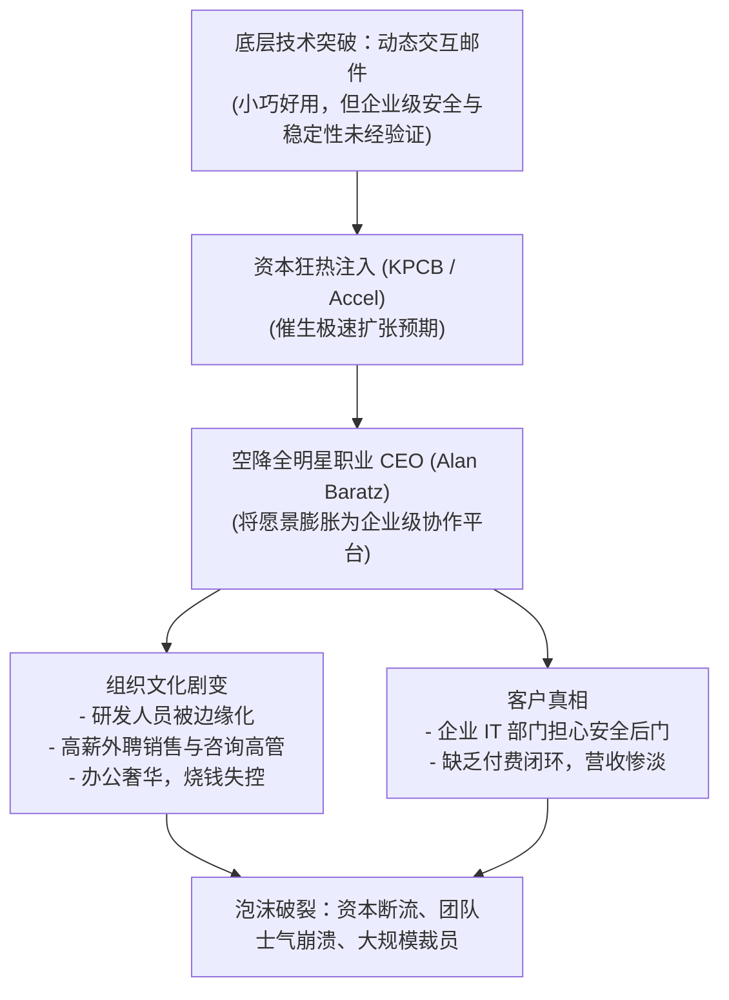

# Lec 03 愿景、文化与战略对齐：Zaplet 的起伏 (Setting Direction: Zaplet)

> 授课教师：Prof. M. Diane Burton & Prof. Jesper B. Sørensen · MIT Sloan School of Management

## TL;DR

- Zaplet 案例展现了硅谷互联网泡沫期技术初创企业的剧烈膨胀与迷失。
- 在未验证商业模式前引入重型职业经理人易导致企业愿景被过度催熟。
- 组织文化一旦被资本驱动的急功近利所稀释，技术凝聚力将迅速瓦解。
- 创始人向职业 CEO 交接权力时，必须明确企业灵魂价值观的守护边界。

## 创业愿景与战略对齐的本质

在创业初期的狂热中，技术创新往往容易被误等同于商业成功。创业企业的生命力源于一种微妙的平衡：既需要极具感染力的宏大愿景吸引顶级资本与天才极客，又必须在微观层面上保持对真实客户付费意愿的敬畏。当资本的助推力远远超过产品本身的商业成熟度时，企业就会出现严重的“战略肥胖症”。

麻省理工学院本讲通过对硅谷明星企业 **Zaplet（前身为 Firefly Network）** 的深入剖析，探讨在极速扩张期，创始人愿景、职业经理人团队与企业底层文化之间如何发生脱节与崩塌。

::: definition 战略对齐 (Strategic Alignment)
企业的核心价值主张（Value Proposition）、价值创造机制（Value Creation）、价值获取途径（Value Capture）与组织内部的资源分配、考核指标和文化导向保持高度一致的状态。
:::

## 经典案例诊断：Zaplet 的流星轨迹

### 1. 突破性技术概念与泡沫期狂热
Zaplet 诞生于 2000 年互联网泡沫顶峰，由斯坦福年轻极客开发。其核心概念是“动态交互式电子邮件（Dynamic Email Applets）”：用户无需离开邮件客户端，即可在邮件正文内直接完成日程投票、微型调查、采购审批乃至简单的在线协作。

这一颠覆性概念迅速引爆了风险投资界。顶级风险投资机构（包括 Kleiner Perkins 与 Accel Partners）斥资数千万美元领投，估值瞬间飙升至数亿美元。

### 2. 引入重量级职业 CEO：艾伦·巴拉茨（Alan Baratz）
为了推动公司迅速上市，投资人极力主张引入成熟的高管。前 Sun Microsystems 顶尖技术高管、Java 软件事业部负责人艾伦·巴拉茨（Alan Baratz）作为“全明星职业 CEO”空降 Zaplet。

巴拉茨上任后迅速开启了激进的全面企业化改造：
- **愿景过度膨胀**：将原本小巧灵活的交互邮件工具，包装成“颠覆全球企业级软件架构的下一代动态协作基础设施平台”；
- **人员规模大跃进**：在未签下任何大型企业级长期付费客户的情况下，几个月内将员工从几十人迅速扩张至上百人，并租赁奢华写字楼；
- **文化断层与阶级分化**：引入大量传统企业级软件销售总监与咨询顾问，给予高额底薪与期权；原初创极客团队被边缘化，原有的黑客文化被严苛的行政汇报与 PPT 汇报文化取代。

### 3. 商业模式幻灭与结局
随着 2001 年互联网泡沫破裂，企业级 IT 采购预算急剧收紧。大企业首席信息官（CIO）发现 Zaplet 的动态邮件存在严重的企业防火墙安全隐患与垃圾邮件风险，拒绝买单。Zaplet 耗尽了数千万美元融资后，最终只能低价转卖资产，成为硅谷“过度催熟”的经典反面教材。

## 创始人 vs 职业经理人：权力交接的四种暗礁

在创业企业规模化过程中，何时引入职业 CEO、如何界定职业经理人与创始人的权力边界，是关乎企业命运的终极命题：

| 潜在暗礁 | 现象表现 | 破坏性影响 | 防控机制 |
| :--- | :--- | :--- | :--- |
| **虚荣性愿景膨胀** | 为配合职业经理人的背景，强行拔高产品战略定义 | 脱离真实客群，研发资源被拖入宏大架构泥潭 | 坚持以客户签约与现金流作为战略验证的唯一基准 |
| **文化入侵排异反应** | 外部经理人带着上一家大公司的流程生搬硬套 | 原有高战斗力初创成员被孤立，凝聚力瞬间瓦解 | 明确“哪些核心文化必须保留，哪些流程需渐进升级” |
| **双中心领导权争夺** | 创始人退而不休，在走廊窃窃私语；CEO 无法贯彻政令 | 一线员工陷入站队困境，决策陷入政治内耗 | 董事会必须明确单一最高决策责任人，理顺权力边界 |
| **资本拉郎配陷阱** | 投资人单方面强加与其理念相投的名气经理人 | CEO 效忠于资本而非企业长远产品价值 | 创始人必须参与招聘闭环，评估文化基因匹配度 |

::: insight
职业 CEO 不是救世主。企业从 0 到 1 的本质是“探索（Exploration）”，这一阶段需要极度的灵活性与创始人对产品的本能直觉；职业经理人擅长的是从 1 到 100 的“利用与规模化（Exploitation）”。如果在企业尚未找到可持续的商业闭环前就过早引入重型正规军流程，就像给一艘皮划艇装上了波音 747 的喷气发动机，其结果必然是船毁人亡。
:::

## 极速扩张期守护组织文化的落地举措

Zaplet 的教训警示创业者，在极速扩张期必须构筑三道“文化防火墙”：
1. **守护核心面试权**：无论招聘节奏多么紧急，创始核心团队必须对前 100 名新员工保留“文化契合度一票否决权”，杜绝为了填补人头而妥协价值观。
2. **警惕奢华仪式感**：保持节俭与饥饿感是初创企业的免疫系统。过早追求豪华办公室与繁复福利，会吸引大量追求舒适的雇佣兵，驱逐真正的技术理想主义者。
3. **保持高管与一线客户的物理接触**：即使是空降的总裁或 VP，入职首月必须强制参与 20 场一线客户交付或技术排错，用真实的业务泥泞打破 PPT 幻想。

::: pitfall
在转型期，千万不要用“花钱搞团建、贴标语”来替代对业务战略混乱的治理。文化不是墙上的口号，而是当利益面临冲突时，管理层究竟根据什么原则做决策。如果战略本身是自相矛盾的，再多的文化建设也只是粉饰太平。
:::
