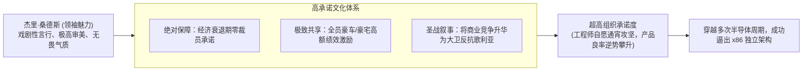

# Lec 04 魅力型领导与组织动员：AMD 杰里·桑德斯的传奇 (Charismatic Leadership: Jerry Sanders)

> 授课教师：Prof. M. Diane Burton & Prof. Jesper B. Sørensen · MIT Sloan School of Management

## TL;DR

- AMD 创始人杰里·桑德斯开创了半导体行业极具个人魅力的激励型领导风格。
- 在与巨头英特尔的残酷不对称竞争中，“人是核心（People First）”成为凝聚力基石。
- 高承诺型文化需要公开的仪式感、物质激励与领袖情感投入形成合力。
- 魅力型领导在提振士气的同时，需防范过度个人崇拜导致的战略盲区。

## 魅力型领导与极度逆境中的动员机制

在技术密集型产业中，工程师往往被视为纯粹由逻辑与技术优雅度驱动的理性群体。然而，当一家初创企业面对资源百倍于己的行业寡头时，纯粹的理性推演往往得出“毫无胜算”的悲观结论。在这一绝境下，创业领导者必须具备一种超乎寻常的能力：通过独特的个人魅力、极富煽动性的叙事以及崇高的组织图腾，唤醒团队超越自我极限的战斗意志。

本讲通过对超微半导体（Advanced Micro Devices, AMD）传奇创始人**杰里·桑德斯（Jerry Sanders）**的领导力实操剖析，解构高承诺型组织文化的构建机制。

::: definition 魅力型领导力 (Charismatic Leadership)
领导者通过清晰而具有感染力的远大愿景表达、个性化的人格魅力、非同寻常的行为举止以及对员工情绪的敏锐共鸣，激发追随者产生高度的忠诚感、使命感与自我牺牲精神的领导形态。
:::

## 经典案例诊断：杰里·桑德斯与 AMD 的生死突围

### 1. 不对称战争的残酷现实
1969 年，桑德斯联合几位仙童半导体的工程师创立 AMD。与竞争对手英特尔（Intel）由罗伯特·诺伊斯与戈登·摩尔等诺奖级科学家执掌不同，桑德斯是销售和市场背景出身。
- **英特尔定位**：技术贵族、象牙塔精英、专利统治者；
- **AMD 困局**：缺乏顶尖研发人才，最初只能充当英特尔与第二供应商的代工厂，利润微薄，研发常年落后半代。

### 2. 桑德斯的领导力实践与组织设计
在无法依靠品牌与学术权威吸引人才的劣势下，桑德斯设计了一套独特的领导力符号与组织动员体系：

#### A. “以人为本（People First, Products and Profits Will Follow）”
桑德斯提出著名的三大法则：人第一，产品第二，利润第三。他坚信只要把最优秀的人才凝结成死忠团队，产品与利润自然水到渠成。在 1974 年与 1982 年半导体产业严重衰退、全行业疯狂裁员的寒冬中，桑德斯向全员公开承诺：**AMD 绝不因经济周期裁掉任何一名正式员工！** 全体管理层自愿减薪 10-15%，与基层员工共度时艰。这一承诺在硅谷引发震动，为 AMD 铸就了坚不可摧的员工忠诚度。

#### B. 极致的仪式感与情感共振

人类从来不是纯粹由电子表格计算驱动的理性经济人。在高强度的商业对抗与身心极度疲惫的加班冲刺中，冰冷的 KPI 数字与期权协议往往无法激发出个体深层的奉献精神。伟大的领导者必须懂得如何运用神圣的仪式感、戏剧性的人格魅力以及崇高的集体叙事，将原本枯燥的技术攻坚转化为一场充满荣光与救赎的史诗征战。

桑德斯深谙组织动员的社会心理学法则。他深知半导体芯片制造是一项良率每提升 1% 都需要数万次反复微调的极其枯燥的精密劳动。为了让基层产线工人和实验室测试员日复一日地保持极度专注，必须通过高频、极具视觉冲击力的公开仪式，让所有人亲眼见证胜利者的荣光，从而在团队潜意识中建立“付出必有丰厚回报”的坚固神经反射。
桑德斯本身以好莱坞明星般的光鲜衣着（定制西装、劳斯莱斯汽车）示人，但他将这种戏剧性转化为全员的胜利狂欢：
- 设立全员抽奖大会，在达成重大季度营收目标后，直接在全体员工面前抽出一套豪宅首付或崭新跑车赠予一线装配线工人；
- 每次面向全员发表演讲，桑德斯都充满激情与泪水，将打败英特尔描绘为大卫挑战歌利亚的圣战，赋予普通芯片工程师神圣的历史使命感。

## 魅力型领导的双刃剑效应

桑德斯的领导方式在半导体历史上留下了浓墨重彩的一笔，但也给组织带来了显著的负面溢出效应。创业团队在借鉴魅力型领导力时，必须清醒认知其两面性：

| 领导力维度 | 积极效应 (光明面) | 潜在系统性风险 (阴暗面) |
| :--- | :--- | :--- |
| **超凡个人愿景** | 在企业面临生死危机时能够一锤定音，极速统一思想 | 组织产生对领袖的病态依赖，基层丧失自主纠错能力 |
| **反常规冒险言行** | 敢于向庞大在位巨头下战书，大幅提振团队自信心 | 容易忽视客观工程极限与财务红线，陷入赌徒式下注 |
| **情感共振动员** | 激发员工超越金钱报酬的深层归属感与奉献精神 | 组织内部可能形成“报喜不报忧”的回音室效应，扼杀异见 |
| **英雄主义薪酬分配** | 奖赏极其丰厚，极大刺激关键突破与单兵作战力 | 分配标准可能偏向主观偏好，引发后台默默奉献者的不平 |

::: insight
魅力并不是一种神秘的与生俱来的超能力，而是一种可以通过“符号化行为”被精准设计的领导力工具。在资源匮乏的初创期，创始人的坚定信念与情感流露是唯一的硬通货。然而，随着组织规模突破邓巴数（150 人），领导者必须逐步将个人魅力转化为制度化的流程与分布式授权，否则领袖自身的认知边界就是企业成长的绝对天花板。
:::

## 打造高承诺型团队的四项落地实践

对于资源有限的技术初创企业，如何汲取桑德斯的智慧打造高承诺团队：
1. **塑造具体的外部挑战目标**：为团队树立一个清晰、令人尊敬但可被击败的“假想敌”（如某个臃肿的行业巨头），将内部的琐碎摩擦转化为对外一致的协同作战力。
2. **在危机时刻践行不对称承诺**：在顺境中的奖金无法建立真正的忠诚。只有当公司遭遇寒冬时，创始团队率先牺牲自身利益保护基层核心员工，才能在团队心中建立无可替代的情感抵押。
3. **设计具备强烈心理冲击力的里程碑仪式**：不要让里程碑的跨越沦为财务报表上的冷冰冰数字。用公开的香槟庆功、极客奖杯或全员见证，让每一位做出突出贡献的普通人享受英雄般的赞誉。
4. **引入理性的二把手制衡**：魅力型领袖身边必须常驻一位冷静、死扣细节且敢于说真话的首席运营官（COO），负责将领袖的天马行空落地为工程交付排期与现金流防火墙。

::: pitfall
绝不要把“PUA”或无休止的“空头支票”当成魅力型领导。桑德斯之所以能获得全员死效，核心在于他在做出狂热承诺的同时，总能不折不扣地兑现切实的物质奖赏与利益共享。没有真金白银与共同分担的魅力演说，在当代高智商人才眼中只是低级欺骗。
:::
