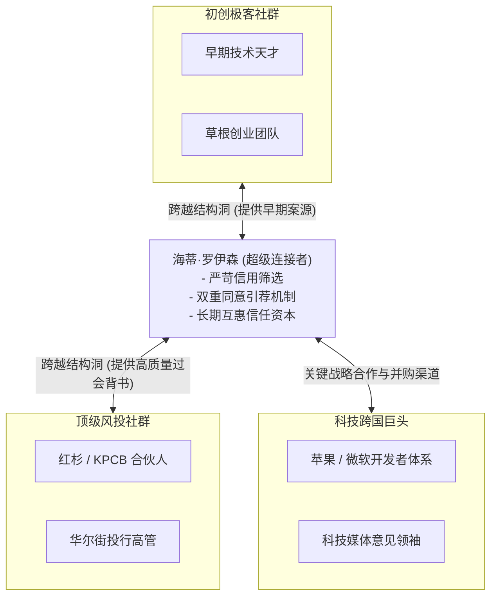

# Lec 05 社会资本与人际网络构建：海蒂·罗伊森的战略资产 (Building Social Capital: Heidi Roizen)

> 授课教师：Prof. M. Diane Burton & Prof. Jesper B. Sørensen · MIT Sloan School of Management

## TL;DR

- 社会资本是创业者获取稀缺资源、信息与信任的核心无形资产。
- 海蒂·罗伊森案例揭示了专业化人际网络维护的互惠与信用法则。
- 优秀的人际网络连接者通过跨越“结构洞”创造非对称商业价值。
- 网络管理需要严格的时间精力预算，切忌沦为无价值的浅层社交狂欢。

## 什么是社会资本？创业者的无形资产池

在传统管理学中，人们习惯于关注人力资本（Human Capital，即个人的知识、技能与智商）以及金融资本（Financial Capital，即资金与固定资产）。然而，社会学与组织行为学研究表明，在充满高度不确定性与信息不对称的创业生态中，决定一个创业者或投资人能否脱颖而出的关键往往是**社会资本（Social Capital）**。

社会资本并非虚浮的酒局人脉，而是深深植根于人际信任、声誉背书与互惠规范之中的网络结构资产。它为企业提供了高保真信息雷达、非公开交易机会（Deal Flow）以及在危机时刻迅速调度跨界资源的能力。

::: definition 社会资本 (Social Capital)
个体或组织通过嵌入其社会关系网络中，所能够动员、调用和转化的高价值资源（包括信息前瞻、权威背书、关键引荐与稀缺资本）的总和。
:::

## 经典案例诊断：海蒂·罗伊森（Heidi Roizen）的网络治理学

斯坦福与麻省理工商学院共同采纳的**海蒂·罗伊森（Heidi Roizen）案例**，是全球商学院讲授人际网络与社会资本最经典的范本。

### 1. 从软件创始人到全明星超级连接者
海蒂·罗伊森早年联合创办了 T/Maker 软件公司并成功出售；随后出任苹果公司全球开发者关系副总裁；之后加入硅谷著名早期风险投资机构 Mobius Venture Capital 成为全资合伙人。在二十多年的职业生涯中，罗伊森构建了横跨硅谷创业者、天使投资人、一线风投巨头、华尔街投行与科技媒体的庞大社交网络，被誉为硅谷第一“超级连接者（Super-Connector）”。

### 2. 罗伊森的网络治理原则
许多人误以为拥有庞大网络意味着整日忙于应酬。罗伊森的实践表明，高价值人际网络的本质是**高度纪律化的信用管理工程**：

#### A. 严格的互惠与价值守恒定律（The Law of Reciprocity）
罗伊森绝不做单方面的索取者（Taker），也绝不做廉价的讨好者。她将每一次引荐视为对自己个人信用的支票背书。在向顶级 VC 引荐创业项目时，她会严格把关：“如果我推荐了 3 个平庸的项目，我的引荐电话在顶级投资人那里就一文不值了。”

#### B. 结构洞跨越（Bridging Structural Holes）
社会学家罗纳德·伯特（Ronald Burt）指出，在不同的社会群体（如极客工程师圈与华尔街资本圈）之间往往存在割裂的空白地带，即“结构洞”。罗伊森的巨大价值正是在于她能够跨越不同行业社群，充当可信赖的翻译官与价值中介。

#### C. “双重同意（Double Opt-in）”引荐机制

在商业社交生态中，许多人盲目信奉“人脉越多越好”，甚至在未经允许的情况下私自将两位大佬的联系方式相互推送，误以为这是在促成合作。事实上，这种鲁莽的行为是对双方注意力和时间隐私的严重侵犯。在高端人脉圈层中，声誉与信任是最稀缺的无形资产，每一次不合格的劣质连接都会在无形中透支中间人的个人信用额度。

海蒂·罗伊森确立的双重同意法则是高价值网络维护的黄金铁律。在发起任何引荐之前，她会分别私下向双方发送简要说明，清晰阐明对方的背景、当前诉求以及本次连接可能带来的互惠价值，并给予双方绝对舒适的拒绝空间。只有在双方均明确表达积极意愿后，才建立正式联系通道。这一机制不仅消除了尴尬的社交无效沟通，反而让每一次连接都成为一次高质量的深度协作起点。
在将两位高价值人士相互引荐前，罗伊森永远先分别私下征求双方同意，并说明引荐理由与潜在价值。这一准则既尊重了高管的时间隐私，又确保了每一次连接的质量与严肃性。

## 网络分析：社交网络 vs 社会资本

并非所有的社交网络都是有价值的社会资本。伯顿与索伦森教授在课堂上对人际网络的结构特性进行了清晰界定：

| 网络特征维度 | 封闭式网络 (Dense / Closed Network) | 开放式跨界网络 (Sparse / Structural Holes) |
| :--- | :--- | :--- |
| **拓扑结构** | 圈子里所有人相互认识，形成紧密团伙 | 由多个互不相连的子群构成，中心节点居中穿针引线 |
| **核心优势** | 高度信任、情感支持强、违约惩罚极高 | 信息多样性极高、创新碰撞激烈、早期机会丰富 |
| **主要劣势** | 容易形成回音室效应，新思想与信息极度匮乏 | 信任成本高，需要中心节点持续耗费精力维系桥梁 |
| **典型代表** | 早期同班同学或同一个大学实验室的技术兄弟会 | 跨行业的投资人、技术经纪人、连续创业孵化者 |

::: insight
初创团队最容易犯的人际网络错误是“在舒适区内同质化抱团”。三个同专业的软件工程师聚在一起，他们的社交圈层几乎 100% 重叠。这种封闭网络能提供心理安慰，但无法带来任何新的商业增量。真正的创业社会资本扩张，必须勇敢走出同温层，去寻找那些能连接法律、资本、政府与大客户的异质性桥梁节点。
:::

## 创业者打造高价值社会资本的五大实践准则

1. **先给予，再索取（Give First）**：在要求他人提供帮助或引荐之前，先思考自己能为对方提供什么价值（哪怕是一篇深度行业分析报告、一个关键代码排错建议或一个优秀应届生的简历）。
2. **恪守双重同意原则**：严禁未经允许擅自将重要人物的个人微信、电话或邮箱推给第三方。保持严密的准入守门人姿态，反而会让重要人脉更加尊重你的专业性。
3. **建立人际关系动态档案（CRM for Relationships）**：对核心 50-100 位关键利益相关者进行系统化追踪，记录他们的兴趣爱好、职业里程碑与痛点诉求，在重要节点（如生日、职位变动、公司融资）提供真诚的祝贺与支持。
4. **警惕“网络超载（Network Overload）”**：人类的认知与情感带宽是有限的。不要追求数千个点赞之交的通讯录数字，坚决清理那些长期索取却不提供正向价值的负能量节点，将 80% 的社交精力集中在 Top 20 的核心信任基石上。
5. **在个人专业胜任力之上构建网络**：社会资本是个人专业实力的放大器，而非替代品。如果你本身缺乏过硬的业务与技术交付能力，任何大佬的合影与微信好友位都只是虚妄的肥皂泡。

::: pitfall
千万不要把维护人脉变成露骨的功利交易。在硅谷与高科技生态中，聪明人能瞬间识破带着强烈急功近利色彩的逢迎者。最高维度的社会资本往往建立在对共同技术理想的纯粹热爱与多年如一日的靠谱品格之上。
:::
