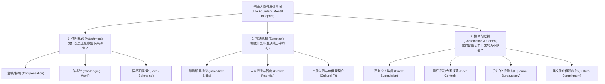

# Lec 06 组织构建与雇佣模型：斯坦福 SPEC 框架 (Building the Organization: Employment Models)

> 授课教师：Prof. M. Diane Burton & Prof. Jesper B. Sørensen · MIT Sloan School of Management

## TL;DR

- 斯坦福新兴企业研究（SPEC）系统定义了初创企业的五大经典雇佣模型。
- 三种关键维度：依附基础（钱/工作/爱）、挑选机制（技能/潜力/文化）、协调控制方式。
- 明星型与承诺型模型在长期存活率与 IPO 表现上显著优于官僚与独裁型。",
- 初创期确立的雇佣蓝图具备极高印记效应，中途随意切换往往带来毁灭性动荡。

## 斯坦福新兴企业研究（SPEC）的里程碑意义

创业团队在成立之初，往往认为人力资源管理是一项在公司成熟后才需要考虑的后勤事务。然而，由詹姆斯·男爵（James Baron）与迈克尔·汉南（Michael Hannan）主导、戴安·伯顿（Diane Burton）深度参与的**斯坦福新兴企业研究（Stanford Project on Emerging Companies, SPEC）**彻底推翻了这一传统观念。

该研究对硅谷数百家高科技创业公司进行了长达十余年的前瞻性追踪，得出了一个震撼学术界与产业界的结论：**创始人在招揽前十名员工时大脑中预设的“雇佣蓝图（Employment Blueprint）”，对企业未来是否能够成功上市（IPO）、以及在破产寒冬中的存活率具有决定性的长久印记效应（Imprinting Effect）**。

::: definition 组织印记效应 (Organizational Imprinting)
组织在初创脆弱期所受到的创始人偏好、外部环境与首批雇佣契约的深刻塑造，会固化为深层的组织基因。即使后续环境发生剧变、创始人离职，这种初始结构与文化惯性依然会长期主导企业的行为轨迹。
:::

## 雇佣蓝图的三大基本构件

这三大基本构件构成了企业人力资本战略的底层三角，缺一不可：
1. **依附基础（Attachment Dimension）**：企业依靠什么纽带将员工与组织长久绑定在一起？是以金钱报酬为核心的交易型契约（“给你硅谷最高时薪，但随时可能解雇你”），是以工作挑战性为驱动的技术极客契约（“这里有全球最难攻克的算法问题，供你自由探索”），还是以情感归属为核心的家庭使命契约（“我们是一家人，彼此生死与共、永不抛弃”）？不同的依附基础，直接决定了团队在遭遇逆境寒冬时的抗压韧性。
2. **挑选标准（Selection Dimension）**：企业在筛选新成员时，排在第一位的硬性门槛是什么？是看重其即刻可用的特定工程技能（如精通某种编译器优化），是看重其超越常人的绝对智力与学习潜能（即便其从未写过该语言的代码），还是看重其是否认同团队的底层价值观与为人处世准则？挑选标准的差异，深刻影响了组织内部的技术异质性与协同摩擦系数。
3. **协调与控制（Coordination & Control Dimension）**：管理层如何保证日常成百上千名员工的努力方向不偏离轨道？是依靠创始人个人的直接巡视与口头指令，是依靠严密的工程师同行评审与开源式代码审查，是依靠厚重的员工手册与层层签批审批流，还是依靠将企业核心价值观内化为全员自发的道德自觉？控制手段的选择，直接决定了企业的运营管理杠杆与管理层级跨度。

创始人在成立企业之初，大脑中往往存在一系列关于“人究竟为何而工作、应该依据什么标准招募伙伴、以及应当如何管理组织”的隐性假设。这些假设并非凭空产生，而是深受创始人早期的教育背景、职业经历与个人性格特质的深刻塑造。

斯坦福 SPEC 研究的最伟大贡献，就是将这些弥漫在创始人潜意识中的直觉感性认知，系统提炼为三个可被量化对比与实证检验的结构性维度。每一个维度都代表了企业在处理人与组织关系时不可逃避的核心战略决策。

SPEC 研究指出，任何创始人在构建团队时，不论其是否明确意识到，都在隐性回答关于劳资关系的三个根本性问题：



## 五大经典雇佣模型深度对照

基于上述三个维度的不同组合，SPEC 研究系统归纳了五种在硅谷最常见的雇佣模型类型：

| 雇佣模型 | 依附基础 (Attachment) | 挑选标准 (Selection) | 控制与协调机制 (Control) | 典型代表案例 |
| :--- | :--- | :--- | :--- | :--- |
| **工程型模型**<br/>(Engineering) | 工作本身的硬核技术挑战性 | 即刻可用的工程专业硬技能 | 同行专业评议、极客同行压力 | 早期的惠普 (HP)、多数开源项目 |
| **明星型模型**<br/>(Star) | 极致的工作挑战与长远前途 | 全球顶尖智力、未来绝顶潜能 | 自主探索、极少干预、专家荣誉 | 早期的苹果麦金塔团队、贝尔实验室 |
| **承诺型模型**<br/>(Commitment) | 对组织的深厚情感与文化家庭归属 | 价值观与文化基因的绝对契合 | 强文化内化、同侪道德约束、高度忠诚 | SAS 软件研究所、早期西南航空 |
| **官僚型模型**<br/>(Bureaucracy) | 长期稳定的职业阶梯与明确报酬 | 严格对照既定岗位职责（JD）选拔 | 严密规章手册、明确流程、层层审批 | 传统电信巨头分拆业务、银行 IT 部 |
| **独裁型模型**<br/>(Autocracy) | 纯粹的即时经济收益（按件计酬） | 能够听话完成单一指定任务的人 | 创始人或包工头极其严苛的个人直接监控 | 早期无技术壁垒的血汗代工厂、部分外包组 |

## 实证结论：谁能活到最后？谁更容易 IPO？

SPEC 研究通过大量生存分析与多元回归统计，揭示了一系列极具颠覆性的实证结论：

### 1. 承诺型模型的惊人韧性
在企业成长的早期阶段，**承诺型模型企业在抵御破产倒闭方面表现最为卓越**。即使在经济大衰退或产品研发严重延误时，基于情感归属和使命感绑定的员工极少离职，团队愿意主动降薪共度时艰，其破产倒闭概率显著低于其他所有模型。

### 2. 明星型模型在上市速度与估值上的爆发力
明星型企业聚集了一批智商极高但个性桀骜不驯的顶级极客。虽然其内部管理协调成本极高、团队内耗严重，但一旦突破关键核心技术，其**实现成功 IPO 的速度最快，市值天花板最高**。然而，如果明星型企业未能迅速达成技术突破，其离职率和瓦解速度也最为迅猛。

### 3. “半途换道”的毁灭性灾难（Model Switching Hazard）
SPEC 最震撼的研究发现是：**在创业过程中强行切换雇佣模型，会对企业造成致命打击！**
许多企业在拿到 B 轮融资或引入外部职业经理人后，试图从最初的“承诺型”或“工程型”强行转向正规军的“官僚型”。这种切换往往引发灾难性的“排异反应”：老员工感觉心理契约遭到无情背叛，核心骨干大规模离职，新老派系内斗不休。统计显示，中途切换雇佣模型的初创企业，其**破产概率暴增数倍，IPO 成功率骤降**。

```mermaid
quadrantChart
    title 五大雇佣模型的 IPO 潜力 vs 生存稳定性
    x-axis 低生存稳定性 (易碎) --> 高生存稳定性 (极抗造)
    y-axis 低商业天花板 (平庸) --> 高商业天花板 (巨型爆发)
    quadrant-1 理想黄金区：承诺与爆发兼备
    quadrant-2 极速爆发区：明星型 (Star)
    quadrant-3 死亡泥潭区：独裁型 (Autocracy)
    quadrant-4 坚固防御区：承诺型 (Commitment)
    "明星型 (Star)": [0.35, 0.9]
    "承诺型 (Commitment)": [0.85, 0.65]
    "工程型 (Engineering)": [0.65, 0.55]
    "官僚型 (Bureaucracy)": [0.55, 0.35]
    "独裁型 (Autocracy)": [0.2, 0.2]
```

::: insight
创始人在招募前五名员工时，不仅仅是在招募打工人，更是在为你未来的组织架构“投票”。如果你选拔所有人都是看中其“技术有多牛”，你就是在默认构建工程型甚至明星型组织；如果你选拔的标准是“认同我们的使命且愿意干脏活”，你就是在构建承诺型组织。必须清醒意识到：任何一种选择都有其对应的红利与代价，最可怕的是创始人首鼠两端，在不同模型之间反复摇摆。
:::

## 创业创始人落实雇佣蓝图的行动指南

1. **审慎反思自身的管理偏好**：创始人必须与联合创始人开会坦诚剖析：我们究竟想建立什么样的公司？我们能容忍技术天才的傲慢吗（明星型）？还是我们更看重团队如同一家人的忠诚陪伴（承诺型）？
2. **招聘机制与蓝图的刚性绑定**：如果选择了承诺型，面试流程中必须设立专门的价值观与文化契合度面试环节，严禁仅仅因为对方背景光鲜就破格录用与团队价值观冲突的人才。
3. **慎重对待“正规化”诱惑**：当公司规模扩张至 50-100 人时，不可避免地需要引入专业 HR 与管理流程。此时切记：引入管理工具的目的是“服务于原有雇佣蓝图”，而不是让外部 HR 顾问带着大厂的官僚手册全盘覆盖企业原有的灵魂基因。

::: pitfall
千万不要盲目迷信“明星型模型”。绝大多数普通创业企业根本不具备驾驭“明星型天才”的组织资源与管理耐心。盲目招募一群心高气傲的名校博士，却没有极其宏大的挑战性课题供其攻关，最终只会引发无休止的学术清谈与自相残杀。
:::
