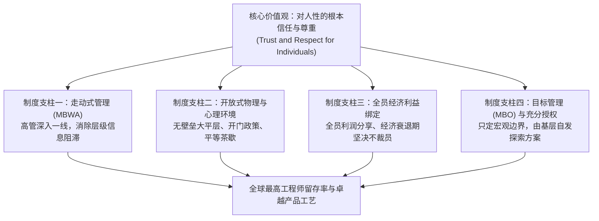

# Lec 07 组织文化的制度化践行：惠普之道（The HP Way） (Institutionalizing Culture: Hewlett-Packard)

> 授课教师：Prof. M. Diane Burton & Prof. Jesper B. Sørensen · MIT Sloan School of Management

## TL;DR

- 惠普之道（The HP Way）是硅谷最早将信任与尊重制度化落地的典范。
- 走动式管理（MBWA）与开放式大平层打破了层级隔阂与信息壁垒。
- 全员利润分享与终身雇佣理念在几十年间铸就了惠普顶尖的工程师忠诚。
- 当企业面临全球化与资本市场华尔街季度利润施压时，文化传承面临严峻挑战。

## 文化如何超越口号成为制度化现实？

在现代商业世界中，几乎所有企业都在其官网与大堂墙壁上粉刷着“创新、尊重、诚信、客户第一”等崇高标语。然而，在绝大多数员工眼中，这些标语只是公关部门的装点门面，一旦触及实际利益考量与资源分配，管理层的决策依然遵循赤裸裸的短期功利逻辑。

真正的组织文化从来不是写出来的，而是通过几十年来一系列连贯、甚至在短期内显得“不合算”的制度设计与管理行为沉淀而成的。由比尔·休利特（Bill Hewlett）与戴夫·帕卡德（Dave Packard）在 1939 年创立的**惠普公司（Hewlett-Packard, HP）**，不仅奠定了硅谷科技创业的地理坐标，更开创了一套影响全球半个多世纪的管理哲学——**“惠普之道（The HP Way）”**。

::: definition 惠普之道 (The HP Way)
以对员工个人的根本信任与尊重（Trust and Respect for Individuals）为基石，强调高目标、团队合作、敏捷自主、利润分享以及通过走动式管理保持全员紧密联结的一整套管理哲学与制度体系。
:::

## 经典案例诊断：惠普之道的核心制度支柱（1939-1979）

麻省理工学院本讲通过对惠普前 40 年黄金扩张期（1939-1979）的深度案例剖析，解构高信任度文化如何被具象化为一系列精密运转的微观管理机制：

### 1. 物理环境与仪式感设计：开放式空间与平等主义
早在 20 世纪 40 年代，当全球企业普遍等级森严、高管拥有独立豪华办公室与专用餐厅时，惠普率先开创了**无隔断大平层办公（Open-Plan Cubicles）**与**开门政策（Open Door Policy）**：
- 创始人比尔与戴夫的办公桌没有任何豪华遮挡，任何普通工程师都可以随时走过去讨论技术问题；
- 设立全员统一标准的免费早晚咖啡与甜甜圈茶歇（Coffee Break），强制要求各部门主管与一线员工共同排队取餐、站立交流，在非正式交流中自发消融跨部门墙。

### 2. 走动式管理（Management By Wandering Around, MBWA）
帕卡德坚信，高管待在空调办公室里看的报表充满了过滤与谎言。领导者必须保持持续在研发实验室、车间与仓库的随机漫步：
- 倾听一线技术人员的抱怨，亲眼观察零件装配过程中的不顺畅；
- 走动不是为了突击检查惩罚员工，而是为了了解“我作为领导者能帮你扫清什么障碍”。

### 3. 仓储信任法则：一把剪断锁头的钥匙

在传统的工厂和科研院所管理制度中，防范员工盗窃与跑冒滴漏往往被列为行政与安保部门的首要考核指标。各类精密仪器、螺丝零件与示波器被牢牢锁在铁门之后，工程师每次领取一个电阻都需要填写三联审批单，找车间主任签字盖章。这种防贼式的制度虽然防范了极个别的微小财产损失，却在无形中向全员传递了一种令人窒息的猜忌氛围。

戴夫·帕卡德用一把老虎钳剪断的不仅是一把生铁大锁，更是打破了禁锢工程师创造力的心理牢笼。他用行动向全体技术人员宣告：惠普视每一个员工为正直成熟的成年人。当员工感受到来自最高创始人的这份崇高信任时，他们会自然萌生出一种强烈的道德自律，自发爱护公共财产，并在周末自发来到车间通宵测试新想法。
在惠普历史上有一段广为人知的真实传奇：帕卡德在周末巡视实验室时，发现存放精密电子元器件的仓库大门被一把大铁锁牢牢锁住。帕卡德当即找到值班负责人，要求立即拿钳子剪断锁头，并留下一张便条：**“惠普信任每一个员工，永远不要把我们的工具和零件锁起来防备自己的工程师！”**
这一行为极大地刺激了工程师的责任心。工程师在周末可以自由将贵重仪器带回家进行个人实验，正是在这种近乎放任的信任土壤中，惠普诞生了数十项自发的技术创新。

## 惠普组织一致性模型（Congruence）复盘

将惠普黄金时代的实践代入组织一致性模型，可以清晰看到其惊人的系统契合度：

| 一致性要素 | 惠普之道的设计与实践 | 相互强化效应 |
| :--- | :--- | :--- |
| **战略 (Strategy)** | 追求极致测量仪器与计算机硬件的高精度、高质量与高溢价 | 客户对惠普产品的信赖建立在每一颗螺丝钉的工艺上 |
| **人才 (People)** | 招聘富有创造力、热爱动手实践、有自我驱动力的顶尖工程师 | 员工视惠普为终身荣誉，主动将公司利益置于个人之上 |
| **关键任务 (Tasks)** | 复杂精密仪器的研发、定制化装配与跨部门联合技术攻坚 | 需要不同专业背景的工程师紧密配合、毫无保留地分享代码 |
| **正式组织 (Formal)** | 事业部小规模化（一旦超过 1,500 人立即分拆）、全员分红 | 保持组织的灵动与创业活力，避免大企业病蔓延 |
| **文化 (Culture)** | 尊重个人、容忍技术试错、平易近人、内部提拔为主 | 形成极高心理安全感，员工敢于在工作中追求技术极致 |

::: insight
信任不是一种道德说教，而是一笔精明的高效商业投资。传统企业为了防范 1% 的不诚实员工，设立了极其繁琐的报销审批、门禁登记与层层监视系统，结果让 99% 的优秀诚实员工感到尊严受辱，并为之付出了极其高昂的行政协同成本。惠普之道的精髓在于：宁可承受极个别由于过度信任导致的跑冒滴漏，也要保护全员高信任度带来的极致敏捷与全身心投入。
:::

## 规模化与资本市场压力下的文化裂变

进入 20 世纪 90 年代及新千年后，惠普之道遭遇了前所未有的严峻挑战：
- **组织规模超级膨胀**：员工规模突破十万人，走动式管理与熟人网络难以维系；
- **华尔街季度报表暴政**：外部激进投资人要求公司削减成本以提振短期每股收益（EPS），终身雇佣与不裁员神话被打破；
- **空降职业经理人文化的冲击**：从外部聘请的卡莉·菲奥莉娜（Carly Fiorina）等明星 CEO 试图通过铁腕兼并（如强行收购康柏电脑）来扭转乾坤，引发了创始人家族与老员工对“惠普之道已死”的悲凉抗争。

## 现代创业者如何践行高信任度组织文化

对于今天的初创与高成长型企业，“惠普之道”依然提供了历久弥新的行动指引：
1. **建立“言行一致”的文化试金石**：挑选一两项最具象征意义的行为准则（例如：绝不苛扣离职员工合法期权、报销差旅无需繁琐发票贴票），用实际行动向全员证明“我们玩真的”。
2. **警惕管理过度（Over-Management）**：当发现团队效率变低时，管理者本能的反应是“增加监控流程与日报制度”。优秀领导者应当反向思考：我们能否通过减掉两道审批手续，重新激发员工的自主责任心？
3. **保持单元组织的小型化**：随着公司业务扩张，坚定采取“细胞分裂法”。将庞大的团队拆解为数个拥有端到端独立作战权的小型敏捷小组，防止部门墙在深层滋生。

::: pitfall
不要把“尊重员工”误读为“绩效平庸者的避风港”。比尔·休利特和戴夫·帕卡德从来不是老好人，他们对产品工艺与工程交付的要求极其严苛。真正的惠普之道是“高支持 + 高标准”的结合体，如果只有温情脉脉的关怀而没有清晰的目标追责，高信任文化最终会退化为平庸官僚的温床。
:::
