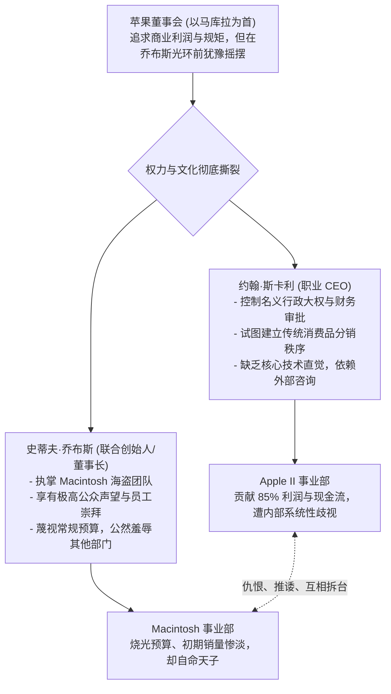

# Lec 08 创始人交接与治理博弈：苹果公司乔布斯与斯卡利 (Founder Transitions and Governance: Apple Computer)

> 授课教师：Prof. M. Diane Burton & Prof. Jesper B. Sørensen · MIT Sloan School of Management

## TL;DR

- 苹果公司早期历史深刻展现了创始人魅力与职业管理制度化之间的悲剧性冲突。
- 内部设立特权部门（Macintosh）与主流现金流部门（Apple II）的部落式内耗。
- 董事会在产品愿景与财务纪律之间的摇摆加剧了权力斗争与最终摊牌。
- 创始人交接需要理顺决策权限，避免在同一组织内存在两个平行的权威中心。

## 创始人神话与职业管理的不可调和性

在硅谷创业叙事中，创始人往往被赋予半神般的色彩：他们凭借超凡的技术前瞻性、不可动摇的执念与极具感染力的个人魅力，将公司从车库推向千亿美元市值。然而，在企业从产品研发走向规模化制造、全球渠道分销与公开上市的过程中，创始人早期那些促成成功的品质——偏执、反叛、蔑视规章、凭直觉决策——往往会转变为阻碍公司进一步成长的致命负债。

麻省理工学院本讲通过对 1983-1985 年间**苹果电脑（Apple Computer）公司乔布斯（Steve Jobs）与约翰·斯卡利（John Sculley）**之间那场举世瞩目的董事会摊牌，深入探讨高科技企业在创始人交接与权力架构设计中的系统性风险。

::: definition 双头政治困境 (The Diarchy Trap)
在企业最高决策层同时存在两位拥有不同权力来源的领导者（例如：掌控精神图腾与产品定义的创始人，与掌控行政大权与财务资源的职业 CEO），且双方缺乏清晰的权力边界与制衡仲裁机制，导致整个组织分裂为两个对抗阵营的管理陷阱。
:::

## 经典案例解构：苹果早期的内部部落战争

### 1. “糖水之问”与斯卡利入局
1983 年，年仅 28 岁的史蒂夫·乔布斯面临着来自董事会（特别是苹果早期重要导师与投资人迈克·马库拉）的巨大压力。董事会认为乔布斯虽然极富远见，但情绪喜怒无常、缺乏运营大企业的成熟心智，拒绝让他出任 CEO。乔布斯亲自飞赴纽约，向百事可乐总裁约翰·斯卡利抛出了那句著名的灵魂叩问：“你究竟是想卖一辈子糖水，还是想跟我一起去改变世界？”斯卡利随后接受邀请，出任苹果首席执行官。

### 2. 致命的组织分裂：Macintosh 组 vs. Apple II 组

在企业组织中设立内部特遣团队（Skunkworks）本是一种打破常规、激发颠覆式创新的有效工具。然而，一旦领导者在缺乏全局统筹的前提下，将特遣团队拔高为凌驾于全公司制度之上的神圣特权阶层，内部灾难便不可避免。

乔布斯在领导 Macintosh 团队时，犯下了管理学上最严重的禁忌：公开羞辱为公司提供造血现金流的主流业务部门。Apple II 团队由一批踏实严谨的资深工程师组成，他们忍受着平淡的待遇支撑着公司的基本盘；而乔布斯不仅给自己的海盗团队发放巨额奖金，还公开嘲笑 Apple II 团队是平庸的二流货色。这种人为制造的部落仇恨，彻底撕裂了苹果的内部协同网络。
斯卡利上任后，苹果在组织架构上犯下了教科书级的错误：在公司内部制造了两个地位极不对称且利益敌对的平行世界：
- **Apple II 事业部**：由经验丰富的务实工程师组成，贡献了公司 85% 以上的真实营业收入与全部净利润，养活了全公司数千名员工；但在公司内部被视为“过时的二流老古董”，得不到任何聚光灯；
- **Macintosh 事业部**：由乔布斯亲自统领的“特遣海盗团”。乔布斯在大楼楼顶升起骷髅海盗旗，宣扬“宁当海盗，不当海军”。该部门享受顶级薪酬、奢华办公室与无限制研发预算，并公开嘲弄 Apple II 团队。

### 3. 终局摊牌：1985 年的董事会大地震
1984 年初 Macintosh 震撼发布，但随后因内存过小、缺乏软件生态与缺少硬盘接口，销量在下半年出现断崖式下跌。乔布斯拒绝承认产品缺陷，反而指责斯卡利的市场营销与定价失误。

1985 年 5 月，趁斯卡利前往中国出访之际，乔布斯企图策动内部高管政变夺权。斯卡利紧急回国，在长达数日的激烈董事会辩论中，斯卡利向董事会下达最后通牒：“要么选择我，要么选择乔布斯。”最终，董事会一致倒向职业管理团队，乔布斯被剥夺全部运营实权并被赶出苹果。

## 苹果一致性模型（Congruence）的系统性失效

从组织一致性视角复盘，苹果早期的动荡本质上是多重维度的结构性冲突：

| 维度对比 | 战略现实对组织的要求 | 实际运行中的内部状态 | 破裂点分析 |
| :--- | :--- | :--- | :--- |
| **关键任务 vs 正式组织** | PC 市场进入激烈价格战，需要规范供应链与渠道管控 | 乔布斯率领的部门完全游离于正规采购与财务审核之外 | 成本彻底失控，两部门硬件规格互不兼容 |
| **文化 vs 激励机制** | 需要激励贡献利润的基本盘员工，维护组织稳定 | 公司全部声誉、奖金与表彰向无盈利的 Mac 部门单向倾斜 | 核心造血部门骨干士气崩溃，大规模流失 |
| **领导力 vs 治理架构** | CEO 必须拥有全公司统筹调度权与最终人事裁决权 | 董事长兼创始人公然破坏 CEO 的政令，下属面临站队困境 | 汇报线彻底瘫痪，任何决策都沦为政治内耗 |

::: insight
“当海盗”在公司只有 10 个人、需要打破一切陈规打破僵局时是极致的美德；但当公司拥有 4,000 名员工、需要依靠精密供应链准时交付产品时，“当海盗”就是对组织秩序的犯罪。如果一个创始人不能在公司规模化时完成从“特种兵队长”到“正规军统帅”的认知跃迁，他亲手缔造的帝国必然会反噬并驱逐他。
:::

## 创始人与职业经理人共存的治理启示

苹果早期的阵痛为现代高科技创业者与投资人提供了弥足珍贵的治理启示：
1. **彻底拆除内部特权阶层**：绝不要在公司内部设立一个可以豁免遵守公司通则的“神圣特战组”。哪怕是最前沿的创新项目，也必须在基础财务规范与人际尊重上与主流业务遵守同一套底线。
2. **避免双头重叠的权力结构**：如果引入职业 CEO，创始人必须退居明确的特定领域（如首席产品官 CPO 或纯粹的董事会战略顾问），并在全员面前明确宣布：“凡是行政、运营与人事指令，一律以 CEO 为唯一最高准则。”
3. **重视基本盘业务的尊严**：现金流业务是支持创新的母体。任何卓越的领导者都必须在内部公开表达对造血部门的感恩与尊重，坚决制止新业务团队对成熟业务团队的优越感与傲慢。

::: pitfall
董事会在处理创始人与职业经理人矛盾时最忌讳“和稀泥”。马库拉和早期苹果董事会在长达一年多的时间里对两人的矛盾视而不见，企图维持表面和谐，最终导致矛盾积重难返，险些让公司在内耗与销量暴跌中走向破产。
:::
