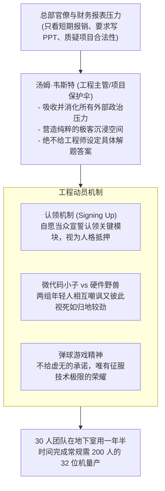

# Lec 09 硬核研发团队的激励与极客文化：数据通用《新机器的灵魂》 (Managing Creative Talent: Data General)

> 授课教师：Prof. M. Diane Burton & Prof. Jesper B. Sørensen · MIT Sloan School of Management

## TL;DR

- 普利策奖经典《新机器的灵魂》深度解构了底层计算机研发团队的内在动机。
- 汤姆·韦斯特通过“弹球理论”与“主动认领（Signing Up）”构建高压极客文化。
- 在缺乏充足资金与高额奖金时，知识自主权与同侪荣誉成为研发最强催化剂。
- 孤立团队的高压冲刺容易导致工程师身心耗竭，必须建立可持续的接力机制。

## 创造性智力劳动的驱动力密码

在科技创业企业中，技术研发团队往往由极度聪慧、受过顶尖高等教育且高度自尊的工程师组成。传统工业时代的胡萝卜加大棒（绩效考核打分、严格考勤、层层打卡监视）在面对复杂的算法设计、底层芯片架构开发与复杂系统调试时，往往彻底失灵。工程师如果缺乏内心深处的执念，哪怕每天在工位上枯坐 12 小时，也可以产出平庸至极的代码。

麻省理工学院本讲基于特蕾西·基德尔（Tracy Kidder）荣获普利策奖的非虚构文学巨著《新机器的灵魂》（The Soul of a New Machine），深度剖析了 1970 年代末**数据通用公司（Data General, DG）**由汤姆·韦斯特（Tom West）率领的地下特遣队（Eagle 项目组）如何在资源极度匮乏、被总部边缘化的绝境下，创造出一款拯救公司命运的 32 位超级微型计算机的真实历程。

::: definition 弹球理论 (The Pinball Theory of Motivation)
由汤姆·韦斯特总结的工程师内在激励法则：在极客世界里，如果你赢下了一局极其艰难的弹球游戏，你得到的真正奖赏不是金钱或勋章，而是**“赢得投下一枚新硬币、去玩下一局更难游戏的权利”**。真正的顶尖研发者渴望的是直面更硬核的技术挑战与完全的架构自主权。
:::

## 经典案例诊断：Eagle 项目组的极客工程奇迹

### 1. 沦为弃儿的地下特战队
1970 年代末，微型计算机霸主 DEC 发布了革命性的 32 位 VAX-11/780，彻底打爆了数据通用（DG）原有的 16 位产品线。
- 数据通用高层将全部希望寄托在北卡罗来纳州设立的豪华新研发中心（FHP 项目），拨付了数千万美元预算与数百名全明星工程师；
- 留在马萨诸塞州地下室的一帮老员工被定义为“打补丁的二流团队”。然而，工程总监汤姆·韦斯特敏锐意识到 FHP 过于追求理论完美，必将延期交付；他向总部秘密申请了一个“低成本增量改良”的代号为“老鹰（Eagle）”的备选项目。

### 2. 韦斯特的领导艺术：筑起一道现实扭曲保护屏障

在当代知识密集型研发中，项目经理面临的最大挑战往往不是技术本身的复杂度，而是来自外部官僚层级对研发进程的频繁骚扰。大公司的财务审计要求每周提交工时明细，法务合规要求审查每一份接口文档，市场公关部门要求定期安排媒体拍摄。如果工程师每天需要花费三分之一的精力去填报表、写工作总结与应付各种形式主义会议，他们的创造力心流将被彻底打碎。

汤姆·韦斯特展现出了极其高超的“政治消音器”智慧。他将整个 Eagle 项目团队深藏在公司地下室的昏暗角落里，甚至切断了通往外界的电话线。韦斯特独自一人在地面上周旋于总部各大副总裁与财务总监之间，用看似冷漠的借口挡回所有无意义的行政骚扰，为地下室的年轻极客们争取到了整整 18 个月完全沉浸的净空环境。
汤姆·韦斯特本人不写一行微代码，但他展现了极其高超的“工程保护伞”能力：
- **隔离外部官僚政治**：韦斯特主动在研发地下室大门前构筑了一道绝对防线，挡住总部财务、审计与市场部的一切繁文缛节与表格报告，让工程师免受任何政治干扰；
- **从大学校园招募“白纸天才”**：因为没有预算吸引行业大牛，韦斯特大量录用刚从麻省理工、普林斯顿毕业的热血年轻人。这帮年轻人不知道 32 位架构的硬件调试有多么不可能，他们毫无畏惧。

### 3. “主动认领（Signing Up）”仪式
在项目启动时，韦斯特不强行给任何人派单，而是召开一次沉闷但充满神圣感的会议。他向年轻人摊牌：这个项目极其艰难，可能通宵达旦、没有加班费、甚至可能被总部随时取消。“如果你决定接下这个模块，这就是你自己签署的契约。”工程师一旦在白板上签下名字，就意味着将自己的专业尊严全盘抵押。

## 工程师激励的三大内在维度

结合现代组织行为学与丹尼尔·平克（Daniel Pink）的动机理论，Eagle 案例印证了智力密集型创新的三大核心驱动支柱：

| 驱动要素 | 传统大企业的做法 | 韦斯特与高绩效极客团队的做法 | 产出差异 |
| :--- | :--- | :--- | :--- |
| **自主权 (Autonomy)** | 事无巨细规定代码规范、打卡时间与实现路径 | 明确性能指标后，实现路径与架构设计 100% 由工程师自决 | 激发颠覆性思维，打破常规架构定势 |
| **胜任感 (Mastery)** | 安排重复性、低风险的安全熟练任务 | 给予跨越其当前能力边界的硬核挑战（“去造从未存在过的芯片”） | 进入深度心流（Flow），技术能力呈指数级跃升 |
| **使命感 (Purpose)** | 宣传“为公司股东创造更高的每股收益” | 宣传“拯救落后的母体，在硅谷技术史上留下自己的签名” | 产生无私奉献与团队生死相托的情感羁绊 |

::: insight
许多创业公司 CEO 抱怨现在的研发团队“没有主人翁意识、给多少钱干多少活”。根源在于管理层习惯于把工程师当作外包敲代码的螺丝钉。真正的极客之所以愿意为你卖命，是因为你为他提供了一个能够证明自身智力卓越的角斗场。如果你剥夺了他们对系统架构的定义权，你就剥夺了他们的灵魂。
:::

## 极客冲刺文化的系统性代价与平衡

虽然 Eagle 项目最终创造了奇迹，并在市场上狂揽数亿美元营收，但它也付出了极其沉重的代价：
- **心身耗竭（Burnout）与心理创伤**：机器发布当天，多名核心工程师陷入了严重的抑郁与失落感，甚至有人当场辞职，发誓这辈子再也不碰计算机硬件；
- **功名分配失衡**：在产品成功后，总部的公关部门与高管瓜分了期权与荣耀，在一线拼命的年轻工程师并未得到实质性的财富跃迁，导致原团队迅速分崩离析。

## 现代研发团队领导者的行动法则

1. **充当团队的政治消音器**：作为工程 VP 或技术合伙人，你的首要天职不是向下指手画脚，而是向上和向外充当缓冲垫。坚决杜绝让一线研发人员整天去应付跨部门的无意义扯皮与格式化汇报。
2. **制度化实施“自愿认领制”**：在攻坚重大架构版本时，将复杂目标拆解为几个关键挑战模块，由骨干自发结对竞标认领。经由个体主动承诺的任务，其交付韧性比行政命令指派高出数倍。
3. **在胜利后及时组织“心理降压与价值共享”**：项目上线后，必须给团队留出充足的休整期与心理复盘窗口，更要确保早先承诺的奖金、期权与晋升不折不扣兑现，切忌在研发刚缓过一口气时立即压上另一项生死任务。

::: pitfall
不要把“弹球理论”扭曲为无良老板剥削年轻人的借口。韦斯特的方法在 1970 年代之所以有效，是因为当时计算机技术刚刚兴起，技术纯粹度极高。在今天商业化极其成熟的环境下，若只有技术挑战而没有任何切实的股权分享与身心保障，这种高压打法只会在几个月内彻底搞垮团队。
:::
