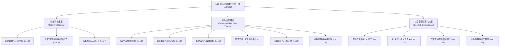

# 9.55 / 15.8471 消费者行为学

> MIT 脑与认知科学系（Course 9）与斯隆管理学院（Course 15）联合开设课程 · 3-0-6 学分 · 主讲团队（David G. Rand / Drazen Prelec / John R. Hauser 等）

MIT 9.55（本科生版 9.55 / 15.8471J，研究生版 9.550 / 15.847J）是一门将**认知科学（Cognitive Science）**、**行为经济学（Behavioral Economics）**与**实验社会心理学（Social Psychology）**深度熔铸的跨学科前沿课程。

与传统商学院侧重于定性描述或经验总结的营销学教学截然不同，本课程从人类心智的底层信息加工约束出发，将消费者的决策过程视为一个在有限认知带宽、感觉感知阈限、神经估值机制以及复杂社会网络交互下的自适应计算系统。课程深入剖析从感知滤镜到跨期折现、从诱饵效应到连贯任意性、从心智账户到地位信号传递的全链路机制，最终将理论武器导向商业战略设计、选择架构（Choice Architecture）与公共政策助推（Nudge）。

## TL;DR

- MIT 9.55 熔铸认知科学、行为经济学与实验社会心理学，解构“理性经济人”神话。
- 确立注意力瓶颈、双系统加工、参考点依赖、连贯任意性与情境依赖等核心底层心智机制。
- 涵盖前景理论、心智账户、跨期选择偏倚、吸引与折中效应、代价高昂信号与行为助推。
- 以严格实验心理学范式与计量模型支撑，从实验室因果推断跨越至商业设计与公共政策。

## 课程核心框架与三重视角

MIT 9.55 将传统商业营销中零散的战术技巧，重构为一个建立在严密认知与实证基础上的三维立体心智模型。课程强调，消费者并非被动的广告受众，而是在复杂的物理环境与社会网络中实时进行价值推断的信息处理器。

为了系统解构消费决策的每一个环节，全课程划分为三个相互交织的认知层次：
1. **认知科学维度（Cognitive Foundation）**：探究感官输入如何在毫秒级时间内被注意力机制筛选、如何在工作记忆中形成语义联想图式，以及人类双系统思维如何通过直觉启发式接管复杂计算；
2. **行为决策理论维度（Behavioral Decision Theory）**：聚焦于新古典经济学效用理论在面对现实选择时的系统性崩溃，深入剖析前景理论的价值曲率、损失厌恶、情境效应以及心智账户对金钱可替代性的扭曲；
3. **社会心理与演化维度（Social & Evolutionary Dynamics）**：将个体决策置于群体环境与演化生物学视野中，揭示态度转变的认知路径、社会规范对从众行为的隐秘驱动、炫耀性消费的代价高昂信号机制，以及助推技术在商业与公共治理中的伦理边界。

这三大维度共同构成了从感知输入、心智估值到社会行动的完整认知决策闭环。

## 讲义目录

| 讲次 | 标题 | 核心理论模型与实证焦点 |
|---|---|---|
| [Lec 1](./lec1.md) | 理性神话与行为范式 | 新古典经济学公理体系的破产；阿莱悖论；有限理性（Simon）与行为决策理论（BDT）范式转型 |
| [Lec 2](./lec2.md) | 注意机制、感觉营销与具身知觉 | 视觉显著性图谱；最小可觉差（韦伯律）；鸡尾酒会效应；具身认知（重量、温度与触觉对评价的渗透） |
| [Lec 3](./lec3.md) | 记忆图式、联想网络与品牌表征 | 柯林斯-洛夫特斯激活扩散模型；品牌语义网络；商业外观（Trade Dress）混淆；记忆提取失败 |
| [Lec 4](./lec4.md) | 双系统理论与启发式决策 | 卡尼曼系统 1 直觉 vs. 系统 2 深思；可得性启发式、代表性启发式与小数定律偏差 |
| [Lec 5](./lec5.md) | 锚定效应与连贯任意性 | 阿里利-洛温斯坦-普雷莱克范式；社保尾号对支付意愿（WTP）的锚定；任意基础上的相对一致性 |
| [Lec 6](./lec6.md) | 前景理论与参考点依赖 | 卡尼曼-特沃斯基 S 型价值函数；损失厌恶（$\lambda \approx 2.1$）；禀赋效应（WTP vs. WTA）；现状偏倚 |
| [Lec 7](./lec7.md) | 框架效应与选择架构 | 属性框架、目标框架与风险选择框架；默认选项效应（器官捐献自然实验）；自由主义家长制 |
| [Lec 8](./lec8.md) | 情境效应：吸引、折中与幻影选项 | 违反独立无关备选公理（IIA）；不对称占优效应（诱饵效应）；折中效应；幻影选项对偏好的诱导 |
| [Lec 9](./lec9.md) | 心智账户与支付之痛 | 萨勒心智账户；金钱的可替代性被打破；获得效用 vs. 交易效用；信用卡解耦与支付之痛（Prelec 范式） |
| [Lec 10](./lec10.md) | 跨期决策与自我控制困境 | 传统指数贴现 vs. 双曲贴现（Hyperbolic Discounting）；现时偏倚（Present Bias）；冷热共情差距与预先承诺 |
| [Lec 11](./lec11.md) | 态度形成、说服机制与精细加工 | 精细加工可能性模型（ELM）；中枢路径 vs. 外周路径；认知失调理论；努力合理化与购后失调消除 |
| [Lec 12](./lec12.md) | 社会规范、从众与行为传染 | 描述性规范 vs. 禁令性规范；西奥迪尼石化森林与酒店毛巾实验；社会认同假说与多数人从众压力 |
| [Lec 13](./lec13.md) | 炫耀性消费、昂贵信号与身份认同 | 凡勃伦商品；代价高昂信号理论（Zahavi 劣势原则）；隐形奢华与文化资本；身份不一致补偿性消费 |
| [Lec 14](./lec14.md) | 行为助推、数字暗黑模式与消费者福祉 | 塞勒-桑斯坦 Nudge 理论；EAST 助推框架；数字产品暗黑模式（Sludge / Dark Patterns）；行为干预的伦理边界 |

## 前置知识与跨学科联结

- **心理学基底**：建议先修或同步修读 [MIT 9.00 心理学导论](../../intro/900_introdution2psy/) 或 [MIT 9.70 社会心理学](../970_social_psy/)，掌握知觉、记忆与群体动力学基本概念。
- **认知科学交叉**：与 [MIT 9.59 实验心理语言学](../../cognitive/959_psycholinguistics/) 的信息论模型（香农熵、有噪信道）与眼动/反应时范式深度互通。
- **经济与商业映射**：与 MIT 14.01 微观经济学原理、15.810 营销管理学形成鲜明的“规范性模型（Normative）”与“描述性模型（Descriptive）”的辩证张力。
