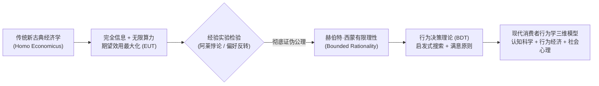
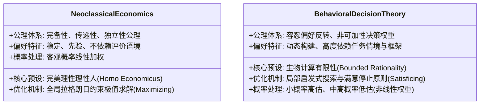

# Lec 1 理性神话与行为范式

> MIT 9.55 / 15.8471 · 消费者行为学 · 主讲团队

## TL;DR

- **理性经济人假设的瓦解**：冯·诺依曼-摩根斯坦期望效用理论（EUT）将人预设为具备完全偏好一致性与概率线性的理性机器，但在真实实验中遭到系统性证伪。
- **阿莱悖论的公理击穿**：阿莱（Allais 1953）通过常见后果效应证实，人类在面对确定性奖励时赋予极不成比例的确定性溢价，直接粉碎了独立性公理（Independence Axiom）。
- **有限理性与满意原则**：赫伯特·西蒙提出有限理性（Bounded Rationality），指出人类计算带宽与认知资源的内在稀缺性，迫使决策系统采用启发式“满意化”（Satisficing）取代全局“最优化”（Optimizing）。
- **三重视角范式转型**：规范性模型（应该怎么选）、描述性模型（实际怎么选）与规定性模型（如何助推改进）的彻底解耦，确立了行为决策理论（BDT）的现代科学地基。

## 1. 核心问题

- **规范性与描述性的鸿沟**：新古典经济学建立在严密的理性公理体系之上，然而当这些数学公理推导出的预测与实验室中真实消费者的击键和选择发生剧烈冲突时，究竟是人类做错了，还是理论的基础假说存在根本性缺陷？
- **认知有限性与决策代价**：在商品信息爆炸的现代消费市场中，人类大脑是否具备足够的工作记忆和算力来遍历全排列选择集并求解效用最大化的一阶导数条件？
- **行为规律的系统性偏倚**：消费者的“非理性”究竟是一团毫无规律的随机白噪声，还是具备高度可预测性、深植于人类认知神经演化机制中的系统性规律（Systematic Biases）？



## 2. 核心概念

| 概念 | 一句话定义 | 易混淆对象 |
|---|---|---|
| **期望效用理论（EUT）** | 冯·诺依曼与摩根斯坦构建的新古典决策理论，假定人在风险决策中最大化可能结果效用的概率加权和 | 期望值理论（仅计算客观金额加权平均） |
| **独立性公理（Independence Axiom）** | 若两个博弈混合了相同的第三个不相关选项，决策者在两者之间的偏好排序保持不变 | 传递性公理（Transitivity: 若 A>B 且 B>C 则 A>C） |
| **阿莱悖论（Allais Paradox）** | 实验证实人们在面对极高确定性选项时产生的偏好模式，直接在数学上违反了 EUT 的独立性公理 | 圣彼得堡悖论（边际效用递减的数学佯谬） |
| **有限理性（Bounded Rationality）** | 人类受到神经生物计算带宽、信息不完全与时间压力的硬约束，无法进行全局最优化搜索 | 纯粹的随机决策或精神病态行为 |
| **满意原则（Satisficing）** | 决策者设定一个可接受的心理阈值，一旦找到满足该阈值的方案即停止搜索并做决定的启发式策略 | 全局最优化原则（Optimizing / Maximizing） |

## 3. 证据链

### 3.1 经典公理体系的崩溃：阿莱悖论（Allais 1953）

莫里斯·阿莱（Maurice Allais）在 1953 年巴黎计量经济学会议上向包括保罗·萨缪尔森、米尔顿·弗里德曼在内的新古典经济学泰斗呈现了经典的成对选择实验。

#### 实验设计与博弈矩阵

受试者面临两组独立的风险决策选择（金额为当时的高额法郎/美元）：

```text
博弈 1:
  选项 A: 100% 获得 100 万美元
  选项 B: 89% 概率获得 100 万美元，10% 概率获得 500 万美元，1% 概率什么也得不到 ($0)

博弈 2:
  选项 C: 11% 概率获得 100 万美元，89% 概率什么也得不到 ($0)
  选项 D: 10% 概率获得 500 万美元，90% 概率什么也得不到 ($0)
```

#### 实证结果分布

大量跨文化、跨阶层的重复实验记录了压倒性的稳定选择：
- 在**博弈 1** 中，绝大多数受试者（超过 80%）坚定选择 **A**（追求确定性 100 万，规避 1% 空手而归的后悔风险）；
- 在**博弈 2** 中，绝大多数受试者（超过 70%）却反转偏好选择了 **D**（认为 10% 赢 500 万与 11% 赢 100 万的概率相差无几，但奖金翻了 5 倍）。

#### 数学矛盾与独立性公理击穿

根据期望效用理论（EUT），设效用函数为 $u(x)$ 且归一化 $u(0) = 0$：
- 偏好 $A \succ B$ 意味着：
  $$u(100) > 0.89 u(100) + 0.10 u(500) + 0.01 u(0)$$
  移项化简得：
  $$0.11 u(100) > 0.10 u(500) \quad \text{--- (式 1)}$$
- 偏好 $D \succ C$ 意味着：
  $$0.10 u(500) + 0.90 u(0) > 0.11 u(100) + 0.89 u(0)$$
  移项化简得：
  $$0.10 u(500) > 0.11 u(100) \quad \text{--- (式 2)}$$

式 1 与式 2 产生了直接的代数逻辑矛盾！
- **本质根源**：在两个博弈中，如果将一个共同的 89% 概率事件（在博弈 1 中是 89% 拿 100 万，在博弈 2 中是 89% 拿 0）剔除，两组博弈剩余的实质性权衡完全相同。EUT 的**独立性公理（Independence Axiom）**断言这种共同背景绝不应影响核心选择。
- **实证结论**：人类心智对“确定性（Probability = 1.0）”赋予了非线性的心理溢价（Certainty Effect），这种主观概率权重的非线性扭曲宣告了规范性期望效用理论无法作为人类实际行为的有效描述工具。

---

### 3.2 偏好反转现象：Lichtenstein & Slovic (1971)

心理学家萨拉·利希滕斯坦与保罗·斯洛维克发现了更为激进的**偏好反转（Preference Reversals）**现象，直接动摇了“效用函数存在”的根本前提。

#### 实验材料设计

研究者为受试者提供两个期望值接近的博弈：
1. **P-博弈（High Probability Bet）**：极高概率赢取中等金额（例如：$35/36$ 概率赢 $4 美元，$1/36$ 概率输 $1 美元）；
2. **$-博弈（High Payoff Bet）**：极低概率赢取超高金额（例如：$11/36$ 概率赢 $16 美元，$25/36$ 概率输 $1.5 美元）。

#### 实验任务双轨操纵

受试者被要求完成两项不同的评估任务：
- **选择任务（Choice Task）**：如果只能拥有其中一张彩票，你挑选哪一张？
- **定价任务（Pricing Task）**：如果你拥有该彩票，你愿意出售它的最低保留现金售价（WTA, Certainty Equivalent）是多少？

#### 震撼的实验数据

- 在**选择任务**中，绝大多数人（约 75%）选择了安全性极高的 **P-博弈**；
- 在**定价任务**中，同一个受试者给 **$-博弈** 标出的最低现金售价却显著**高于** P-博弈！
- **逻辑困境**：如果用选项评估价值，受试者主张 $P \succ \$$；如果用货币现金度量，受试者却表明 $\$ \succ P$。这意味着如果一个投机商在两个市场中流转，就可以将受试者当成“金钱抽水机（Money Pump）”，通过循环套利榨干其资产。
- **理论推论**：消费者的偏好并不是预先储存在大脑中等待提取的固定标量（Pre-formed Utilities），而是在具体的任务环境、评价框架和反应模式中**即时构建出来（Constructed Preferences）**的认知产物。

---

## 4. 理论之争与计算模型

### 4.1 理论对立：新古典最优化 vs. 行为决策理论

为了系统理解这场跨越半个世纪的经济学与心理学范式之争，我们需要从决策假设、信息处理机制以及价值评估基石等核心维度，对这两大理论流派进行严格解构：



这两大理论流派的冲突集中体现于三大计算哲学维度：

1. **计算复杂度与搜索边界**：
   新古典模型假设消费者面临 $K$ 个属性的 $M$ 件商品时，能够瞬时计算并比较所有 $M \times K$ 个特征维度的边际替代率；而行为决策理论指出人类视觉注意与工作记忆在实时决策中只能处理极其有限的几个焦点属性（Focus Attributes），搜索遵循顺序启发式（Lexicographic ordering）。
2. **最优化（Optimizing）与满意化（Satisficing）的分野**：
   西蒙指出，在现实世界的复杂环境下，“求解全局最优解”在计算几何与算法复杂度上通常是 NP-hard 的。生物演化不可能等待一个大脑消耗几个小时去计算晚餐的最优卡路里成本。最适应生存的策略是**设定一个欲望阈值（Aspiration Level）**，当且仅当候选方案满足该阈值时便立即执行。
3. **三种科学模型的清晰解耦**：
   - **规范性模型（Normative Models）**：以公理化逻辑推演“一个完全理性的人在数学上**应当**怎样决策”（如 EUT）；
   - **描述性模型（Descriptive Models）**：以严格可重复的实验数据描述“现实中由神经元构成的人**实际**如何决策”（如前景理论、BDT）；
   - **规定性模型（Prescriptive Models）**：针对现实人类的心智缺陷与认知偏差，研究“如何通过制度与工具**帮助**人们做出更符合其长远福祉的决定”（如选择架构与 Nudge）。

---

### 4.2 有限理性的搜索模型：西蒙启发式算法形式化

赫伯特·西蒙将有限理性消费者的购买决策形式化为一个动态序贯搜索算法（Sequential Search Algorithm）。

设选择集包含 $N$ 个商品备选项 $\{x_1, x_2, \dots, x_N\}$，每个商品具有 $D$ 个质量属性向量 $\mathbf{a}(x) \in \mathbb{R}^D$ 和一个价格 $p(x)$。消费者的心理欲望水平（Aspiration Level）设定为一个向量 $\mathbf{\theta} = (\theta_1, \theta_2, \dots, \theta_D)$ 以及预算上限 $B$。

在每一个离散时间步 $t$，消费者检视一个商品 $x_t$，决策准则并非比较全局效用，而是进行极简的布尔阈值校验：

$$\text{Accept}(x_t) = \begin{cases} 1, & \text{if } p(x_t) \le B \;\land\; \forall d \in \{1,\dots,D\}, a_d(x_t) \ge \theta_d \\ 0, & \text{otherwise} \end{cases}$$

如果遍历数个备选后未找到满足项，消费者不会强行计算全局最优化，而是自适应地调整其欲望阈值：

$$\mathbf{\theta}_{t+1} = \mathbf{\theta}_t - \mathbf{\delta} \cdot \Delta t$$

这种算法将高昂的全局联立极值求解，退化为复杂度极低的常数级局部对比，用极小的次优容忍度换取了宝贵的生物能量与决策速度。

---

## 5. 分析层次的整合

| 系统层次 | 核心研究维度 | 本讲关键机制与实证 |
|---|---|---|
| **计算理论层（Computational Theory）** | 有限环境资源下的自适应目标界定 | 满意原则（Satisficing）：在有限认知功耗与时间压力下最大化生存效用比 |
| **算法与表征层（Algorithm & Representation）** | 偏好的动态构建与启发式规则执行 | 阿莱悖论揭示确定性效应的概率加权算法；P/$-博弈表明任务表征（选择 vs. 定价）改变属性权重分配 |
| **生理与行为实现层（Physical & Behavioral Implementation）** | 神经经济学决策回路与反应时量化 | 前额叶皮层（dlPFC / vmPFC）与纹状体（Striatum）对确定性奖励的非线性突触激活；眼动追踪显示搜索停机行为 |

#### 层次小结

从纯粹数学公理体系的构建，到底层神经元突触传递的物理延迟，消费者行为学的诞生本身就是一场跨越层次的认知科学革命。计算层证明了全局最优化在物理宇宙中的不可行性；算法层展示了人类心智如何借助启发式捷径优雅地化繁为简；行为与神经层则用扎实的眼动轨迹与神经影像，为“理性人仅仅是数学沙盘上的空想假说”敲下了最后的实证铁钉。

---

## 6. 边界条件与失效情形

- **高利益强激励下的市场纠偏局限（Market Discipline）**：
  新古典学者常辩称“实验室里的几十美元小把戏无法外推到真实大额交易”。然而后续针对百万美元级房地产交易、金融股票衍生品套利以及企业重大并购的实证计量研究证明：**市场经验与高额奖金并不能消除启发式偏差**。在极高压力与复杂风险下，专业交易员反而更容易爆发代表性偏差与锚定效应。
- **透明度操纵对公理违背的修正**：
  如果将阿莱悖论中相同的“89% 共同后果”以物理形式（如两个同色透明抽奖箱）摆在受试者眼前，直观剔除混淆背景，相当比例的受试者会意识到逻辑矛盾并回归独立性公理。这表明公理的违背在很大程度上由人类信息表征的透明度（Transparency）所决定。
- **算法代理与自动化消费的前沿异化**：
  当当代消费者将购物决策委托给自动化推荐算法、量化比价机器人或大语言模型智能体（AI Agents）时，决策的底层算力约束被瞬间抹平，新古典模型在机器对机器（M2M）的交易场景中可能重新展现出强大的解释力。

---

## 7. 课程内外的横向关联

- **本课奠基坐标**：作为全课程的开篇第 1 讲，本讲建立的“有限理性与行为决策理论”奠定了后续所有专题的总基调。Lec 2（注意与感觉知觉）将下沉至物理输入端；Lec 5（锚定）与 Lec 6（前景理论）将对本讲提出的数学公理违背给出具体的计算替代方案。
- **横向跨学科映射**：
  - 与 **MIT 14.01（微观经济学原理）** 的消费者效用最大化推导形成鲜明的实证批判对照；
  - 与 **MIT 9.59（实验心理语言学）** 在贝叶斯有噪信道推断与工作记忆容量瓶颈的数学建模上高度同构；
  - 为 **MIT 9.70（社会心理学）** 中关于个体在处境约束下的认知吝啬鬼（Cognitive Miser）画像提供坚实的决策学地基。

---

::: insight
### 认知科学家的心智诊断：告别理性幻觉——在有限的硬件上构筑优雅的生存

在长达一个多世纪的时间里，经济学帝国用精妙绝伦的微积分公式，在黑板上构筑了一个完美的乌托邦：在这个世界里，人类如同全知全能的神祇，冷静地评估着千百种可能性的每一个微小概率，永远精确地最大化着自己的生命效用。

然而，当认知心理学家把真实的测试纸条递给大师们自己时，这尊精雕细琢的“理性神像”瞬间坍塌了。

阿莱悖论与偏好反转并不是人类心智的“愚蠢缺陷”，而是大自然写在人类神经系统里最深刻的生存智慧。

我们的大脑重约 1.4 千克，消耗着人体 20% 的能量，但在物理上却受制于极为有限的突触传导速率和短暂的工作记忆带宽。如果每一个远古祖先在面对草丛晃动时，都要计算捕食者出现的连续概率密度积分并求解拉格朗日极值，人类这个物种早就在几百万年前灭绝在非洲大草原上了。

满意化原则、确定性溢价与启发式搜索，是生物进化在计算复杂度（Computational Intractability）面前交出的最高雅的答卷。

我们不是一台故障频出的烂电脑；我们是一台在残酷而嘈杂的现实物理世界中，用极其廉价的认知能耗，高精度达成了数百万年繁衍奇迹的自适应优化大师。
:::

---

## 8. 思考题与自测

### 思考题

1. **独立性公理的证伪力量**：请用数学语言解释，为什么阿莱悖论中受试者在博弈 1 选择 A、在博弈 2 选择 D 的组合，构成了对独立性公理（Independence Axiom）无可辩驳的反驳？
2. **偏好反转与“金钱抽水机”论证**：在 Lichtenstein & Slovic (1971) 的实验中，如果一个消费者的偏好模式是“选择时偏好安全的小彩票 P，定价时却为高风险的大彩票 $ 标出更高的现金价格”，投机者如何通过一系列简单的买卖操作在不承担任何风险的情况下榨干该消费者的财富？
3. **最优化（Optimizing）与满意化（Satisficing）的计算代价**：在超市选购一瓶洗发水时，一个真正的新古典理性人面临的计算挑战究竟有多大？西蒙的满意原则是如何保护消费者大脑不至于因信息过载而崩溃的？

### 参考答案

<details>
<summary>点击展开详细解析</summary>

1. **确定性效应导致的概率权重代数矛盾**：在博弈 1 中，$A = (1.0, \$1M)$，$B = (0.89, \$1M; 0.10, \$5M; 0.01, \$0)$。根据期望效用理论，$A \succ B$ 等价于 $u(\$1M) > 0.89 u(\$1M) + 0.10 u(\$5M) + 0.01 u(\$0)$，两边同时减去 $0.89 u(\$1M)$ 得到 $0.11 u(\$1M) > 0.10 u(\$5M)$。在博弈 2 中，$C = (0.11, \$1M; 0.89, \$0)$，$D = (0.10, \$5M; 0.90, \$0)$。$D \succ C$ 等价于 $0.10 u(\$5M) + 0.90 u(\$0) > 0.11 u(\$1M) + 0.89 u(\$0)$，由于 $u(\$0)=0$，化简即得到 $0.10 u(\$5M) > 0.11 u(\$1M)$。两个代数不等式互为完全相反的命题，直接推翻了独立性公理假定“等额剔除共同概率事件不影响相对偏好”的基石。
2. **金钱抽水机（Money Pump）循环套利机制**：
   - 第一步：消费者当前持有 P-博弈彩票。因为他在定价时认为 $\$$ 彩票更值钱（例如标价 $\$_{\text{WTA}} = \$10$，而 $P_{\text{WTA}} = \$5$），投机者向其提出：“你拿 P 加一个微小的差价（例如 $1）来换我的 $\$$”，消费者由于认为 $\$$ 价值远超 P，欣然接受并支付 $1；
   - 第二步：消费者现在持有 $\$$。投机者向其呈现“两选一选择任务”。由于在直接选择中消费者实际上偏好安全稳定的 P，投机者提出：“你把 $\$$ 免费还给我，我把 P 还给你”，消费者欣然同意平价交换；
   - 结果：一个循环过后，消费者手中拿回了最初的 P 彩票，但净损失了 $1 现金。投机者可以无限循环此过程，直到彻底吸干该消费者的资金。这一理论推论证明：如果这种偏好反转是静态刚性的，在金融市场上将是毁灭性的，促使认知科学家深入反思人类偏好的语境依赖与动态构建特征。
3. **计算复杂度与停机启发式**：超市货架上有 50 种洗发水，每种涉及价格、控油度、去屑力、香味、包装环保性、品牌声誉等 10 个属性。新古典最优化要求消费者首先获取全部 $50 \times 10 = 500$ 个数据点（包含对未来洗发体验的主观预期效用计算），随后计算复杂的效用函数全微分，在连续预算线上求解最优解。这在有限时间与工作记忆下具有极高的时间机会成本。西蒙的满意原则指导消费者设定基线门槛（例如：“价格低于 40 元且必须有去屑功效”），从货架左上角按空间就近原则逐个扫描，一旦看到第一瓶符合这两个布尔条件的洗发水，便立即拿起放进购物车并终止搜索，节约了 95% 以上的心智计算能耗。
</details>

---

## 9. 开放问题与前沿探索

- **神经预测编码与偏好构建**：在认知神经科学预测编码（Predictive Coding）框架下，消费者的主观价值感究竟是边缘系统神经元放电的多巴胺先验，还是皮层在感知到商品刺激后瞬间自组织生成的后验信念？
- **生成式 AI 环境下的机器决策代理**：当未来个人 AI 助手替人类执行 80% 的日常消费采购时，AI 是会彻底终结人类的非理性启发式偏倚，还是会反向继承并放大人类训练数据中的系统性认知偏差？

---

## 10. 参考文献与延伸阅读

- **奠基性理论文献**：
  - von Neumann, J., & Morgenstern, O. (1944). *Theory of Games and Economic Behavior*. Princeton University Press.
  - Allais, M. (1953). Le comportement de l'homme rationnel devant le risque: critique des postulats et axiomes de l'école américaine. *Econometrica*, 21(4), 503–546.
  - Simon, H. A. (1955). A behavioral model of rational choice. *The Quarterly Journal of Economics*, 69(1), 99–118.
  - Lichtenstein, S., & Slovic, P. (1971). Reversals of preference between bids and choices in gambling decisions. *Journal of Experimental Psychology*, 89(1), 46–55.
- **前沿综述与商业映射**：
  - Kahneman, D. (2003). Maps of bounded rationality: Psychology for behavioral economics. *American Economic Review*, 93(5), 1449–1475.
  - Hauser, J. R. (2015). *Note on Consumer Behavior (15.810 Course Materials)*. MIT Sloan School of Management.
