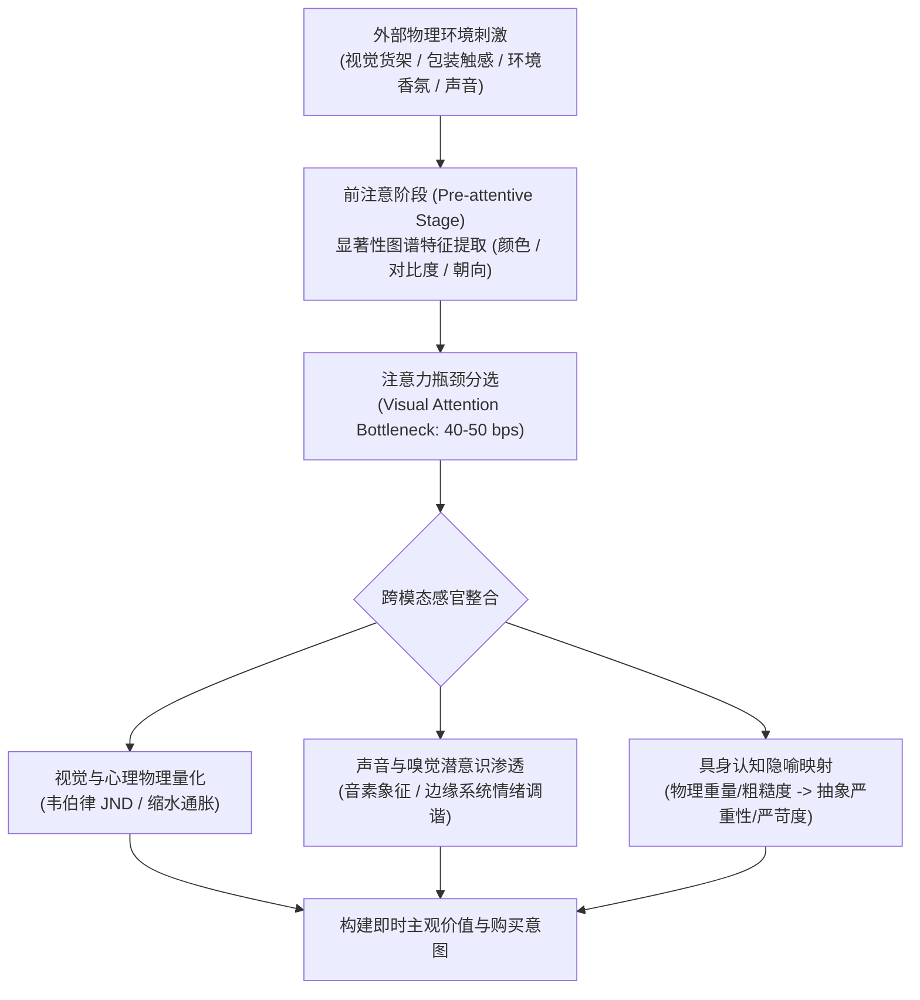
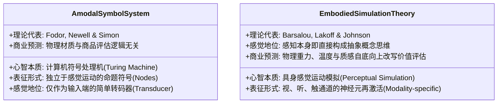

# Lec 2 注意机制、感觉营销与具身知觉

> MIT 9.55 / 15.8471 · 消费者行为学 · 主讲团队

## TL;DR

- **注意力的认知瓶颈**：人类感官每秒接收数百万比特物理信号，但工作记忆注意瓶颈仅能处理约 40-50 比特，使得视觉显著性成为消费决策的第一道物理分选机。
- **心理物理学与缩水通胀**：韦伯律（$\Delta I / I = k$）确立了最小可觉差（JND）法则；厂商精准利用 JND 阈值设计“缩水式通胀”（Shrinkflation）以维持原价并削减净重。
- **多感官整合营销**：声音象征主义（音素前元音 vs. 后元音）与环境气味通过跨模态感知通道绕过前额叶理性审查，直接浸润情感系统。
- **具身认知对评价的渗透**：阿克曼等（Science 2010）证实物理触感（重压板、粗糙拼图、温暖咖啡杯）可自底向上无意识映射并重塑消费者的高阶商业判断。

## 1. 核心问题

- **信息超载与感官门户**：现代超市货架上陈列着成千上万种商品，消费者的视觉注意系统如何在不到 200 毫秒的时间窗口内，从物理杂乱背景中提取出候选商品并引导眼动注视？
- **知觉连续性与心理物理量化**：物理强度的线性增加为何在人类心智中呈现对数压缩？商家如何利用知觉阈限的非线性几何规律隐蔽调价或重新设计包装？
- **肉身具象对高阶决策的自底向上渗透**：人类大脑的抽象商业判断（如对求职者的专业度评估、对奢侈品价值的感知、对谈判对手的信任度）是否真的独立于决策者所处的物理触觉、重量、温度与空间环境？

在消费决策的最初几百毫秒内，大脑并不是在执行冷酷的微积分预算对比，而是在进行残酷的感官信号粗筛与能量配给。外部世界每秒轰击视网膜与体感神经的物理信息量高达数兆比特，但人类工作记忆中枢在意识层面维持的处理通量极限仅为每秒 40 至 50 比特。这种悬殊的物理-认知吞吐量断层，迫使心智建立起一道高度严密的漏斗式过滤网，只有通过了自底向上物理显著性与跨模态具身校准的信息流，才能最终获得进入决策中枢的门票：



## 2. 核心概念

| 概念 | 一句话定义 | 易混淆对象 |
|---|---|---|
| **自底向上显著性（Bottom-up Saliency）** | 由刺激本身的物理对比度（颜色、边缘、空间频率）强制驱动的非自主注意捕获机制 | 自顶向下目标引导注意（Top-down Goal-driven Attention） |
| **最小可觉差（JND）** | 物理刺激强度发生改变时，人类知觉系统恰好能够察觉出差异所需的最小物理增量 $\Delta I$ | 绝对感觉阈限（能察觉刺激是否存在的绝对能量门槛） |
| **缩水式通胀（Shrinkflation）** | 厂商在名义价格保持不变的前提下，通过将体积或净重的缩减幅度控制在 JND 阈值之下以隐蔽转嫁成本的商业策略 | 显性提价（Direct Price Hike） |
| **声音象征主义（Sound Symbolism）** | 语言中的基本音素（如高频前元音 [i] 与低频后元音 [o]）在跨文化人类心智中稳定映射特定物理属性（大小、轻重、圆滑）的神经联觉机制 | 纯粹任意性的索绪尔符号学命名 |
| **具身认知（Embodied Cognition）** | 主张抽象思维、概念表征与理性决策深植于身体的感官-运动系统，物理身体状态直接构成心智思考的一部分 | 唯理主义身心二元论（Cartesian Dualism） |

## 3. 证据链

### 3.1 货架视觉注意与眼动追踪：Pieters & Wedel (2004)

里克·皮特斯（Rik Pieters）与米歇尔·韦德尔（Michel Wedel）利用高精度红外角膜反射眼动仪，彻底量化了解构消费者注视行为的动力学机制。

#### 实验设计与测量指标

受试者在自由浏览和模拟购物任务中观察复杂的商品印刷广告与真实超市货架图像。在传统市场营销中，广告主普遍假设消费者会逐字逐句阅读文案，然而眼动追踪技术直接揭示了注意力在空间维度的残酷非对称性。

研究团队预先将整个视觉刺激平面划分为三个互不重叠的核心感兴趣区（AOI, Area of Interest），并严格测量了不同设计元素在空间占用与注意转化率之间的投入产出比：

```text
广告/货架三要素区域 (AOI 划分):
+-------------------------------------------------------+
|  [ 品牌标志 Brand ]       [ 文本信息 Text Copy ]       |
|  面积占比: 10%            面积占比: 40%               |
|  注视效率: 极高 (单位面积高吸睛) 注视效率: 低 (高认知负荷)      |
+-------------------------------------------------------+
|                                                       |
|             [ 视觉主体图像 Visual Image ]              |
|             面积占比: 50%                             |
|             注视效率: 最强注意捕获门控 (Gating Mechanism) |
|                                                       |
+-------------------------------------------------------+
```

实验系统记录了三项核心眼动物理指标：
1. **注视次数（Fixation Count）**：落在特定感兴趣区（AOI）的离散注视点数量，直接反映该元素唤起认知深加工的频次；
2. **总注视时间（Total Dwell Time）**：在目标商品上的累计注视毫秒数，量化了工作记忆在该信息节点上的资源停留总代价；
3. **眼跳扫视路径（Scanpath Sequence）**：注视点转移的时序拓扑结构，揭示大脑在提取信息时的因果依赖流向。

#### 关键实证发现

- **图像的主导门控效应（Image Gating）**：视觉图像面积是唯一能够显著预测广告整体被注意概率的要素；如果主体图像未能捕获注意力，消费者根本不会触发对文本和品牌的注视扫视（$p < 0.001$）。
- **自顶向下目标的重塑力量**：当给受试者施加明确的搜索目标（例如“找到含无糖成分的饮料”）时，自底向上的物理显著性图谱（Itti-Koch Saliency）的预测力暴跌 60% 以上，自顶向下的语义特征掩膜迅速接管了眼动控制系统。

---

### 3.2 心理物理学与缩水式通胀（Shrinkflation）

物理世界与心智世界的几何映射遵循经典的心理物理学定律。

#### 韦伯-费希纳定律在价格与分量中的数学形式

恩斯特·韦伯（Ernst Weber）指出，人类对于刺激变化的辨别阈限不是一个绝对常量，而是一个相对比率：

$$\frac{\Delta I}{I} = k$$

其中 $I$ 为初始物理强度，$\Delta I$ 为刚好被察觉的最小可觉差（JND），$k$ 为常数（韦伯分数）。
古斯塔夫·费希纳在此基础上积分，推导出主观感觉量 $S$ 与客观物理量 $I$ 的对数关系：

$$S = c \cdot \ln\left( \frac{I}{I_0} \right)$$

#### 商业战术中的 JND 阈限博弈

消费品巨头（如巧克力、薯片、洗洁精制造商）在原材料成本上升时，面临两个选择：
- **方案 A（直接提价）**：一包薯片从 5.0 元涨至 5.8 元，价格增量 $\Delta P = 0.8$ 元。对于价格敏感型商品，价格的韦伯分数 $k_P \approx 0.05 \sim 0.08$，这一变化显著高出 JND 阈限，立即触发消费者前额叶皮层强烈的价格疼痛警报。
- **方案 B（缩水通胀 / Package Downsizing）**：包装袋外观几何轮廓保持不变，内部净含量从 100 克微调至 92 克（减少 8%），同时在袋内充入更多氮气维持充盈饱满感。对于立体容积的触觉与视觉感知，人类的韦伯分数 $k_V \approx 0.10 \sim 0.12$。由于 $\Delta V / V = 0.08 < k_V$，这一物理减量精准滑落在人类感觉阈限之下！
- **实证追踪**：行为经济学市场追踪数据证实，采用方案 B 的产品短期销量流失率比采用方案 A 低整整 70% 以上，证明消费者的知觉盲区构成了商业利润的弹性护城河。

---

### 3.3 具身认知的物理映射：Ackerman, Nocera, & Bargh (2010, Science)

约书亚·阿克曼、克里斯托弗·诺切拉与约翰·巴奇在顶级学术期刊《科学》（*Science*）发表了具有里程碑意义的三联实证研究，确立了触觉物理体验自底向上重塑抽象社会经济评估的直接因果链条。

#### 实验 1：物理重量隐喻“重要性”（Weight -> Importance）

在第一项经典实验中，研究者招募了 54 名受试者参与一项看似正规的人力资源招聘评估任务。实验操纵了极其微小且通常被新古典理论视为“完全无关干扰”的物理环境变量——受试者手持的写字垫板自重。

受试者被要求阅读一份标准化的求职者简历，并在多项 7 点李克特量表上对该候选人的专业度、严谨性以及是否值得录用进行打分：

```text
受试者手持写字板评估求职者候选人 (N = 54)
+--------------------------------------------------------+
| 条件 A: 轻量写字板 (Lightweight Clipboard, 约 340 克)  |
| 结果: 倾向于认为求职者工作态度一般, 对该招聘评估投入度较低 |
+--------------------------------------------------------+
| 条件 B: 沉重写字板 (Heavy Clipboard, 约 2,040 克)      |
| 结果: 显著认定该求职者工作素养更高、资历更严肃 (p < 0.05) |
|      愿意在后续决策中分配更多的官方预算资源             |
+--------------------------------------------------------+
```

实验数据展示了教科书级别的跨模态因果渗透：
- **概念严重性的无意识激活**：尽管两组受试者阅读的简历文字、客观排版与候选人经历完全一致，手持沉重写字板的受试者显著倾向于认定该求职者表现更稳健、对其专业价值给予更高评价（$p < 0.05$）；
- **行为承诺的外溢**：在后续的虚拟政府预算分配任务中，沉重组受试者展现出更强烈的社会责任倾向，愿意为公共安全与基础设施分配显著更多的财政资金；
- **核心机制**：实验的关键控制在于写字板上的纸质文本完全相同。仅仅是手臂骨骼肌感受到的额外地球引力负载，就通过神经具身隐喻回路（"Heft" 隐喻 "Weighty matters"）自动激活了大脑前额叶关于“严肃、重要、权威”的抽象语义网络。

#### 实验 2 与实验 3：质感与硬度隐喻（Texture & Hardness）

- **粗糙感隐喻社交艰难（Roughness -> Social Harshness）**：受试者在完成一个打磨光滑的木制拼图，或砂纸打磨的粗糙拼图后，阅读一段包含社交模糊冲突的日常对话。摸过粗糙砂纸的受试者显著倾向于将对方的意图解读为“敌对、不协调、充满对抗”（$p = 0.004$）。
- **物理硬度隐喻心理死板（Hardness -> Rigidity）**：在谈判实验中，坐在硬木椅子上的买家在二手车价格博弈中表现出显著更高的死板与不妥协性，其第二次出价的妥协让步幅度显著小于坐在柔软皮椅上的买家。

---

## 4. 理论之争与计算模型

### 4.1 理论对立：抽象符号假说 vs. 具身模拟理论

在认知科学与消费者心理学领域，长期存在关于知识与知觉表征本质的理论交锋：



这两大理论流派在解释消费行为时的核心分歧：

1. **感觉运动剥离与否（Modality-General vs. Modality-Specific）**：
   非模态符号系统主张消费者在评估一辆汽车的“奢华度”时，大脑提取的是抽象的布尔逻辑标签（如 `is_luxury = True`）；而具身模拟理论指出，人们在心智中构建奢华感时，直接激活的是指尖抚摸纳帕真皮的触觉皮层、关门时低沉金属撞击声的听觉皮层以及坐进座舱时的沉降包裹感。
2. **概念隐喻的神经基础（Conceptual Metaphor Theory）**：
   乔治·莱考夫指出，人类绝大多数高级抽象概念（重要性、亲密感、道德、难度）都是通过空间与具身隐喻建立起来的。因为幼儿在成长早期首先接触的是物理世界（抱紧父母感受体温、拿取重物感受阻力），这些早期神经感觉运动连接（Sensorimotor Circuits）构成了日后所有复杂经济决策的脚手架。

---

### 4.2 视觉注意力物理计算模型：Itti-Koch 显著性图谱

Laurent Itti 与 Christof Koch 提出了具有神经生物学基础的视觉注意前注意选择模型，被广泛应用于数字界面与包装设计的注意力预测。

设输入图像为 $I(x, y)$，模型首先通过高斯金字塔提取多个尺度的低阶物理特征：

```text
输入图像 I(x, y)
    |
    +---> 颜色通道 (Color):      红-绿对抗 (R-G), 蓝-黄对抗 (B-Y)
    +---> 亮度通道 (Intensity):  明暗对比度 I(c, s)
    +---> 方向通道 (Orientation): Gabor 滤波器响应 (0°, 45°, 90°, 135°)
```

各特征图谱利用跨尺度中央-周边差异运算（Center-Surround Differences, $\ominus$）模拟初级视皮层（V1）感受野：

$$\mathcal{F}_l = \bigoplus_{c=2}^4 \bigoplus_{s=c+3}^{c+4} \mathcal{N}\left( |M(c) \ominus M(s)| \right)$$

其中 $\mathcal{N}(\cdot)$ 为非线性局部极值归一化算子。最终将各通道线性合并为唯一的**主导显著性图谱（Master Saliency Map, $\mathcal{S}$）**：

$$\mathcal{S}(x, y) = \frac{1}{3} \Big[ \mathcal{N}(\bar{\mathcal{C}}) + \mathcal{N}(\bar{\mathcal{I}}) + \mathcal{N}(\bar{\mathcal{O}}) \Big]$$

- **眼动预测动力学**：显著性图谱中像素值最高的区域充当注意力吸引子。注意力焦点（FOA, Focus of Attention）通过胜者为王（WTA, Winner-Take-All）神经网络瞬时跳跃至最大峰值，并伴随**返回抑制（IOR, Inhibition of Return）**机制，强制眼动在几十毫秒后移向次高显著区域。
- **商业设计应用**：通过算法热力图优化关键买点在包装正面的物理坐标，确保其落入前 3 次注视跳跃的着陆区。

---

## 5. 分析层次的整合

| 系统层次 | 核心研究维度 | 本讲关键机制与实证 |
|---|---|---|
| **计算理论层（Computational Theory）** | 有限信道带宽下的自适应感知信息采样 | Itti-Koch 显著性采样；韦伯律非线性物理-主观压缩；最小能量下的感知分选 |
| **算法与表征层（Algorithm & Representation）** | 多模态知觉特征融合与具身隐喻映射机制 | 概念隐喻激活（重量->严肃；粗糙->苛刻）；声音象征跨模态联觉编码（前元音/后元音） |
| **生理与行为实现层（Physical & Behavioral Implementation）** | 视网膜神经节细胞感受野、红外眼动追踪与外周躯体神经传导 | V1/V4 视觉皮层特征抽取；红外瞳孔角膜反射记录凝视轨迹；触觉机械感受器（麦斯纳小体）电位传导 |

#### 层次小结

从视网膜感受野的明暗对抗反应，到指尖神经末梢的物理压迫感，再到前额叶作出的商业信任裁决，注意与具身知觉向我们展示了“理智”如何被牢牢锚定在“肉身”之中。计算层定义了感官信息流的极限容量；算法层揭示了具身隐喻在概念层级间的无缝映射；物理层则以眼球微颤轨迹与神经冲动，证明了营销与设计的本质就是一场对人类生物感知硬件的精密调试。

---

## 6. 边界条件与失效情形

- **自顶向下专家认知对显著性的免疫**：
  受过高度专业训练的买手或具备极强品牌忠诚度的消费者，在进入零售终端时表现出极强的自顶向下目标驱动（Top-down goal shielding）。他们对包装颜色的自底向上物理诱惑表现出显著的注意力忽略，显著性图谱的预测力退化。
- **具身启动效应的意识觉察中和（Conscious Awareness Erasure）**：
  具身认知实验（如重写字板效应）高度依赖**受试者的潜意识盲区**。如果实验者在测试前明确告知受试者：“请注意这个写字板非常沉重”，或者受试者意识到测试的目的与重量有关，大脑前额叶系统 2 将被强制唤醒，具身启动效应会瞬间衰减至统计不显著。
- **跨文化音素与感官象征的异构性**：
  虽然声音象征主义（如 [i] 对应细小、[o] 对应庞大）具有极高的跨物种与跨文化普适性，但在特定语系与深层文化习俗中，某些感官符号可能受到特定社会禁忌的压制（例如特定气味在某些文化中隐喻神圣，而在另一些文化中隐喻污秽）。

---

## 7. 课程内外的横向关联

- **承接 Lec 1（理性神话）**：Lec 1 探讨了人类在逻辑与数学公理层面的有限理性；本讲则进一步将战线推进到底层感官端：消费者不仅在“算”的时候不理性，甚至在最开端的“看”、“摸”、“闻”时就已经被生理硬件深刻塑造。
- **启示 Lec 3（记忆图式与品牌）**：本讲被注意系统筛选保留的感官碎片，如何在长时记忆中固化为复杂的语义联想网络与商业外观（Trade Dress）？下一讲将解构品牌在心智中的拓扑构造。
- **横向跨学科映射**：
  - 与 **MIT 9.35（知觉感知）** 中的视觉心理物理学与眼动注视神经生理机制紧密结合；
  - 呼应 **MIT 15.810（营销管理）** 中的感官差异化定位策略与包装工程学。

---

::: insight
### 认知科学家的心智诊断：肉身的烙印——我们从未真正脱离动物感知

笛卡尔曾经留给西方文明一个迷人的幽灵假说：思维是一团纯洁无瑕的理智光芒，高高盘旋在凡俗肉身之上，客观冷静地审视着外部世界。

但感觉营销与具身认知的实验室数据，却无情地刺破了这个形而上学神话。

当一个投资人在决定是否向一家初创企业注资数百万美元时，他的大脑皮层以为自己是在仔细权衡商业计划书里的现金流贴现模型。然而，神经科学告诉我们：他手中拿的那份文件夹是沉重还是轻飘，他屁股下坐的椅子是坚硬的实木还是柔软的丝绒，甚至他在走进会议室前手里握着的是一杯温热的拿铁还是一杯冰冷的冰红茶——都在微秒级的时间尺度内，悄悄篡改着他对这个创业者“是否值得托付”的终极直觉。

我们从来不是生活在抽象概念里的纯逻辑生物。

我们是一群携带着几亿年感官演化印记的灵长类动物。那些古老而敏锐的感觉神经，时刻在阴影中向我们的大脑低语。懂得这一点的商业设计师，不再与消费者的理智进行疲惫的雄辩；他们直接与那具沉甸甸的、温暖的、充满感官渴望的身体达成默契的共谋。
:::

---

## 8. 思考题与自测

### 思考题

1. **缩水式通胀的心理物理学精算**：某知名饮料品牌计划削减易拉罐的实际装罐容积以降低成本。假设人类对圆柱体立体容积的触觉辨别韦伯分数为 $k = 0.10$。如果原包装为 330 毫升，厂商应如何设定新的容积上限，才能确保至少 75% 的普通消费者在日常拿起易拉罐时无法察觉出物理分量的减少？
2. **具身认知的因果证据链闭环**：在 Ackerman et al. (2010) 的轻重写字板实验中，研究者为什么必须确保两组受试者阅读的求职者简历内容严格一模一样？如果两组在简历排版或字体上有哪怕极微小的差异，会对实验结论造成何种致命打击？
3. **视觉显著性与货架陈列博弈**：根据 Itti-Koch 显著性图谱模型，当一个新创消费品牌进入已经被巨头大面积铺满红色包装的碳酸饮料货架时，从自底向上注意捕获的角度，它应当采用怎样的包装色彩与对比度策略才能实现最大的突围概率？

### 参考答案

<details>
<summary>点击展开详细解析</summary>

1. **JND 阈限临界计算**：根据韦伯律 $\frac{\Delta I}{I} = k$，临界最小可觉差为 $\Delta I = k \cdot I$。已知初始分量 $I = 330 \text{ ml}$，韦伯分数 $k = 0.10$。允许削减的最大物理不觉察阈值为 $\Delta I = 0.10 \times 330 = 33 \text{ ml}$。因此，新容积只要设定在 $330 - 33 = 297 \text{ ml}$ 以上（例如行业常见的 310 毫升或 300 毫升微缩版），其相对变化率 $\Delta I / I \le 0.091 < 0.10$，变化量精确处于大多数消费者的神经辨别阈限（JND）之下，从而实现隐秘削减成本而不引发群体抵制。
2. **严苛排除混淆变量与保证因果单因子归因**：心理学因果推断的核心在于“除自变量外，控制一切潜在混淆变量（Confounds）”。如果简历文本、字体大小甚至纸张白度存在微小差异，批评者即可主张“求职者评估变好是因为字体更易读（加工流畅度 Processing Fluency 效应），而非物理重量所致”。唯有将两组的简历纸质、文本文字、排版完全固定为绝对恒定量，受试者唯一的物理输入差异只有写字板背面垫板的铅块配重（340g vs. 2040g），实验才能在因果层面上无可争议地证明：是纯粹的肌肉引力感知诱发了抽象社会经济评价的系统性偏置。
3. **特征对抗与局部物理反差最大化**：Itti-Koch 模型的核心在于计算“跨尺度局部中央-周边对抗（Center-Surround Difference）”。当周围环境大面积充斥着高亮度的红色（Red-Green 对抗通道极高值）时，整个视网膜区域在红色特征维度上发生全局神经适应（Neural Adaptation），红色刺激在该环境中的局部反差显著性趋近于零。新品牌若要实现最大突围，必须切入互补色通道——例如采用高纯度电光青蓝（Cyan/Blue）或黑白高反差几何图斑。这将在蓝-黄对抗通道与空间频率通道产生极其陡峭的孤立能量峰值，直接引爆 WTA 神经网络，使眼动在第一时间强制着陆。
</details>

---

## 9. 开放问题与前沿探索

- **VR/AR 元宇宙环境下的“虚拟具身感”**：当消费者在虚拟现实空间中使用触觉反馈手套或纯手势交互浏览商品时，缺乏重力的虚拟物品能否在人类心智中激发出等同于真实物理实体的“价值感与心理所有权”？
- **嗅觉神经直通边缘系统的神经密码**：嗅觉是人类唯一无需经过丘脑（Thalamus）转接、直接直通杏仁核与海马体的古老感觉系统。在神经营销学中，特定环境分子（如合成环境雪松香）究竟是通过何种神经受体通路自发调节消费者的多巴胺犒赏阈限的？

---

## 10. 参考文献与延伸阅读

- **感官营销与注意力实证文献**：
  - Itti, L., Koch, C., & Niebur, E. (1998). A model of saliency-based visual attention for rapid scene analysis. *IEEE Transactions on Pattern Analysis and Machine Intelligence*, 20(11), 1254–1259.
  - Pieters, R., & Wedel, M. (2004). Attention capture and transfer in advertising: Brand, pictorial, and text-size effects. *Journal of Marketing*, 68(2), 36–50.
  - Krishna, A. (2012). An integrative review of sensory marketing: Engaging the senses to affect perception, judgment and behavior. *Journal of Consumer Psychology*, 22(3), 332–351.
  - Ackerman, J. M., Nocera, C. C., & Bargh, J. A. (2010). Incidental haptic sensations influence social judgments and decisions. *Science*, 328(5986), 1712–1715.
- **进阶方法论拓展**：
  - Williams, L. E., & Bargh, J. A. (2008). Experiencing physical warmth promotes interpersonal warmth. *Science*, 322(5901), 606–607.
  - Yorkston, E., & Menon, G. (2004). A sound idea: Phonetic effects of brand names on consumer judgments. *Journal of Consumer Research*, 31(1), 43–51.
