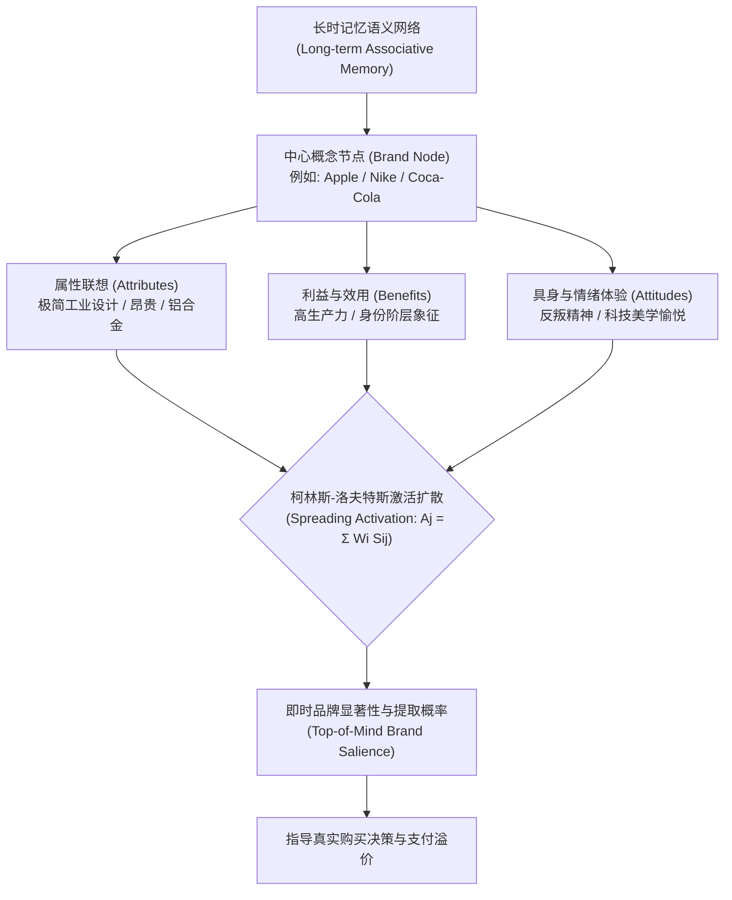

# Lec 3 记忆图式、联想网络与品牌表征

> MIT 9.55 / 15.8471 · 消费者行为学 · 主讲团队

## TL;DR

- **心智联想网络的拓扑构型**：基于柯林斯-洛夫特斯激活扩散模型，品牌在消费者长时记忆中被表征为由概念节点与带权突触连接构成的语义联想网络。
- **基于顾客的品牌资产（CBBE 模型）**：凯文·凯勒（Keller 1993）将品牌资产形式化为两大维度：品牌知晓度（再认 vs. 回忆）与品牌联想图谱（强度、偏好度与独特性）。
- **图式适度不一致效应**：曼德勒（Mandler 1982）证实完全一致引发无聊低加工，极端不一致引发防卫排斥，唯有“适度不一致”（Moderate Incongruity）能激发出最强烈的认知精细加工与积极好感。
- **商业外观与商标混淆的认知量化**：商业外观（Trade Dress）不仅是外观设计专利，更是心智记忆提取线索；感知几何相似度直接决定了神经提取时的假阳性混淆率。

## 1. 核心问题

- **心智中的无形资产本质**：当两瓶化学成分完全相同的可乐贴上不同商标时，为什么消费者盲测时偏好均匀分布，而一旦看到品牌标志，功能性磁共振成像（fMRI）中海马体与腹内侧前额叶（vmPFC）的多巴胺奖赏回路会发生剧烈不对称爆发？
- **记忆提取与激活扩散动力学**：在数十万个商品符号的记忆海洋中，一个促销刺激或环境线索是如何沿着语义联想网络自发扩散并点亮特定品牌的？
- **品牌延伸与资产稀释的认知边界**：高端奢侈品牌推出平价副线或跨界进入全新产品品类时，是会通过跨品类图式借力腾飞，还是会因概念冲突导致核心品牌网络的突触权重发生不可逆的退化与稀释（Dilution）？

在认知心理学视角下，品牌并不是印在纸盒上的商标，而是牢牢扎根在人类长时记忆系统中的动态拓扑知识图谱。消费者对任何商业实体的认知，本质上都是在大脑语义网络中进行的一场电信号扩散寻路。中心概念节点与属性节点、情绪节点以及具身体验节点之间错综复杂的带权连接，共同决定了一个品牌在关键决策时刻能否被瞬间点亮：



## 2. 核心概念

| 概念 | 一句话定义 | 易混淆对象 |
|---|---|---|
| **联想网络记忆模型（Associative Network Model）** | 将长时记忆表征为相互连接的概念节点网络，信息提取表现为电位沿带权连接扩散激活的过程 | 简单的计算机关系型数据库表格 |
| **品牌知晓度（Brand Awareness）** | 消费者在不同提示线索下确认或主动回忆出该品牌的心理能力，涵盖再认（Recognition）与回忆（Recall） | 单纯的广告曝光展示次数（Impressions） |
| **品牌形象（Brand Image）** | 消费者记忆中关于特定品牌的联想节点集合，由联想强度、偏好度与独特性三维向量决定 | 企业的公关通稿或视觉设计规范（VI） |
| **适度不一致效应（Moderate Incongruity Effect）** | 新产品刺激与已有心理图式存在适度认知冲突时，能最大化激发解决谜题的认知快感与评价好感 | 完全契合原型（Assimilation）或彻底离经叛道（Anomaly） |
| **商业外观（Trade Dress）** | 商品或包装的整体视觉形象与物理构型（如可口可乐弧形瓶、蒂芙尼蓝盒），在心智中充当法定的专有识别线索 | 注册文字商标（Word Mark） |

## 3. 证据链

### 3.1 神经品牌学的经典验证：McClure et al. (2004, Neuron)

塞缪尔·麦克卢尔与里德·蒙塔古等人在神经科学权威期刊《神经元》（*Neuron*）发表了震惊营销学界的功能性磁共振成像（fMRI）实证研究，解构了著名的“百事悖论”（Pepsi Paradox）。

#### 实验设计与双轨脑成像

研究招募健康受试者，在磁共振扫描舱内进行两种不同的饮料品尝任务：

```text
品尝任务 A: 匿名双盲测试 (Blind Taste Test)
受试者仅品尝标注为 "Drink 1" 与 "Drink 2" 的可口可乐与百事可乐
脑成像记录: 腹侧被盖区与腹侧纹状体 (Ventral Striatum) 奖赏反应
行为偏好: 两者偏好各占约 50%, 百事略占微弱优势

品尝任务 B: 显性品牌测试 (Semi-blind / Brand-cued Taste Test)
受试者在品尝前看到明确的视觉商标: "这是可口可乐" vs. 匿名饮料
脑成像记录: 海马体 (Hippocampus) 与背外侧前额叶 (dlPFC) 强烈暴发
行为偏好: 超过 75% 的受试者坚定声称可口可乐口感远胜对方!
```

#### 关键神经数据与理论洞见

- **腹侧纹状体（感官驱动）**：在盲测中，饮料的糖分与碳酸刺激激活了初级味觉皮层与腹侧纹状体，两者的物理神经反应幅度高度吻合，反映了底层生物口感的无差别；
- **前额叶与海马体（文化记忆重塑）**：当“可口可乐”的商标亮起时，与情景记忆提取相关的海马体以及负责高阶认知评估的背外侧前额叶（dlPFC）放电量产生压倒性激增；
- **核心结论**：**“品牌”绝非纯粹的外部符号，而是在大脑皮层中重塑初级感官神经反应的物理实体**。强大的品牌联想网络自上而下改写了消费者在神经回路层面的主观味觉体验。

---

### 3.2 基于顾客的品牌资产结构：Keller (1993) CBBE 范式

达特茅斯学院凯文·莱恩·凯勒（Kevin Lane Keller）在《营销杂志》（*Journal of Marketing*）奠定了现代品牌资产的认知测量基石。

#### CBBE 认知金字塔的量化矩阵

凯勒指出，品牌在心智中的资产并不体现在企业资产负债表上，而是体现在消费者面对同一营销刺激时所展现出的**差异化心理反应（Differential Effect）**。如果面对同样的功能与价格，消费者因为商标名称而愿意支付更高的溢价或给予更高的宽容度，该品牌即具备正向的基于顾客的品牌资产（CBBE）。

在认知建构的动力学链条上，品牌资产表现为一座层层递进、逻辑互锁的四阶心智金字塔。品牌必须首先在底层确立绝对的识别显著性，随后沿理性功能与感性情感两条平行轨道向上攀升，最终在金字塔顶端实现高粘性的心理共鸣：

```text
                     [ 4. 品牌共鸣 (Resonance) ]
                      忠诚度、依恋感、社群归属与主动参与
                                  ^
                                  |
            [ 3. 消费者反应: 品牌判断 (Judgments) & 情感感受 (Feelings) ]
                 质量、信赖度、优越感 vs. 温暖、趣味、安全感
                                  ^
                                  |
            [ 2. 品牌含义: 性能表现 (Performance) & 品牌形象 (Imagery) ]
                 功能性属性、耐用性、价格 vs. 用户肖像、购买语境
                                  ^
                                  |
                     [ 1. 品牌显著性 (Salience) ]
                 深层与宽广的品牌知晓度: 在购买时能否被轻易提取?
```

金字塔的四个层级系统回答了消费者在建立品牌关系时依次面临的四大根本性认知追问：
1. **身份识别（Who are you?）**：确立品牌显著性（Salience），解决在目标消费场景下能否被瞬间提取（Recall & Recognition）的根本门槛；
2. **意义建构（What are you?）**：构建由理性性能表现（Performance）与感性视觉形象（Imagery）共同支撑的双轨品牌含义；
3. **主观反应（What about you?）**：引发消费者的理性价值判断（Judgments，如可靠度、优越性）与感性情绪共鸣（Feelings，如安心、自豪）；
4. **终极关系（What about you and me?）**：达到最高阶的品牌共鸣（Resonance），形成具有极高转换成本的认知与行为忠诚闭环。

---

### 3.3 图式适度不一致效应：Mandler (1982) 与 Meyers-Levy & Tybout (1989)

在消费者心智中，既有经验已经被高度压缩并归类为各类先验心理图式（Schemata）。当企业推出全新概念的产品时，消费者的心理图式是如何进行同化（Assimilation）与顺应（Accommodation）的？

乔治·曼德勒（George Mandler）提出了著名的**图式不一致性评估假说**：新输入信息与消费者先验预期之间的偏差程度，并非单调递减地决定消费评价，而是呈现出极其微妙的非线性动力学关系。

#### 实验设计与假设检验

为了验证新产品认知图式偏差对消费态度形成的因果机制，琼·迈耶斯-利维与艾丽斯·泰博特在《消费者研究杂志》（*Journal of Consumer Research*）上设计了一项经典的无酒精软饮料评价实验。研究团队预先对目标群体的基线心理图式进行了严格的心理测量，确认受试者对“清凉碳酸汽水”的原型预期包含“甜味、果味、提神、消暑”等核心属性。

随后，实验精确操纵了新产品广告文案中的属性组合，构筑了三个认知冲突梯度，并在事后通过“思维列举技术”（Thought-listing protocol）全面记录受试者的认知加工耗时与情绪反应极性：

```text
一致性实验条件配置 (3 组平行对照):
+-------------------------------------------------------------+
| 条件 1: 高度一致 (Congruent)                                |
| 描述: "这是一款新型全天然气泡柠檬汽水"                      |
| 认知加工: 毫无意外, 自动化归入已有汽水图式 (无深度思考)       |
| 评价结果: 好感度平平 (中等)                                 |
+-------------------------------------------------------------+
| 条件 2: 适度不一致 (Moderately Incongruent)                 |
| 描述: "这是一款新型无酒精汽水, 但添加了草本矿物提取物与微量发酵原汁" |
| 认知加工: 引发认知失谐, 激发起轻度猜谜的好奇心, 经思考后成功同化   |
| 评价结果: 好感度最高! 唤醒积极评价与极高购买意愿 (p < 0.01)   |
+-------------------------------------------------------------+
| 条件 3: 极端不一致 (Extremely Incongruent)                 |
| 描述: "这是一款新型无酒精汽水, 由牛排浓缩肉汤冷萃并充入高压二氧化碳" |
| 认知加工: 图式彻底崩溃, 无法通过现有网络解释, 产生恶心与防御抵触 |
| 评价结果: 评价断崖式暴跌, 品牌排斥度爆表                    |
+-------------------------------------------------------------+
```

实验测量涵盖了多项互为印证的核心指标：
- **认知精细加工深度（Cognitive Elaboration）**：在适度不一致组中，受试者产出的有效思考项（Cognitive Thoughts）数量显著多于高度一致组（$p < 0.01$），表明认知冲突成功激活了系统 2 的推理机制；
- **积极思维比率（Valence Ratio）**：更关键的是，适度不一致组在经过轻度思索完成图式同化后，产生的积极思维比例高达 72%，远超高度一致组的 45%；
- **操纵校验（Manipulation Check）**：确认了受试者确实感知到了不同程度的品类典型性（Category Typicality）偏离，确立了图式冲突程度与主观评价之间的真实因果关系。

#### 倒 U 型曲线与认知解谜快感

数据证实了经典的心智**倒 U 型曲线（Inverted-U Curve）**：
- 人类大脑本质上是一台“追求适度预测误差（Moderate Prediction Error）”的机器；
- 适度不一致迫使前额叶投入中等强度的认知算力进行图式重组。当消费者最终在大脑中成功找到了一个合理解释（“原来草本发酵可以带来独特的解腻口感！”）时，认知闭合释放了内源性多巴胺奖赏，使得适度不一致的产品在货架上获得了最佳的市场好感。

---

## 4. 理论之争与计算模型

### 4.1 激活扩散动力学方程：Collins & Loftus (1975)

在认知语义网络中，品牌联想的提取不是静态查表，而是一个高度动态的连续激活能量扩散过程。

设消费者心智网络包含 $N$ 个离散概念节点。在时间步 $t$，节点 $j$ 的净激活水平 $A_j(t)$ 取决于其内部自发衰减率、外部感觉刺激输入以及相连所有邻居节点的带权能量输入：

$$A_j(t) = \gamma \cdot A_j(t-1) + I_j(t) + \sum_{i \in \text{Neighbors}(j)} W_{ij} \cdot \max(0, A_i(t-1) - \theta_i)$$

其中：
- $\gamma \in (0, 1)$ 为激活衰减系数（Decay Rate），模拟工作记忆的时间遗忘；
- $I_j(t)$ 为当前物理环境提供的直接知觉输入（如消费者恰好看到一抹红色或听到一段熟悉的广告旋律）；
- $\theta_i$ 为节点 $i$ 的激活激发阈值（Threshold），只有当相邻节点的能量超过阈值，才能向外扩散；
- $W_{ij}$ 为节点 $i$ 与节点 $j$ 之间的突触联想强度（Associative Strength）。

```text
激活扩散拓扑示意图:
[ 外部线索: 炎热夏天 ] ---> (口渴 节点)
                               |  W = 0.85
                               v
                     [ "清凉解渴" 概念 ]
                        /          \
              W = 0.92 /            \ W = 0.78
                      v              v
            (可口可乐 节点)        (纯净水 节点)
                |
       W = 0.88 | (迅速超越提取阈值 θ)
                v
         [ 最终购买行动 ]
```

这种拓扑结构深刻揭示了商业竞争的真谛：**营销并不是孤立地高喊自己的名字，而是抢占高频日常生活场景（如“熬夜加班”、“送礼尊贵”）向核心品牌节点的高权重连接通路**。

---

### 4.2 商业外观（Trade Dress）与商标混淆的认知距离模型

在商业法律与知识产权实践中，仿冒侵权的核心争议在于是否构成“消费者混淆的可能性（Likelihood of Confusion）”。

认知科学利用**多维空间测地线距离（Multidimensional Scaling, MDS）**将商业外观形式化。设受试者在颜色空间（CIE $L^*a^*b^*$）、几何拓扑包络（Aspect Ratio, Curvature）与字形拓扑上对正品 $A$ 与山寨品 $B$ 进行特征向量表征：

$$D_{\text{Perceptual}}(A, B) = \left( \sum_{k=1}^K w_k |f_{k, A} - f_{k, B}|^r \right)^{1/r}$$

根据谢泼德普遍知觉定律（Shepard's Universal Law of Generalization），两款商品在心智中被判定为来自同一来源的**错误泛化概率（Generalization Probability）**呈指数衰减：

$$P(\text{Confuse } B \text{ with } A) = \exp\left( -c \cdot D_{\text{Perceptual}}(A, B) \right)$$

- 当山寨品牌（如山寨饮料“雷碧”）在瓶身绿色色号、黄色斜体字标与包装长宽比上将距离控制在极小区间时，系统 1 启发式扫视将在毫秒级提取中直接判定为同一节点，完成搭便车式的无意识购买。

---

## 5. 分析层次的整合

| 系统层次 | 核心研究维度 | 本讲关键机制与实证 |
|---|---|---|
| **计算理论层（Computational Theory）** | 长期经验统计概率在心智中的高效压缩存储 | 概念图式化（Schematization）：通过聚类压缩降低环境记忆熵，最大化信息检索速度 |
| **算法与表征层（Algorithm & Representation）** | 联想节点网络与带权连接的拓扑动力学 | 柯林斯-洛夫特斯激活扩散模型；适度不一致的预测误差计算；MDS 商业外观混淆几何 |
| **生理与物理实现层（Physical & Empirical Implementation）** | 神经回路突触增强、fMRI 奖赏映射与盲测分离 | 海马体记忆提取与 dlPFC 价值重组；腹侧纹状体初级味觉多巴胺响应；商标法外观专有权判定 |

#### 层次小结

从神经科学舱内多巴胺回路的明暗反转，到语义网络中电位沿着联想权重的静默扩散，再到反不正当竞争法庭上对商业外观微小色差的严密辩论，记忆图式为我们揭开了“品牌价值”这一商业神秘主义概念的唯物面纱。计算层解释了心智为什么必须依赖图式进行经验压缩；算法层提供了检索与混淆的精确预测公式；物理层则证明，商业竞争的最深战场，早已铭刻在大脑海马体与前额叶的神经网络突触之中。

---

## 6. 边界条件与失效情形

- **品牌联想的“回飞镖效应”（Backlash / Dilution Effect）**：
  当一个以“极致专业与硬核”著称的高科技品牌，过度延伸至时尚生活消费品时，原有的紧凑联想网络会被强行拉伸。认知实验表明，跨品类延伸往往不会增加母品牌的资产，反而会显著稀释核心属性节点的联想强度（$W_{ij}$ 显著下降），导致老用户产生严重的认知失谐与身份背叛感。
- **高卷入度决策下的图式穿透（Involvement Modulations）**：
  在购买房产、重疾险或核心工业设备等大额高卷入度交易中，消费者的前额叶认知监控被强制拉满，系统 2 介入深入的数据审查与独立尽职调查。此时，基于品牌外观与浅层语义网络的自动激活扩散将被强制阻断，理性事实与客观合同将击穿品牌的虚幻光环。
- **跨文化联想网络的符号断裂**：
  同一个颜色或命名在不同文化社群中连接的语义图式完全不同。例如，白色在西方图式中强力连接“纯洁、婚礼”，在部分东亚传统图式中却深度连接“丧葬、衰亡”。如果企业忽视跨文化网络的拓扑异构性，机械套用母国联想网络，将导致严重的商业灾难。

---

## 7. 课程内外的横向关联

- **承接 Lec 2（注意与感觉知觉）**：Lec 2 探讨了外部物理刺激如何穿透注意瓶颈；本讲则探讨这些刺激留下的长期记忆沉淀——感官碎片如何凝固为长时记忆中的联想图式。
- **启示 Lec 4（双系统与启发式）**：激活扩散模型中超过阈值的自动化提取，正是下一讲卡尼曼“系统 1 直觉引擎”的核心运作底层；而克服图式惯性进行理性推演，则依赖系统 2 的主动抑制。
- **横向跨学科映射**：
  - 与 **MIT 9.012（认知科学）** 中的语义记忆（Semantic Memory）与概念形成模型深度对齐；
  - 呼应 **MIT 15.810（营销管理）** 中的品牌定位（STP）与品牌资产量化评估工具。

---

::: insight
### 认知科学家的心智诊断：驻留在他人大脑中的神经图腾——品牌的物理实质

商学院的教授们总是喜欢把“品牌”描绘成某种玄妙的、甚至带有形而上学神性光环的企业图腾。

但如果我们将一位受试者推入功能性磁共振成像仪的强磁场中，剥离掉所有的包装与广告滤镜，品牌的残酷物理实质便展露无遗：

所谓品牌，不过是一群被商业刺激反复强化、在消费者大脑皮层中物理共振的特定神经元集群。

当可口可乐的红白弧线映入眼帘，视觉皮层以不到 100 毫秒的速度将电信号沿着颞叶腹侧通路向内爆破，瞬间点燃海马体中关于童年圣诞、夏日冰块、乃至好莱坞电影的复杂突触网络。那一瞬间，前额叶皮层释放的多巴胺，在物理层面上直接篡改了舌头上味蕾传来的真实神经电位。

这正是现代消费社会最惊心动魄的认知工程奇观：

企业所有的厂房、生产线、原材料都会折旧、报废和毁坏；唯有那些通过精密的联想网络设计、成功在数亿陌生人心智中植入的语义神经回路，能够在物理世界中历经百年风雨，持续不断地向现实世界抽取着令人惊叹的信任与真金白银。
:::

---

## 8. 思考题与自测

### 思考题

1. **神经营销学的双盲分离逻辑**：在 McClure et al. (2004) 的可乐实验中，为什么在匿名盲测与显名品牌测试中，大脑激活的神经区域会从“腹侧纹状体”戏剧性地转移到“海马体与前额叶”？这一转移向我们揭示了消费决策中感官与文化的何种关系？
2. **曼德勒图式不一致效应的商业实践**：某高档智能手表品牌计划推出一款全新的奢华健康戒指。在产品发布会上，如果营销团队将其完全宣传为“一款缩小版的手表”（高度一致），或者宣传为“一款能代替医院全身核磁的魔术指环”（极端不一致），为什么都无法取得理想效果？请依据适度不一致理论给出最优定位方案。
3. **商业外观侵权的认知科学抗辩**：假设一家新兴糖果公司生产了一款长条形巧克力威化，其包装采用了与雀巢“奇巧”（KitKat）极度相似的红白配色与四指排列构型，但其上方印着完全不同的注册英文商标“ChocoSnap”。原告律师在法庭上应如何运用多维空间知觉距离与系统 1 激活扩散理论，证明该产品构成侵权混淆？

### 参考答案

<details>
<summary>点击展开详细解析</summary>

1. **初级感官与高阶文化知识的双系统解耦**：在双盲测试中，由于缺乏外部品牌提示，受试者的大脑只能依赖味觉受体输入的化学信号，初级味觉皮层将信号投射至腹侧纹状体（负责直接生物学奖赏评估），此时两款可乐带来的主观口感在神经生理层面几乎无差异。然而，一旦出现“可口可乐”视觉标志，大脑的长时记忆语义网络被瞬间唤醒，海马体（情景记忆提取）与背外侧前额叶（社会评价与认知控制）开始强势介入。前额叶的高阶文化信念反向重塑了感官加工流，自上而下地向味觉系统施加了强烈的正向先验期望，证实了文化知识能够在神经解剖层面上直接压倒底层的物理感知。
2. **适度不一致激发的认知闭合多巴胺溢价**：如果宣传为“缩小版手表”，产品与用户既有认知图式高度一致，完全没有认知新意，无法诱发系统 2 的注意力分配，消费者只会觉得这是一个平庸的衍生品；如果宣传为“替代医院核磁”，与常识存在极端无法调和的图式冲突，消费者会本能地将其归入“虚假宣传或伪科学骗局”，激起强烈的认知防御与厌恶。最优策略是**构建适度不一致**——例如定位为“一款隐形的健康哨兵：它像高级珠宝一样优雅沉默，但在皮肤贴合处却藏着比手表更精密的光电传感器”。这既打破了传统戒指只是装饰的单调图式（制造轻度惊奇），又提供了合理的同化逻辑（手表传感器的微型化演进），让消费者在恍然大悟的顿悟中获得最高的心智评价。
3. **前注意知觉同化与系统 1 误导论证**：原告应主张：消费者的日常购买行为发生在时间极度紧迫的零售终端环境中（平均决策时间不足 2 秒）。在此场景下，系统 1 依托整体视觉外观（Trade Dress）进行启发式快速扫描，而不是逐字拼读商标文本。雀巢 KitKat 的红白配色比例、四指巧克力几何排列已经形成了极强的心智专有性。根据谢泼德普遍知觉距离模型，被告在色彩与几何包络空间上与原告的距离极其微小，在柯林斯-洛夫特斯网络中具有压倒性的提取先验。消费者在眼动扫视甚至来不及看清“ChocoSnap”字样时，就被自底向上的视觉外观直接误导放进购物车，客观构成了实质性的认知混淆。
</details>

---

## 9. 开放问题与前沿探索

- **脑机接口（BCI）时代的品牌心智直接读写**：当未来神经接口能够直接读取消费者的记忆表征并跳过视听觉感知时，品牌资产评估能否从传统的问卷调查与眼动实验，演变为对大脑连接组中特定拓扑突触权重的直接物理计量？
- **生成式 AI 对品牌语义网络的自动化重塑**：现代大语言模型（如 ChatGPT）作为全球消费者的信息入口，其内部的词嵌入向量距离正在成为新的数字心智战场。品牌公关如何通过优化 LLM 的训练语料拓扑，防止本品牌在 AI 生成的回答中被竞争对手的语义节点所覆盖？

---

## 10. 参考文献与延伸阅读

- **品牌认知与记忆经典文献**：
  - Collins, A. M., & Loftus, E. F. (1975). A spreading-activation theory of semantic processing. *Psychological Review*, 82(6), 407–428.
  - Keller, K. L. (1993). Conceptualizing, measuring, and managing customer-based brand equity. *Journal of Marketing*, 57(1), 1–22.
  - McClure, S. M., Li, J., Tomlin, D., Cypert, K. S., Montague, L. M., & Montague, P. R. (2004). Neural correlates of behavioral preference for culturally familiar drinks. *Neuron*, 44(2), 379–387.
  - Mandler, G. (1982). The structure of value: Accounting for taste. In M. S. Clark & S. T. Fiske (Eds.), *Affect and cognition* (pp. 3–36). Lawrence Erlbaum.
- **前沿拓展与应用文献**：
  - Meyers-Levy, J., & Tybout, A. M. (1989). Schema congruity as a basis for product evaluation. *Journal of Consumer Research*, 16(1), 39–54.
  - Aaker, D. A., & Keller, K. L. (1990). Consumer evaluations of brand extensions. *Journal of Marketing*, 54(1), 27–41.
