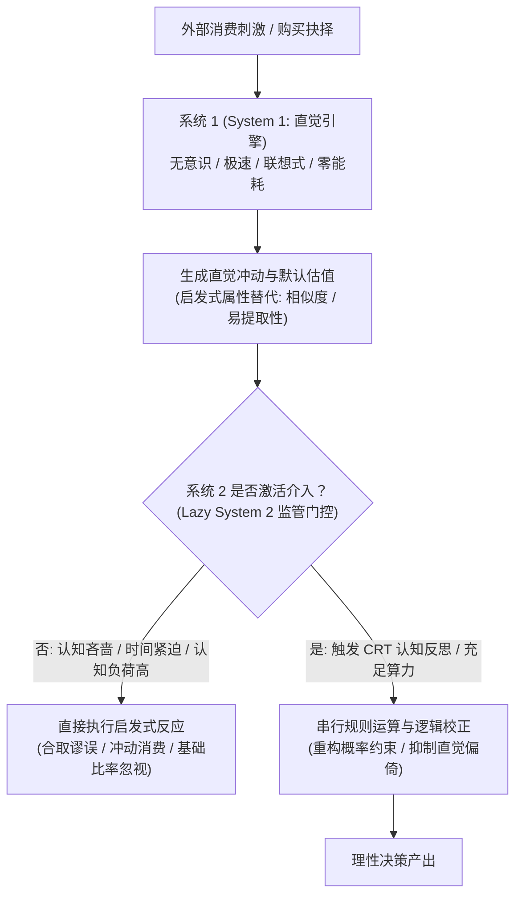

# Lec 4 双系统理论与启发式决策

> MIT 9.55 / 15.8471 · 消费者行为学 · 主讲团队

## TL;DR

- **双系统认知架构**：卡尼曼与弗雷德里克确立了人类心智的双轨结构——快速自动化的“系统 1 直觉引擎”与缓慢串行的“系统 2 深思监督者”，后者因代谢功耗高昂而常态处于“认知吝啬”（Cognitive Miser）的懒惰休眠状态。
- **认知反思测试（CRT）**：肖恩·弗雷德里克（Frederick 2005）通过极简的三题球棒范式量化了个体抑制系统 1 直觉冲动的能力，其实验得分直接预测消费者的跨期贴现率与冲动消费倾向。
- **可得性与提取流畅度**：特沃斯基与卡尼曼（1973）及施瓦茨（1991）证实，概率估算并非基于客观统计样本，而是取决于回忆时的“主观提取容易度”（Ease of Retrieval），生动营销直接篡改了风险感知。
- **代表性启发式与合取谬误**：经典的“琳达问题”（Linda Problem）揭示人类心智本能地以“原型相似度”取代“逻辑包含律”，导致消费者在复合宣传中坚信“有机+天然纯素”比单纯“天然”更可能发生（$P(A \cap B) > P(A)$）。

## 1. 核心问题

- **认知能量与演化权衡**：人类大脑仅占体重的 2%，却消耗机体 20% 的葡萄糖代谢能量。在日常繁杂琐碎的消费环境中，心智如何通过将 95% 以上的决策交由无意识启发式处理，以避免系统 2 算力过载与神经崩溃？
- **属性替代与直觉偷梁换柱**：当消费者面临一个极难计算的“目标问题”（如“这款车未来的机械故障率究竟有多高？”）时，大脑是如何在潜意识中悄然用一个极其容易回答的“启发式问题”（如“我能立刻想起邻居那辆同款车抛锚的生动画面吗？”）进行偷梁换柱的？
- **系统 2 的监管失效机制**：为什么即便受过高等教育的名校 MBA 学生或资深金融分析师，在面对精心设计的语言描述时，依然会系统性地违反概率论与集合论的最基本公理？



## 2. 核心概念

| 概念 | 一句话定义 | 易混淆对象 |
|---|---|---|
| **双系统理论（Dual-Process Theory）** | 将人类心智划分为快速自主的直觉加工（系统 1）与缓慢受控的深思加工（系统 2）的认知分层模型 | 生理学上的左脑与右脑解剖结构 |
| **属性替代（Attribute Substitution）** | 决策者在评估一个复杂的计算目标属性时，潜意识中自发将其替换为一个更容易提取的启发式属性的机制 | 故意欺诈或偷换概念的逻辑辩论 |
| **认知反思测试（CRT）** | 测量个体抑制直觉诱惑性错误答案并调动系统 2 运算能力的认知倾向性量表（如著名的“球棒与棒球”问题） | 传统的通用智商测试（IQ / G-factor） |
| **可得性启发式（Availability Heuristic）** | 根据某类事件的事例在心智中被提取回想起来的容易程度来评估该事件发生概率的心理捷径 | 客观先验概率分布（Objective Base Rates） |
| **合取谬误（Conjunction Fallacy）** | 人类错误地认为两个独立事件的交集（$A \cap B$）比其中单个事件（$A$）发生的可能性更高的逻辑错误 | 简单的相关性误判 |

## 3. 证据链

### 3.1 认知反思测试（CRT）与冲动折现：Frederick (2005)

传统心理测量学长期依赖韦氏智力量表（WAIS）或 SAT/ACT 等通用标准化考试来度量人类的智商（IQ）。然而，MIT 斯隆管理学院教授肖恩·弗雷德里克（Shane Frederick）敏锐地指出，高智商并不等同于理性的决策者。许多能够熟练解出复杂微积分方程的优秀学者，在面对日常生活中的折扣诱惑、信用透支或推销骗局时，依然会像普通人一样迅速缴械投降。

这一现象的根本原因在于：传统智力测验衡量的是系统 2 的**最大计算算力（Maximum Cognitive Capacity）**，但在真实消费情境中，更为关键的瓶颈在于系统 2 的**启动倾向上（Cognitive Willingness / Monitoring Disposition）**——即个体在直觉冲动跃入脑海的瞬间，是否有能力和意愿按下“暂停键”，调动理性资源去反思和否定第一直觉。

#### 极简的三题 CRT 范式

为了在极低的时间成本下精准测量这种认知反思倾向，弗雷德里克在 2005 年发表于《经济展望杂志》（*Journal of Economic Perspectives*）的论文中设计了著名的三题测试。这三道题目在纯数学难度上不超过小学高年级算术水平，但其精妙之处在于每一道题都为系统 1 精心预设了一个极度诱人、看似显然却完全错误的“直觉反射陷阱”。

在实验设计阶段，弗雷德里克对比了数十道潜在的候选数学难题，发现绝大多数传统难题需要复杂的因式分解或运算法则，这混淆了“运算技能”与“反思监控”。最终入选的三道经典题目，其核心特征在于题干极短、数字极小、无需草稿纸即可在脑海中完成心算，但在阅读完毕的最初一瞬间，错误的直觉答案具有几乎无法抗拒的心理显著性：

```text
CRT 核心测试题干与双系统反应模式:
+------------------------------------------------------------------------------------+
| 题目 1: 球棒与棒球问题 (Bat and Ball)                                               |
| 题干: 一根球棒和一个棒球总共售价 1.10 美元。球棒比棒球贵 1.00 美元。请问棒球多少钱? |
| 系统 1 直觉冲动答案: 10 美分 ($0.10)  ---> [ 典型错误! 此时球棒为 1.10, 总价为 1.20 ] |
| 系统 2 运算校正答案: 5 美分 ($0.05)   ---> [ 方程: x + (x + 1.00) = 1.10 => x = 0.05 ] |
+------------------------------------------------------------------------------------+
| 题目 2: 机器与零件问题 (Widget Machines)                                           |
| 题干: 5 台机器制造 5 个零件需要 5 分钟。请问 100 台机器制造 100 个零件需要多少分钟? |
| 系统 1 直觉冲动答案: 100 分钟        ---> [ 典型直觉线性比例套用错误 ]                |
| 系统 2 运算校正答案: 5 分钟          ---> [ 单机速率为 1 件/5 分钟, 100 台并行仍需 5 分钟 ] |
+------------------------------------------------------------------------------------+
| 题目 3: 睡莲蔓延问题 (Patch of Lily Pads)                                          |
| 题干: 湖面上长有一片睡莲。睡莲每天覆盖面积翻倍。若 48 天能完全覆盖湖面, 覆盖半个湖面要多少天? |
| 系统 1 直觉冲动答案: 24 天           ---> [ 典型将指数演化误读为简单除法 ]            |
| 系统 2 运算校正答案: 47 天           ---> [ 逆向递推: 第 48 天的一半即为前一天 ]       |
+------------------------------------------------------------------------------------+
```

深入剖析这三道题目的认知工效学，可以发现其背后的心智设计哲学：
- **题目 1 的模式匹配漏洞**：题目巧妙利用了 1.10 与 1.00 的自然数字差值。人类语言系统将“1.10 美元拆分成 1 美元和 10 美分”作为一种极高频的日常语音习惯，直觉引擎顺理成章地将 10 美分指派给棒球，而完全忽视了“比……贵”所暗含的代数差值关系；
- **题目 2 的线性比例错觉**：系统 1 对成正比的数字序列（5 台、5 个、5 分钟）展现出高度的格式塔对称性偏好，当看到“100 台、100 个”时，直觉会本能地脱口而出“100 分钟”，跳过了对“生产率与机器并行性”的因果机理推导；
- **题目 3 的逆向时间推理障碍**：人类直觉极难理解非线性的指数级暴增过程。直觉系统在面对“覆盖一半”的需求时，唯一能够想到的简单算法就是将时间直接除以二（$48 / 2 = 24$），唯有系统 2 进行逆向时间反推（从第 48 天往前倒推 24 小时），才能领悟到前一天面积恰好是最终状态的一半。
- **神经赛跑动力学（Neural Race）**：在受试者读完题目的前 200 毫秒内，系统 1 依托语义模式匹配，瞬间将直觉答案推送到意识前台。此时若系统 2 处于懒惰休眠状态，受试者会在极短时间内给出自信满满的错误答案；唯有当冲突监测机制成功激活代数运算，正确答案才会被费力地生产出来。
- **多样本信度与跨院校对比**：弗雷德里克在 MIT、哈佛大学、密歇根大学安娜堡分校、托莱多大学以及 Bowling Green 等 9 组不同学术背景与社会阶层的受试者（总样本量 $N = 3,428$）中执行了该测试。数据表明，CRT 得分与受试者的大学入学考试成绩（SAT/ACT）的相关性仅处于中等水平（$r \approx 0.44$），证实它捕捉到了一种与纯粹抽象逻辑智力不同维度的核心心理特质——即面对直觉幻觉时的“认知警觉性”。

#### 实证数据与消费者时间偏好

弗雷德里克在包括 MIT、普林斯顿在内的全美数千名大学生与成年消费者中展开测试，揭示了惊人的认知异质性：
- 即使在 MIT 顶尖理工科学生中，全部三题答对率也仅为 48%，超过三分之一的学生至少落入一个直觉陷阱；
- **跨期时间贴现率（Time Discounting）的剧烈分离**：
  - CRT 得分为 0（完全被直觉支配）的受试者，在选择“现在拿 3400 美元还是一个月后拿 3800 美元”时，压倒性地选择**“现在立刻拿钱”**（年化隐含贴现率高达 200% 以上）；
  - CRT 得分为 3（系统 2 监管高度活跃）的受试者，绝大多数选择**“等待一个月获取更高利息”**；
- **核心结论**：消费者在金融储蓄、信用卡透支与冲动网购上的自控力匮乏，根本上源于系统 2 在面对即时诱惑时微弱的监控与反思阻截能力。

---

### 3.2 可得性启发式与提取流畅度：Schwarz et al. (1991)

诺伯特·施瓦茨（Norbert Schwarz）等人设计了一项极具革命性的实验，彻底澄清了可得性启发式的底层算法——**人们依赖的究竟是“提取出来的论据数量”，还是“提取时的主观难易体验”？**

#### 实验设计与流畅度操纵

受试者被随机分配到两个实验组，要求完成对自己“果断自信性格”（Assertiveness）的自我评估：
- **组别 A（低负荷组）**：列举出 **6 个** 自己在日常生活中表现得坚定自信的真实事例；
- **组别 B（高负荷组）**：列举出 **12 个** 自己在日常生活中表现得坚定自信的真实事例。
- 列举完毕后，受试者在 10 点量表上对自己的自信程度进行终极打分。

#### 震撼的实验反转

```text
主观自信评分 (Self-rated Assertiveness: 1-10)
7.0 |                        [ 组别 A: 列举 6 个事例 ]
6.5 |                        (轻松提取 -> 主观体验极顺畅)
6.0 |                        ===> 自我评分: 6.3 分 (极其自信!)
5.5 |
5.0 |   [ 组别 B: 列举 12 个事例 ]
4.5 |   (列到第 8 个后抓耳挠腮, 极度艰难)
4.0 |   ===> 自我评分: 5.2 分 (觉得自己很不自信!)
    +------------------------------------------------------------>
```

- **数据悖论**：组别 B 实际上回忆出了整整 12 个自信的铁证，客观证据量是组别 A 的两倍；但组别 B 对自己自信程度的评价却**显著低于**组别 A（$p < 0.005$）！
- **认知机制解密**：系统 1 在估算概率与特质时，依赖的是**元认知体验（Metacognitive Fluency）**。当受试者在列举第 9 或 10 个事例感到极其费劲时，系统 1 立即给出错误的归纳：“既然我想起一个例子这么难，那我肯定不是一个自信的人！”
- **商业映射**：当保险公司让消费者回想“过去遭遇财产损失的 10 个细节”时，反倒会降低其购买意愿；而仅要求其回想“1 个最可怕的意外”，由于提取体验极其轻松顺畅，购买意愿将瞬间暴增。

---

### 3.3 代表性启发式与合取谬误：Tversky & Kahneman (1983)

阿莫斯·特沃斯基与丹尼尔·卡尼曼在《心理学评论》（*Psychological Review*）发表了著名的“琳达问题”（Linda Problem），展示了人类心智对逻辑全称包含律的公开蔑视。

#### 实验题干与条件配置

受试者阅读一段关于虚构人物“琳达”的背景描述：
> *琳达，31 岁，单身，坦率直言，性格极其聪明。大学主修哲学。在学生时代，她深度关注反歧视与社会正义议题，并多次参与反核抗议示威游行。*

随后受试者对以下命题的可能性进行排序或概率打分：
- **命题 A**：琳达是一名银行出纳员（Linda is a bank teller）；
- **命题 F**：琳达是一名女权主义者（Linda is active in the feminist movement）；
- **复合命题 T & F**：琳达是一名**积极参与女权运动的银行出纳员**（Linda is a bank teller and is active in the feminist movement）。

#### 实验数据与逻辑击穿

- 在包含名校研究生、医生乃至统计学专业学者在内的大量受试者群体中，**超过 85% 的人坚定认定：复合命题 $T \& F$ 的可能性高于单一命题 $T$！**
- **逻辑公理的毁灭性践踏**：根据概率论基础集合包含律，任何两个事件的交集概率绝不可能大于包含它的单个父集概率：
  $$P(T \cap F) \le P(T)$$
  每一个女权主义银行出纳员，在物理上都百分之百属于“银行出纳员”的集合。
- **代表性机制剖析**：系统 1 在面临概率判断时，悄悄执行了**属性替代（Attribute Substitution）**。大脑并没有计算概率测度空间，而是计算了“琳达的肖像与女权主义者的原型特征匹配度”。由于“女权主义出纳员”比单纯冰冷的“出纳员”更能容纳前文的哲学背景，代表性评分更高，心智便毫不犹豫地抛弃了概率法则。

---

## 4. 理论之争与计算模型

### 4.1 属性替代框架的形式化：Kahneman & Frederick (2002)

卡尼曼与弗雷德里克将所有启发式偏差统一归结为一个精密的数学替代算子：

设决策者面临一个需要对目标刺激 $X$ 评估的复杂目标属性（Target Attribute）$Q(X)$（如真实风险概率、商品的长期耐用度、某项资产的客观期望回报）。

1. **启发式映射（Heuristic Mapping）**：
   目标属性 $Q(X)$ 在计算上极其昂贵或需要不可得的信息。系统 1 沿着联想网络，自动激活了一个与 $Q(X)$ 高度相关、但在知觉或记忆中极易提取的启发式替代属性（Heuristic Attribute）$S(X)$（如可得性流畅度、与原型的相似度、即时的情绪唤醒度）。
2. **直觉赋值（Intuitive Valuation）**：
   系统 1 直接以启发式属性的度量值充当目标属性的答案：
   $$\hat{Q}_{\text{System 1}}(X) = f(S(X))$$
3. **系统 2 的监管门控（System 2 Monitoring Gate）**：
   最终的决策输出 $Y$ 由系统 2 的监控函数 $\mathcal{M}$ 决定：
   $$Y = \begin{cases} \hat{Q}_{\text{System 1}}(X), & \text{if } \mathcal{M}(\text{Effort}, \text{Salience}, \text{CRT}) < \tau \\ g(X), & \text{otherwise (Deliberative Computation)} \end{cases}$$
   其中 $\tau$ 为激活阈值。在认知负荷沉重、时间压力大或个体 CRT 分数较低时，$\mathcal{M} < \tau$，系统 2 完全放行错误答案。

---

### 4.2 贝叶斯基准与基础比率忽视（Base Rate Neglect）

在处理分类概率时，人类心智对代表性启发式的滥用最集中地体现在对**客观基础比率（Base Rates）**的完全无视。

设某商品属于高质量类别为事件 $H$，低质量为 $L$。基础先验概率为 $P(H)$ 与 $P(L)$。商品呈现某种包装特征 $D$。根据贝叶斯定理，其后验概率应为：

$$P(H \mid D) = \frac{P(D \mid H) P(H)}{P(D \mid H) P(H) + P(D \mid L) P(L)}$$

```text
贝叶斯理性更新 vs. 代表性启发式偷换:
真实贝叶斯算法:  P(H | D) 依赖于 [先验概率 P(H)] 与 [似然比 P(D | H) / P(D | L)] 的共同乘积
系统 1 启发式算法: P(H | D) ≈ 相似度 Sim(D, Prototype_H)   [彻底丢弃先验 P(H)!]
```

- **市场操纵实例**：即使全行业有机认证的真实通过率仅为 1%（极低基础比率 $P(H) = 0.01$），只要包装上印有一枚设计精美、带有绿色麦穗和木纹手绘的标志（极高代表性特征 $D$），系统 1 会瞬间认定该商品是高品质正品的概率超过 90%，完全无视先验伪劣产品的泛滥程度。

---

## 5. 分析层次的整合

| 系统层次 | 核心研究维度 | 本讲关键机制与实证 |
|---|---|---|
| **计算理论层（Computational Theory）** | 复杂环境下计算资源受限的启发式替代与节约策略 | 属性替代框架（Attribute Substitution）：以廉价的相似度/流畅度代理高昂的全局概率积分 |
| **算法与表征层（Algorithm & Representation）** | 双系统分层监控与元认知体验评估机制 | CRT 认知反思运算门控；施瓦茨提取流畅度算法；特沃斯基琳达合取谬误 |
| **生理与物理实现层（Physical & Empirical Implementation）** | 额叶抑制控制脑区放电、瞳孔放大率与反应时 | 前扣带回（ACC）检测冲突；背外侧前额叶（dlPFC）压制直觉；红外瞳孔测量反映系统 2 代谢负荷 |

#### 层次小结

从神经细胞葡萄糖代谢的生理限制，到双系统属性替代的算法机制，再到现代营销对可得性与代表性偏差的精准收割，启发式决策向我们展示了“人类非理性”背后惊人的计算条理性。计算层揭示了心智偷懒的生态经济学必然；算法层给出了直觉替换逻辑的代数框架；物理层则用瞳孔放大与额叶脑电信号，证明了克服直觉诱惑所需付出的真实生理代价。

---

## 6. 边界条件与失效情形

- **自然频率表征对合取谬误的戏剧性纠偏**：
  盖德·吉仁泽（Gerd Gigerenzer）指出，如果将琳达问题中的抽象百分比概率改换为**自然频数（Natural Frequencies）**形式（例如：“在 100 个符合琳达描述的人中，有几个人是出纳员？有几个人是女权主义出纳员？”），受试者的合取谬误率从 85% 暴跌至 20% 以下。这表明人类大脑不是无法理解逻辑，而是进化出的认知模块天然适应频数统计而非抽象测度。
- **利益极度攸关与系统 2 强制唤醒**：
  当决策结果直接涉及受试者的巨额自身切身利益，或明确引入激烈的竞争淘汰压力时，系统 2 的监管门控 $\mathcal{M}$ 被大幅提高，启发式偏倚会受到显著抑制，理性概率权衡开始占领主导地位。
- **专业领域训练的特异性迁移障碍**：
  在特定领域（如专业统计学）训练有素的专家，在处理本专业数理问题时能保持极高的严谨性；但一旦脱离专业语境进入日常生活超市购物时，专家依然会毫无抵抗力地落入买一送一或代表性包装的认知陷阱。

---

## 7. 课程内外的横向关联

- **承接 Lec 3（记忆图式与品牌）**：Lec 3 探讨了长时记忆网络的静态拓扑结构；本讲则探讨系统 1 如何利用这些现存的联想突触，执行可得性与代表性的极速动态推断。
- **启示 Lec 5（锚定效应）与 Lec 6（前景理论）**：特沃斯基与卡尼曼归纳的第三大启发式——锚定与调整（Anchoring），将在下一讲展开极其惊人的深水区剖析；而前景理论则是对系统 1 价值非线性特征的全面数学形式化。
- **横向跨学科映射**：
  - 与 **MIT 9.00（心理学导论）** 中的思维与决策章节构成深层理论延伸；
  - 呼应 **MIT 15.810（营销管理）** 中的消费者沟通设计与风险知觉管理。

---

::: insight
### 认知科学家的心智诊断：古老节能引擎的现代困局——为什么我们注定会犯错？

在科学界所有的认知理论中，双系统理论大概是最容易被世俗误解、却又最令人着迷的学说。

现代人习惯于将“系统 1”贬斥为鲁莽、低级、充满偏见的原罪，而将“系统 2”奉为文明、理性、逻辑的神圣王冠。

然而，认知进化学告诉我们截然相反的事实：

系统 1 才是大自然最引以为傲的杰作。它在毫秒之间并行处理着几百万维度的物理感官输入，指挥着我们的每一次呼吸、每一次肌肉微调和每一次危险闪避。如果没有这台强大的自动化直觉引擎在后台默默承载 99% 的生存运算，那个脆弱、狭隘、每次只能处理一件事情的系统 2，在睁开眼的第一秒钟就会因为能量耗尽而彻底休克。

人类的悲剧并不在于拥有启发式直觉；

而在于我们用一副专为原始大草原狩猎演化出的节能硬件，猝不及防地跌入了由现代商业文明精密编织的符号迷宫中。

超市货架上的每一个发光标签、金融衍生品合同里的每一个复合修饰词、社交媒体上的每一条生动灾难推送，都在处心积虑地向我们的系统 1 投喂它最喜欢的属性替代诱饵。懂得这一点的观察者，在看到人类排队抢购毫无价值的纪念品时，不会再发出傲慢的嘲弄；在那荒谬的行为深处，他看到的是一颗古老的心智，在光怪陆离的现代商海中疲惫而忠诚地奔跑。
:::

---

## 8. 思考题与自测

### 思考题

1. **认知反思测试（CRT）的深层测量属性**：为什么 Frederick (2005) 坚持认为 CRT 衡量的不是传统智商（IQ），而是“认知冲动抑制力”？在消费决策场景中，一个高 IQ 但低 CRT 的消费者通常会表现出怎样的行为特征？
2. **施瓦茨流畅度实验的商业诊断**：一家豪华汽车品牌在进行广告调研时，要求试驾车主列出“购买该品牌汽车的 10 个决定性理由”。请依据 Schwarz et al. (1991) 的提取流畅度模型，预测该调研对车主后续品牌忠诚度的负面破坏效应，并给出改进方案。
3. **合取谬误在营销包装中的精准应用**：为什么某高端酸奶品牌在包装上打出“100% 纯天然牧场 + 有机生牛乳双认证”（复合命题 $A \cap B$），比单纯标注“100% 纯天然牧场”（单项命题 $A$）能向消费者索取高出 50% 的溢价？请用代表性启发式与属性替代框架进行理论拆解。

### 参考答案

<details>
<summary>点击展开详细解析</summary>

1. **反思监控与纯粹算力的解耦**：传统 IQ 测试测量的是在给定规则下解决复杂逻辑题目的“最大算力（Maximum Cognitive Capacity）”；而 CRT 测量的是“系统 2 是否具有足够的警觉性去激活（Typical Disposition to Question Intuition）”。在球棒问题中，求解一次方程 $x + (x+1) = 1.1$ 的数学难度小学五年级即可完成，高 IQ 者完全具备算力，但如果其缺乏认知反思特质，系统 2 就会极度懒惰地放行系统 1 抛出的“10 美分”直觉答案。在消费场景中，高 IQ 低 CRT 的消费者往往非常聪明、能言善辩，但却频繁陷入冲动消费、高杠杆金融投机或轻信天花乱坠的理财套路，并在事后动用强大的智商为自己的非理性冲动作出极其精妙的合理化辩护。
2. **提取艰难感引发的元认知怀疑**：要求列举 10 个理由是一项极度艰巨的任务。普通车主在写出第 3 或第 4 个理由（如外观漂亮、动力充沛）后，便陷入严重的认知搜寻停滞，提取流畅度（Processing Fluency）剧烈恶化。系统 1 依赖提取难度这一元认知体验进行自发归纳，车主会在内心产生怀疑：“如果我想出为什么买这辆车都这么困难，那这辆车可能并没有那么优秀！”这直接削弱了原有的品牌信念。改进方案：**减少提取负担至极限**——仅要求车主列出“1 个最让你心动的震撼瞬间”。极高的提取流畅度将让车主的大脑确信：“这个品牌简直完美无瑕！”
3. **原型匹配度对测度包含律的压制**：根据逻辑学，符合两项严格认证的产品范围必然比符合单项认证的范围更窄、概率更低。然而，根据卡尼曼的属性替代模型，消费者在快速做出购买判断时，大脑计算的并不是该声明在统计学上的真实概率，而是包装符号与心理“高端健康食品原型（Prototype）”的相似度。单纯标注“天然”只激活了初级的绿色图式；而“天然 + 有机双认证”构成了极度致密的高端健康联想丛林，极大地满足了代表性启发式的特征匹配需求。大脑潜意识用极高的“代表性评分”替换了“客观逻辑评估”，使消费者心甘情愿地为虚构的认知饱满感支付高额溢价。
</details>

---

## 9. 开放问题与前沿探索

- **移动互联网短视频对人类系统 1 的慢性塑形**：长期浸泡在几秒钟一次感官奖赏反馈的短视频与快节奏消费应用中，是否正在对现代人类前扣带回（ACC）与前额叶的突触连接进行慢性物理重塑，导致整个年轻一代的群体平均 CRT 得分发生不可逆的退化？
- **大语言模型的“系统 1 幻觉”与“系统 2 慢思考”**：基于自回归生成的传统 LLM 极易表现出类似于人类系统 1 的直觉合取谬误；而近期引入的思维链（Chain-of-Thought / CoT）与多轮规划推理机制，是否在人工硅基架构中完美复现了生物心智的系统 2 慢思考监控？

---

## 10. 参考文献与延伸阅读

- **双系统理论与启发式奠基文献**：
  - Tversky, A., & Kahneman, D. (1974). Judgment under uncertainty: Heuristics and biases. *Science*, 185(4157), 1124–1131.
  - Tversky, A., & Kahneman, D. (1983). Extensional versus intuitive reasoning: The conjunction fallacy in probability judgment. *Psychological Review*, 90(4), 293–315.
  - Frederick, S. (2005). Cognitive reflection and decision making. *Journal of Economic Perspectives*, 19(4), 25–42.
  - Kahneman, D., & Frederick, S. (2002). Representativeness revisited: Attribute substitution in intuitive judgment. In T. Gilovich, D. Griffin, & D. Kahneman (Eds.), *Heuristics and biases: The psychology of intuitive judgment* (pp. 49–81). Cambridge University Press.
- **前沿拓展文献**：
  - Schwarz, N., Bless, H., Strack, F., Klumpp, G., Rittenauer-Schatka, H., & Simons, A. (1991). Ease of retrieval as information: Another look at the availability heuristic. *Journal of Personality and Social Psychology*, 61(2), 195–202.
  - Evans, J. S. B. (2008). Dual-processing accounts of reasoning, judgment, and social cognition. *Annual Review of Psychology*, 59, 255–278.
