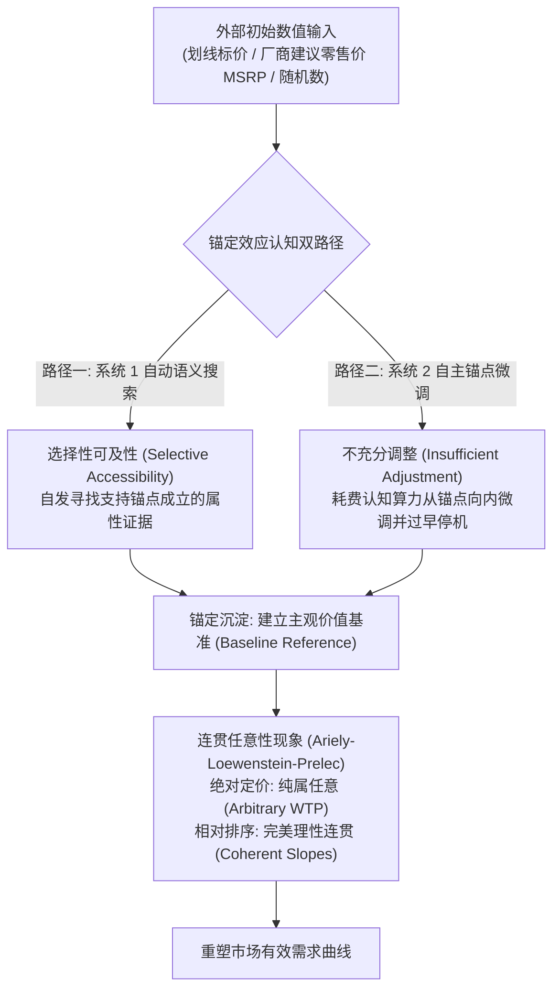
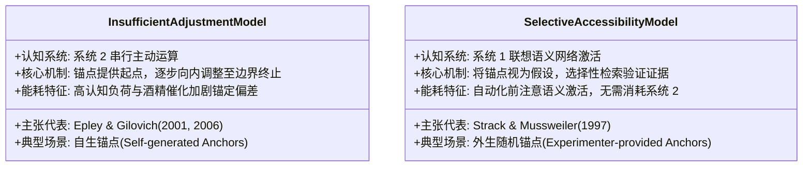

# Lec 5 锚定效应与连贯任意性

> MIT 9.55 / 15.8471 · 消费者行为学 · 主讲团队

## TL;DR

- **锚定与调整启发式**：特沃斯基与卡尼曼（1974）证实，面对不确定估计时，一个完全无关的初始随机数字（如幸运轮盘）会产生强大的引力，导致后续判断呈现系统性不充分调整。
- **选择性可及性模型**：施特拉克与穆斯韦勒（1997）揭示锚定的神经认知算法并非机械的微调，而是锚定值作为语义线索激活了特定联想证据（Selective Accessibility）。
- **连贯任意性假说（QJE 2003）**：阿里利、洛温斯坦与普雷莱克在 MIT 证实，消费者的社会保险号后两位随机数字可决定其对红酒与电子产品的支付意愿（WTP）；人们对商品的“绝对价值感”纯属任意构建，但不同分量间的“相对价格排序”却保持精密的理性连贯。
- **专家与专业市场的脆弱性**：诺思克拉夫特与尼尔（1987）证实资深房地产经纪人同样受到挂牌初始标价的强烈锚定，市场专业经验无法抵御底层认知渗透。

## 1. 核心问题

- **商品真实内在价值的虚妄性**：新古典微观经济学假设消费者内心对每一件商品都存在一条确定不变的保留价格曲线（Reservation Price）。然而，如果一个人的支付意愿可以被自己完全随机的身份证尾号轻易改变 100% 以上，商品所谓的“内在客观效用”是否根本只是一个虚构的幻象？
- **锚定作用的双重认知路径之争**：锚定效应究竟是系统 2 在串行计算时因为认知惰性而导致的“调整不充分”（Insufficient Adjustment），还是系统 1 在前注意阶段由确认性语义线索驱动的“选择性记忆激活”（Selective Accessibility）？
- **“连贯的任意性”对需求曲线理论的颠覆**：当初始估值完全来自外界偶然植入的随机锚点，而后续一系列衍生消费选择却表现出教科书般的理性传递性与边际效用递减时，微观经济学的需求曲线究竟是在测量消费者的预存偏好，还是在记录其自圆其说的心理合理化轨迹？



## 2. 核心概念

| 概念 | 一句话定义 | 易混淆对象 |
|---|---|---|
| **锚定效应（Anchoring Effect）** | 人类在定量估算时，不成比例地受到此前接触过的初始数值线索影响的系统性认知偏倚 | 单纯的从众效应（Social Conformity） |
| **连贯任意性（Coherent Arbitrariness）** | 消费者对某种体验或商品的绝对基准出价完全受偶然锚点支配（任意性），但面对不同数量或质量变体时却严格遵循理性边际替代规律（连贯性） | 彻底无规律的精神分裂式混乱选择 |
| **选择性可及性（Selective Accessibility）** | 决策者在检验锚定数值是否合情理时，心智自发偏向于激活与该锚定值一致的知识与属性证据 | 客观中立的双向假设检验（Hypothesis Testing） |
| **不充分调整（Insufficient Adjustment）** | 决策者明知锚点极度荒谬，试图离开锚点向真实区间逐步推演，但在刚触碰到心理可接受边界边缘时即过早终止搜索的认知惰性 | 拒绝做出任何调整的彻底固执 |
| **支付意愿（WTP） vs. 接受意愿（WTA）** | 消费者为获得某物品愿意支付的最大现金上限，与为出让同一物品要求获得的最低补偿下限 | 市场的客观供求平衡价格（Market Clearing Price） |

## 3. 证据链

### 3.1 经典转盘范式：Tversky & Kahneman (1974)

阿莫斯·特沃斯基与丹尼尔·卡尼曼在《科学》（*Science*）发表的开创性论文中，首次确立了锚定效应的实验室定量范式。

#### 实验设计与随机操纵

受试者面前放置着一个标有数字 0 到 100 的轮盘赌转盘。实验者通过暗中机关，使转盘在旋转后只能停在两个预设数字之一：
- **条件 1（低锚点组）**：轮盘指针停在数字 **10**；
- **条件 2（高锚点组）**：轮盘指针停在数字 **65**。

受试者被要求完成两个连续的评估步骤：
1. **比较性判断（Comparative Question）**：非洲国家在联合国的席位比例，是高于还是低于转盘停下的这个数字（10 或 65）？
2. **绝对估值判断（Absolute Estimation Question）**：你认为非洲国家在联合国的实际比例具体是多少？

#### 实证结果与锚定指数

受试者完全目睹了转盘旋转的物理过程，心知肚明该数字纯属随机偶发，但其实际估值展现了惊人的引力粘性：
- **低锚点组（转盘 10）**：给出的非洲国家席位比例中位数为 **25%**；
- **高锚点组（转盘 65）**：给出的非洲国家席位比例中位数为 **45%**！
- **统计检验**：两组估计差异极其显著（$p < 0.001$）。一个毫无政治与统计意义的随机轮盘数字，硬生生将全美大学生的客观常识估计拉开了整整 20 个百分点！

---

### 3.2 连贯的任意性假说：Ariely, Loewenstein, & Prelec (2003, QJE)

麻省理工学院斯隆管理学院教授丹·阿里利、乔治·洛温斯坦与德拉任·普雷莱克（Drazen Prelec）在顶级经济学期刊《经济学季刊》（*The Quarterly Journal of Economics*）发表了彻底颠覆微观估值理论的里程碑实证研究。

#### MIT 课堂拍卖实验设计

研究团队走进 MIT 斯隆管理学院的 MBA 课堂，向 55 名具备极高数理素养与商业训练的商学院硕士生呈现了 6 件具有真实物理使用价值的消费品：
- 极品法国罗曼尼·康帝年份红酒（1998 年产 Hermitage）；
- 普通餐桌佐餐红酒；
- 罗技无线极光轨迹球鼠标；
- 顶级比利时手工巧克力礼盒；
- 复杂的人体工学无线双模键盘以及精装设计艺术画册。

为了彻底排除“假想问卷无成本吹牛”的传统方法论弊端，阿里利与普雷莱克引入了微观经济学中标准的**激励相容机制（Incentive-Compatible Mechanism）**。所有商品均以实物形式真实陈列在讲台上，受试者被明确告知这绝非虚构游戏，而是一场真实的现场拍卖。

实验设计了严密的因果诱导三步法，巧妙地将完全外生的随机噪音植入受试者的工作记忆：

```text
步骤 1: 提取个体随机数 (社会保险号 SSN)
受试者在纸上写下自己社会保险号 (SSN) 的最后两位数字 (范围: 00 - 99)。
例如: 某学生 SSN 尾号为 79, 即转化为虚构基准价格 $79 美元。

步骤 2: 强制二元锚定判断 (Yes/No Question)
针对上述 6 件物品, 逐一询问受试者: "你是否愿意以等同于你 SSN 尾号的金额 ($79) 购买该物品?"
受试者必须明确勾选 "愿意" 或 "不愿意"。

步骤 3: 诱发真实支付意愿 (Incentive-Compatible BDM 机制)
采用贝克-德格鲁特-马沙克 (BDM) 真实竞价机制:
受试者写下自己愿意支付的最大现金上限 (WTP, $0 - $100)。
计算机随机生成一个清算价: 若学生出价高于清算价, 必须当场用现金购买并带走物品!
```

在 BDM 机制的严密博弈结构下，任何受试者如果出价高于自己的真实心理保留价值，将面临以高于意愿的价格强制成交的风险；若出价低于真实保留价值，则可能错失本可以低价买入的获利机会。因此，真实出价（WTP）在数学上严格揭示了个体内心的真实评价。实验的关键假设在于：如果人类心智中真的存在先验稳定的商品价值函数，那么前两步提取的由美国社会保障署随机分配的数字编号，在理论上应该与第三步的现金出价完全正交、统计独立。

#### 震撼的实证数据图谱

根据受试者 SSN 尾号的五分位数（Quintiles），统计各类商品真实的现金支付意愿均值：

| 商品类别 | 尾号最低组（00-19）出价 | 尾号中等组（40-59）出价 | 尾号最高组（80-99）出价 | 高低组出价增幅（Ratio） |
|---|---|---|---|---|
| **小仲马特级红酒** | $8.64 | $12.43 | **$27.91** | **+223%** ($p < 0.001$) |
| **1996 年波尔多精酿** | $11.73 | $17.95 | **$37.55** | **+220%** ($p < 0.001$) |
| **罗技轨迹球鼠标** | $8.73 | $13.48 | **$26.10** | **+199%** ($p < 0.001$) |
| **高档无线键盘** | $16.09 | $22.31 | **$40.09** | **+149%** ($p < 0.001$) |
| **精装设计艺术画册** | $5.55 | $8.45 | **$18.00** | **+224%** ($p < 0.001$) |

```text
社会保险号尾号对红酒支付意愿 (WTP) 的锚定轨迹:
出价 ($)
40 |                                              [ 最高尾号组 80-99 ]
35 |                                              WTP = $37.55
30 |
25 |
20 |                       [ 中间尾号组 40-59 ]
15 |                       WTP = $17.95
10 |   [ 最低尾号组 00-19 ]
 5 |   WTP = $11.73
 0 +---------------------------------------------------------------->
           00 - 19              40 - 59              80 - 99    SSN 尾号五分位
```

#### “连贯任意性”的核心理论推论

数据揭示了经济学史上最戏剧性的“双重分离”：
1. **绝对基准的极端任意性（Arbitrary Foundations）**：同一个人的支付意愿被完全不相干的出生证明社保尾号生生拉开了 3 倍以上的差距！这无可辩驳地证明了：**人类对于绝大多数非生存必需品，根本不存在一个天生内置的“绝对效用标尺”**。
2. **相对斜率的完美连贯性（Coherent Relative Slopes）**：当分析同一个受试者内部的相对出价时，所有受试者无一例外地给“特级年份红酒”标出远高于“普通餐桌红酒”的价格；给“功能完备的双模键盘”标出高于“轨迹球鼠标”的价格。在两款红酒之间的边际价值权衡上，受试者的偏好排序在数学上呈现出近乎 100% 的传递性（Transitivity）！
3. **微观经济学的幻觉**：微观经济学家走进市场观察时，发现价格上升需求量下降、优质品比劣质品更贵，于是欣慰地断言“市场需求曲线完美验证了理性人假说”。然而 Prelec 等人指出：**这条平滑优雅的需求曲线，不过是一群被随机锚点绑架的心智，在努力维持自我逻辑一致性时自编自导的心理剧！**

---

### 3.3 专家市场实战检验：Northcraft & Neale (1987)

格雷戈里·诺思克拉夫特与玛格丽特·尼尔检验了专业经验在真实房地产市场中的抗锚定能力。

#### 实验设计与现场操纵

研究招募了两组受试者：一组为普通大学商科学生，另一组为执业多年、在当地房地产市场拥有极高声誉的**资深持牌房产经纪人（Professional Realtors）**。
所有受试者亲自前往一栋真实在售的独栋住宅进行实地考察，拿到包含房屋物理面积、历史交易年限、周边学区配套的完整尽职调查手册。手册中唯独操纵了一项印刷数据——**房东开盘挂牌价（Listing Price）**：
- **低锚点组**：虚构挂牌标价为 **65,900 美元**；
- **高锚点组**：虚构挂牌标价为 **83,900 美元**。

#### 实证结果：专家的全盘沦陷

```text
专业房产经纪人终极估值结果 (Listing Price Anchor Experiment):
- 低锚点组专业评估出的房屋合理市价均值: $67,811 美元
- 高锚点组专业评估出的房屋合理市价均值: $75,190 美元  (差异显著 p < 0.01)
- 锚定指数 (Anchoring Index): 房产专家群体达到 41%! 与普通外行学生的 48% 毫无统计差异!
```

在随后的深入访谈中，专业经纪人极其高傲地声称：“我们完全依赖建筑折旧表、地块基准地价与数十年的专业直觉，挂牌价只是毫无意义的房东心理预期，根本没有对我们的专业评估产生任何影响。”然而硬邦邦的统计数据表明，专家的理性防御在潜意识的数值引力面前完全化为乌有。

---

## 4. 理论之争与计算模型

### 4.1 认知机制大辩论：不充分调整 vs. 选择性可及性

认知心理学界在解释锚定效应的微观算法时，分裂为两大对立阵营：



两大理论的深度对决与适用边界：

1. **调整不充分模型（Epley & Gilovich, 2001）**：
   - 适用于**个体内部生成的锚点（Self-generated Anchors）**。例如回答“火星公转周期是多少天？”，人们会本能地以地球的 365 天为起点。大脑明知火星更远、周期更长，于是从 365 开始往上加；但当数字刚跳到 600 天（进入心理不确定性宽泛区间的底沿）时，前额叶因计算疲惫而过早停机（Premature Stopping）。
   - **实证证据**：给受试者灌入酒精、施加 8 位数字记忆负荷、或要求其快速作答时，自生锚点的调整幅度进一步萎缩，锚定偏差剧烈放大。
2. **选择性可及性模型（Strack & Mussweiler, 1997）**：
   - 适用于**外部强加的无意义锚点（Externally Provided Anchors）**（如转盘 65 或社保尾号）。受试者并不会在 65 与真实答案之间进行步进微调；
   - 真正的微观算法是：当大脑面临“德国勃兰登堡门高度是高于还是低于 150 米？”的二元判断时，系统 1 立即激活了**证实性偏倚（Confirmation Bias）**，在长时记忆中疯狂搜索能够证明“勃兰登堡门极其宏伟、高耸入云、需要仰头瞻仰”的图像记忆；
   - 这些被选择性提取到工作记忆前台的极端特征，永久性地抬高了后续绝对估值的语义基准，使得随后的估计发生系统性上扬。

---

### 4.2 锚定强度的量化数学模型：锚定指数（Anchoring Index）

Jacowitz 与 Kahneman (1995) 提出了无量纲的**锚定指数（Anchoring Index, $AI$）**，用于标准化度量不同商业与实验环境中的锚定吸附力：

$$AI = \frac{\text{Median Estimate}_{\text{High}} - \text{Median Estimate}_{\text{Low}}}{\text{Anchor}_{\text{High}} - \text{Anchor}_{\text{Low}}}$$

- $AI = 1.0$：完全锚定（受试者估计完全等于外部给出的锚定值）；
- $AI = 0.0$：完全理性独立（外部数值完全没有产生任何统计牵引）；
- **实证元分析基准**：在针对普通消费品划线标价、拍卖起拍价、法律民事诉讼索赔额以及企业薪资谈判的大规模元分析中，$AI$ 稳定落在 **0.40 到 0.60 之间**（意味着外部锚点每变动 100 元，消费者的主观估值均值自发偏移 40 到 60 元）。

---

## 5. 分析层次的整合

| 系统层次 | 核心研究维度 | 本讲关键机制与实证 |
|---|---|---|
| **计算理论层（Computational Theory）** | 无先验参考空间下的不确定性估值启发式 | 连贯任意性假说：绝对估值在无信息环境中自由漂移，相对几何关系遵循形式逻辑约束 |
| **算法与表征层（Algorithm & Representation）** | 选择性记忆检索与不充分终止微调算法 | 证实性语义联想网络激活（Strack & Mussweiler）；自生锚点认知疲劳提前停机（Epley & Gilovich） |
| **生理与市场实现层（Physical & Market Implementation）** | 真实激励交易机制（BDM）与商业定价场景渗透 | MIT 斯隆 MBA 拍卖现金真金白银实测；资深地产经纪人 41% 锚定率沦陷；划线价商业法庭争议 |

#### 层次小结

从轮盘赌指针在视网膜上的偶然定格，到社保尾号对名庄红酒真金白银出价的惊人操纵，再到法庭与房地产市场百万元级别的估值偏移，锚定效应向我们展示了“主观价值”在人类心智中极其脆弱的物理现实。计算层揭示了人类在缺乏绝对客观锚点时不可避免的估值荒漠；算法层解构了语义可及性与认知停机的算力妥协；市场实现层则用铁一般的数据，撕毁了“市场竞争与专业知识能消除认知偏倚”的最后遮羞布。

---

## 6. 边界条件与失效情形

- **极端荒谬锚点的“断崖式反噬”（Implausible Anchors）**：
  若给出的锚定值极端偏离物理宇宙常识（例如：问受试者“埃菲尔铁塔的高度是高于还是低于 50,000 米？”），受试者的系统 2 将被强制警报唤醒。此时选择性可及性搜索被瞬间阻断，锚定效应发生非线性崩塌，甚至可能引发强烈的反向反弹（Contrast Effect）。
- **竞争性双向对冲锚定（Counter-anchoring）**：
  在商业谈判中，单一锚点具有绝对统治力；但如果谈判对手在对方开出荒谬高价后，立即在几秒钟内以极其坚决的态度反向砸下一个极低的反向锚点，两个极端锚点将在工作记忆中相互抵消，迫使估值基准退回到理性对数中位数区间。
- **高确定性高频消费品的锚定免疫**：
  对于消费者每周高频购买、具有极强价格透明度的日常刚需品（如可口可乐或一加仑全脂牛奶），消费者大脑长时记忆中早已固化了极度稳健的参考价格带，外部偶然锚点的影响力趋近于零。

---

## 7. 课程内外的横向关联

- **承接 Lec 4（双系统理论）**：本讲深入剖析了特沃斯基与卡尼曼三大启发式中的最后一项——锚定与调整，展示了系统 1 的选择性语义激活与系统 2 的不充分调整如何在价值评估中交织发力。
- **启示 Lec 6（前景理论）**：锚定点在消费者心智中一旦扎根，便立刻演化为前景理论中最为致命的核心变量——**主观参考点（Reference Point）**。低于该点的即为损失，高于该点的方为收益。
- **横向跨学科映射**：
  - 与 **MIT 14.137（心理学与经济学 / Prelec 专讲）** 中的连贯任意性实验范式深度同源；
  - 呼应 **MIT 15.818（定价策略）** 中的划线价设置、价格套餐锚定与奢侈品虚高定价战术。

---

::: insight
### 认知科学家的心智诊断：在虚无中起舞——被抛入世界的心智如何锚定自我

如果说微观经济学带给人类最安心的温床，是告诉我们“我们每个人心里都清清楚楚地知道自己愿意为一块面包、一瓶红酒支付多少代价”；

那么阿里利与普雷莱克的社保尾号实验，就是认知科学丢向这片温床的一颗深水炸弹。

它冷酷地揭示出人类心智最深沉的本体论真相：

在生存的绝对意义之外，我们对这个世界上绝大多数事物的价值感知，本质上都是一片虚无。

我们并不知道一块瑞士机械手表、一瓶波尔多红酒、甚至一平方米的城市钢筋水泥，在宇宙中到底值多少能量与生命时间。当一个数字偶然划过视网膜，心智便如同溺水者抓住了浮木，紧紧咬住这个随机的数值不放，然后以令人赞叹的数学理性，在此之上小心翼翼地搭建起一整套逻辑严密的相对大厦。

连贯的任意性，是人类意识最壮丽、也最脆弱的自嘲：

我们的每一步推演都无比理性，我们的每一个相对排序都完美无瑕；

唯独我们最初站立的那个基石，不过是命运随手掷出的一枚骰子。
:::

---

## 8. 思考题与自测

### 思考题

1. **选择性可及性与不充分调整的实验证伪分离**：Epley & Gilovich 是如何通过巧妙的“施加工作记忆负荷”（如让受试者默记长字符串）实验，在因果链条上证明“自生锚点由系统 2 调整支配，而外生锚点由系统 1 选择性语义激活支配”的？
2. **连贯任意性假说对商业定价的颠覆**：一家初创企业研发出了一款人类历史上前所未有的“脑电波专注睡眠头箍”。在新古典经济学和 Ariely-Prelec 连贯任意性理论下，营销总监对该首款产品的定价策略会发生何种截然相反的根本转向？
3. **法律诉讼中的索赔额锚定效应**：在人身伤害民事侵权赔偿庭审中，为什么原告律师即便知道自己开出的 1 亿美元天价精神赔偿金必然会被法官否决，依然会竭尽全力在法庭上大声念出这个天文数字？请用锚定指数量化其对最终陪审团裁决的心理渗透机制。

### 参考答案

<details>
<summary>点击展开详细解析</summary>

1. **认知负荷的双重分离检验**：
   - 如果一个过程依赖系统 2 的主动运算，那么施加认知负荷（如背诵数字或摄入酒精）会抢占宝贵的中央执行资源，导致该过程受到破坏；
   - 实验发现：在**自生锚点任务**中（如回答乔治·华盛顿当选美国总统的年份，自生锚点为独立宣言 1776 年），施加认知负荷的受试者调整幅度显著更小，锚定偏差剧烈放大，证实了“调整需要消耗系统 2 算力”；
   - 相反，在**外生实验者强加锚点任务**中（如轮盘赌数字），施加认知负荷**完全不改变**锚定效应的强度！这确凿地证实了外生锚点并不依赖系统 2 的向内调整，而是通过系统 1 自动化的前注意“选择性可及性”（搜索匹配证据）在潜意识中瞬间完成的。
2. **从“寻找已有需求曲线”转向“主动铸造初始印记”**：
   - **新古典策略**：通过大样本问卷调研与焦点小组，试图“探寻并测出”消费者心智中预存的保留价格；
   - **连贯任意性策略**：彻底抛弃调研，因为消费者大脑里根本没有答案！关键在于**确立强有力的第一印记锚点（Imprinting Anchor）**。企业应首先推出一款售价高达 9,999 元的至尊限量版，建立极高维度的锚定基准；随后推出 2,999 元的标准版与 1,999 元的青春版。此时，消费者的连贯性心理机制将自发启动，认定 2,999 元是不可多得的巨大实惠，心甘情愿地落入厂商构建的连贯相对价格网络中。
3. **高锚定指数对陪审团裁决的非线性拉动**：根据 Jacowitz 与 Kahneman 的锚定指数理论，外部极端数值在法庭裁决中的锚定指数 $AI$ 通常高达 0.30 至 0.45。原告律师即便明知 1 亿美元无法全额获批，但只要将这个巨大的数字成功注入陪审团的工作记忆，选择性可及性机制便会促使陪审团自发联想被告企业恶性违规的严重性、受害者不可逆的痛苦。在最终闭门评议中，即使陪审员大幅向内下调该数字，最终判决金额（例如 800 万美元）依然会比原告最初保守索赔 200 万时最终判出的金额（例如 50 万美元）高出数倍之多。
</details>

---

## 9. 开放问题与前沿探索

- **动态算法个性化锚定与数字剥削**：在电商平台利用大数据杀熟的时代，算法能否根据用户的搜索历史、消费记录与设备型号，实时计算出该用户专属的“最大可接受初始锚点”，从而在纳什均衡中榨取全部消费者剩余？
- **加密资产与元宇宙资产的“超连贯任意性”**：对于毫无物理工业生产成本的非同质化代币（NFT）或虚拟地块，其数百万美元的市场成交价究竟是一场纯粹由少数社群领袖锚定驱动的集体幻觉，还是人类心智在数字虚无中自发涌现的全新价值共识体系？

---

## 10. 参考文献与延伸阅读

- **经典理论奠基文献**：
  - Tversky, A., & Kahneman, D. (1974). Judgment under uncertainty: Heuristics and biases. *Science*, 185(4157), 1124–1131.
  - Ariely, D., Loewenstein, G., & Prelec, D. (2003). "Coherent arbitrariness": Stable demand curves without stable preferences. *The Quarterly Journal of Economics*, 118(1), 73–106.
  - Strack, F., & Mussweiler, T. (1997). Explaining the enigmatic anchoring effect: Mechanisms of selective accessibility. *Journal of Personality and Social Psychology*, 73(3), 437–446.
  - Epley, N., & Gilovich, T. (2001). Putting adjustment back in the anchoring and adjustment heuristic: Differential processing of self-generated and experimenter-provided anchors. *Psychological Science*, 12(5), 391–396.
- **应用拓展文献**：
  - Northcraft, G. B., & Neale, M. A. (1987). Experts, amateurs, and real estate: An anchoring-and-adjustment perspective on property pricing decisions. *Organizational Behavior and Human Decision Processes*, 39(1), 84–97.
  - Simonson, I., & Drolet, A. (2004). Anchoring effects on consumers' willingness-to-pay and willingness-to-accept. *Journal of Consumer Research*, 31(3), 681–690.
