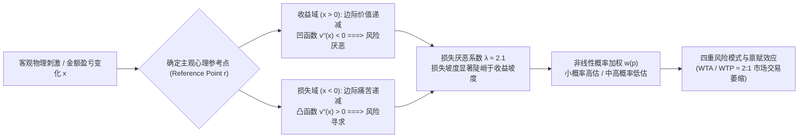
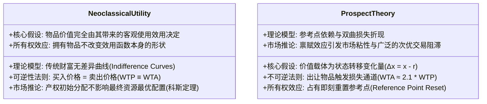

# Lec 6 前景理论与参考点依赖

> MIT 9.55 / 15.8471 · 消费者行为学 · 主讲团队

## TL;DR

- **价值感是相对位移而非绝对财富**：卡尼曼与特沃斯基（1979）前景理论彻底取代了期望效用理论，确立价值函数载体是相对于“主观参考点”（Reference Point）的利害得失，而非绝对财富状态。
- **S 型价值函数的核心三特征**：收益域凸显风险厌恶（凹函数）、损失域凸显风险寻求（凸函数），且损失曲线斜率陡峭于收益曲线（损失厌恶系数 $\lambda \approx 2.1$）。
- **四重风险偏好模式**：非线性概率加权函数 $w(p)$ 高估小概率并低估中高概率，精准解释了穷人买彩票与中产买巨灾保险等看似矛盾的共存行为。
- **禀赋效应与市场失灵**：理查德·塞勒（Thaler 1980）与康奈尔马克杯实验（1990）证实，一旦拥有某物，出让该物的接受意愿（WTA）立即暴涨至买入意愿（WTP）的两倍以上，科斯定理在实验室宣告失效。

## 1. 核心问题

- **财富状态 vs. 相对变化**：新古典经济学假设净资产 100 万美元的富人，在账户变为 99 万时的心理痛苦程度，与净资产 1 万美元的穷人账户变为 0 完全相同。这一“绝对资产状态”假说是如何彻底脱离人类神经生理感知现实的？
- **损失的痛感为何倍于获得的快感**：为什么损失 100 美元带来的心理挫折，必须依靠赢得 200 到 250 美元的意外横财才能勉强抹平？这种不对称的进化生物学根源何在？
- **所有权如何瞬间重塑心智物理学**：一件普通的咖啡杯，在被消费者的手指触碰并持有短短 30 秒后，其在心智中的客观货币估值为什么会自发翻倍？



## 2. 核心概念

| 概念 | 一句话定义 | 易混淆对象 |
|---|---|---|
| **前景理论（Prospect Theory）** | 卡尼曼与特沃斯基构建的描述性决策理论，以参考点依赖、S型价值函数与非线性概率加权为三大核心支柱 | 期望效用理论（EUT，规范性财富绝对效用理论） |
| **主观参考点（Reference Point）** | 消费者在心理上界定“当前现状”或“中性预期”的基准锚点，以此划分收益（Gain）与损失（Loss） | 历史实际购买价格（Historical Cost） |
| **损失厌恶（Loss Aversion）** | 面对等额的客观收益与损失时，人类主观感知到的损失痛苦显著大于获得快感的非对称心理倾向（$\lambda \approx 2.1$） | 纯粹的风险厌恶（Risk Aversion） |
| **禀赋效应（Endowment Effect）** | 消费者一旦拥有某种物品（建立心理所有权），对其主观估值便会立即显著高于未拥有该物品时的心理定价 | 收藏家的情感依恋（Sentimental Attachment） |
| **现状偏倚（Status Quo Bias）** | 决策者在面临变革选项时，由于将现状设为参考点并对任何改变可能带来的损失过度恐惧，因而强烈倾向于维持默认现状的惰性 | 纯粹的懒惰或信息缺乏 |

## 3. 证据链

### 3.1 前景理论 S 型价值函数的形式化：Kahneman & Tversky (1979)

丹尼尔·卡尼曼与阿莫斯·特沃斯基在 1979 年《计量经济学》（*Econometrica*）发表的开创性论文，彻底改写了现代行为经济学与消费者心理学的版图。新古典经济学自伯努利（1738）以来，长达两百余年一直将效用定义在个体的“总财富绝对水平 $W$”之上。然而，卡尼曼与特沃斯基指出，人类神经感知系统本质上是一套“差分探测器”，视网膜对亮度适应的是局部对比度，皮肤对温度适应的是温差变化。同理，心智在评估财富时，敏感度完全聚焦于相对于某个主观中性参考点（Reference Point $r$）的利害得失状态转移：$\Delta x = x - r$。

#### 价值函数 $v(x)$ 的数学参数化

特沃斯基与卡尼曼（1992）在累积前景理论（CPT）中将价值函数精确量化为分段幂函数形式：

$$v(x) = \begin{cases} x^\alpha, & \text{if } x \ge 0 \quad (\text{收益域}) \\ -\lambda (-x)^\beta, & \text{if } x < 0 \quad (\text{损失域}) \end{cases}$$

实证计量经济学在全美大量实验室与真实金融市场中测定出极其稳健的参数经验估计值：
- **曲率指数**：$\alpha \approx \beta \approx 0.88$（表明收益和损失两端均呈现微弱的边际敏感度递减）；
- **损失厌恶系数**：$\lambda \approx 2.25$（损失曲线的倾斜坡度是收益曲线的 2.25 倍）。

该函数在原点 $x = 0$ 处存在一个不可导的锐利拐点（Kink），这一非线性拓扑特征赋予了模型极其强大的行为解释力：

```text
前景理论主观价值函数 v(x) 几何曲线:
                 主观心理价值 v(x)
                         ^
                         |           .---' (收益域: 凹函数 v''(x) < 0, 风险厌恶)
                         |       _.-'
                         |   _.-'
                         |.-'
-------------------------+-------------------------> 客观损益 ($x)
                     _.-'| (参考点 Reference Point = 0)
                 _.-'    |
             _.-'        |
          .-'            |
         /               |
        /                |
       /                 | (损失域: 凸函数 v''(x) > 0, 风险寻求)
      /                  | 坡度极其陡峭! 斜率 ≈ 2.25 倍
     v                   |
```

对该几何曲线的一阶导数与二阶导数分析揭示了人类价值评估的核心法则：
- **边际敏感度递减（Diminishing Sensitivity）**：无论在收益域还是损失域，随着客观金额偏离参考点越远，每增加一单位金额带来的边际主观感受增量都在递减（$|v'(x)|$ 随 $|x|$ 增大而减小）。获得从 0 到 100 美元的愉悦感，远大于从 1000 到 1100 美元；
- **一阶损失厌恶（First-Order Loss Aversion）**：在原点处，左侧导数 $\lim_{x \to 0^-} v'(x)$ 约等于右侧导数 $\lim_{x \to 0^+} v'(x)$ 的 2.25 倍。这意味着面对一个抛硬币 50% 赢 100 美元、50% 输 100 美元的公平博弈，其期望主观价值为负，绝大多数正常人类会断然拒绝下注。

#### 四重风险偏好模式（The Fourfold Pattern of Risk Attitudes）

为了完整预测不确定性条件下的消费抉择，前景理论引入了非线性的概率加权函数 $w(p)$。该函数呈现倒 S 型：在概率接近 0 时极其陡峭（小概率事件被主观过度高估，称为“可能性效应”）；在概率接近 1 时急剧平缓（中高概率事件被系统性低估，称为“确定性效应”）。

将 S 型价值函数与倒 S 型概率权重函数相乘，前景理论形式化推导出了人类在四个决策象限中极具穿透力的反直觉风险态度矩阵：

```text
前景理论四重风险态度矩阵:
+---------------------------------------+---------------------------------------+
|              高概率事件 (High p)        |              低概率事件 (Low p)        |
+---------------------------------------+---------------------------------------+
| 收益域 (Gains)                        | 收益域 (Gains)                        |
| 场景: 95% 概率获得 $10,000 美元       | 场景: 1% 概率赢得 $10,000 美元 (买彩票) |
| 特征: 确定性效应主导, 低估高概率       | 特征: 可能性效应主导, 高估极小概率     |
| 行为: 风险厌恶 (选择确定拿走 $9,000)   | 行为: 风险寻求 (狂热购买乐透彩票)     |
+---------------------------------------+---------------------------------------+
| 损失域 (Losses)                       | 损失域 (Losses)                       |
| 场景: 95% 概率损失 $10,000 美元       | 场景: 1% 概率遭受 $10,000 巨灾 (买保险) |
| 特征: 损失厌恶与凸性主导, 绝望博弈     | 特征: 可能性效应主导, 恐惧被放大       |
| 行为: 风险寻求 (拒绝认赔, 赌徒孤注一掷)| 行为: 风险厌恶 (支付高额保费购买心安)   |
+---------------------------------------+---------------------------------------+
```

系统拆解这四个象限背后的心理物理动力学机制：
1. **高概率收益（右上象限 -> 风险规避）**：受试者面对确定性收益时产生极强烈的“落袋为安”冲动，害怕因继续博弈而丧失唾手可得的确定幸福（对遗憾的预期）；
2. **低概率收益（左上象限 -> 风险寻求）**：尽管中奖概率只有千万分之一，但人类心智会将非零极小概率与绝对的零（不可能）进行神经质变对比，“希望”的情感溢价驱动了彩票与盲盒消费的狂热；
3. **高概率损失（右下象限 -> 风险寻求）**：面对几乎必然到来的毁灭性损失，受试者在绝望中表现出赌徒式的不屈抗争，宁可承担输掉双倍的极高代价，也要博取万分之一的脱身希望；
4. **低概率损失（左下象限 -> 风险规避）**：面对空难、重大疾病或火灾等极小概率灾难，心智对潜在损失施加了恐怖的放大滤镜，宁愿支付高昂且精算不利（Actuarially Unfair）的商业保费以求得绝对的心理安宁。

这套矩阵优雅地终结了经济学界长达数十年的争辩：为什么同一个消费者，既会在周末狂热地购买极难中奖的超级乐透彩票（低概率收益下的风险寻求），又会在周一毫不犹豫地签署一份溢价昂贵的人身意外伤害保险（低概率损失下的风险厌恶）？前景理论证实，这绝非双重人格，而是概率加权函数与参考点价值曲线协同运作的必然数学结果。

---

### 3.2 禀赋效应与康奈尔咖啡杯实验：Kahneman, Knetsch, & Thaler (1990)

理查德·塞勒、杰克·克内奇与丹尼尔·卡尼曼在《政治经济学杂志》（*Journal of Political Economy*）发表了彻底证伪新古典市场清算理论的经典实验。

#### 实验设计与三种角色分配

研究团队在康奈尔大学经济学课堂上进行真实交易实验。受试者被随机平分为三组：
1. **卖方组（Sellers）**：每人面前免费发放一只印有康奈尔大学校徽的高档陶瓷咖啡杯（大学书店官方售价为 6.00 美元）。实验者明确告知：“这只杯子现在完全属于你，你可以带回家；或者你可以写下你的最低保留现金售价（WTA），如果市场买方出价超过该值，你可以卖掉杯子换取现金。”
2. **买方组（Buyers）**：面前没有任何杯子，每个人被要求检视邻座的杯子，并写下自己愿意动用自己钱包里的现金购买该杯子的最高买入上限（WTP）。
3. **选择者组（Choosers）**：受试者在“获得一只咖啡杯”与“获得一笔现金”之间做出选择，以确定现金等价物（Certainty Equivalent）。

```text
康奈尔大学咖啡杯市场清算实验机制:
[ 卖方 Sellers (持有杯子) ] -------> 给出最低接受补偿价 (WTA)
                                            vs.
[ 买方 Buyers (持有现金) ] -------> 给出最高支付意愿价 (WTP)
```

#### 新古典预测 vs. 实际市场雪崩

- **新古典科斯定理预测**：由于咖啡杯是随机分配的，对杯子的偏好应该在两组学生中均匀分布。因此，理论上应该有大约 50% 的杯子在市场上发生换手，且买方的中位数出价应与卖方的中位数标价基本重合（$\text{WTA} \approx \text{WTP}$）。
- **实证数据的残酷反击**：
  - **卖方的中位数 WTA**：**$5.25 美元**；
  - **买方的中位数 WTP**：**$2.25 美元**；
  - **选择者的中位数**：**$2.75 美元**；
  - **WTA / WTP 比率**：高达 **2.33 倍**（与损失厌恶系数 $\lambda \approx 2.25$ 惊人吻合！）；
  - **实际交易量（Market Volume）**：理论预测应成交 11 笔，实际市场仅仅勉强成交了 1 至 2 笔，市场交易量发生断崖式萎缩。
- **理论归因**：卖方出让杯子，在大脑中被编码为“失去心爱财产的严酷损失”；而买方购买杯子，仅被编码为“普通的收益获得”。损失厌恶直接在供需曲线之间撕开了一道无法逾越的价格鸿沟。

---

## 4. 理论之争与计算模型

### 4.1 认知机制对决：无痛放弃 vs. 痛苦剥夺

在微观经济学与认知科学之间，关于消费者所有权心理的本质展开了激烈的交锋：



这两大理论的根本分歧可以解构为三个深层认知机制：

1. **瞬时参考点漂移（Instantaneous Reference Point Shift）**：
   传统理论假设消费者的心理基准是长期稳定的；然而行为实验表明，只要受试者手里握住杯子甚至仅仅在网购购物车里停留片刻，“心理所有权”（Psychological Ownership）便会瞬间发生，参考点立即向前跃迁至“我已经拥有杯子”的新稳态。
2. **注意力聚焦偏差（Attention-Focusing Hypothesis）**：
   近年认知科学研究（Carmon & Ariely 2000）进一步指出，买家和卖家之所以估值悬殊，是因为角色分配强制改变了视觉与记忆的注意力焦点：
   - 卖家聚焦于出让后自己将失去的**独特功能与情感依恋**；
   - 买家聚焦于自己即将失去的**冰冷现金及其替代机会成本**。
3. **现状偏倚（Status Quo Bias）的数学推演**：
   当消费者在当前方案 $A$ 与新方案 $B$ 之间权衡时，若将 $A$ 设为主观参考点，选择 $B$ 意味着接受若干劣势（损失 $\Delta L$）以换取若干优势（收益 $\Delta G$）。由于每个劣势都被乘以了 $\lambda \approx 2.1$ 的损失厌恶放大器，导致只有当新方案的客观优势达到当前现状的 2 倍以上时，消费者才愿意按下确认键。

---

## 5. 分析层次的整合

| 系统层次 | 核心研究维度 | 本讲关键机制与实证 |
|---|---|---|
| **计算理论层（Computational Theory）** | 生存博弈下的不对称风险与能量优化法则 | 演化生物学不对称性：在资源匮乏的原始大草原，损失等额食物意味着饿死，而多得等额食物仅是锦上添花 |
| **算法与表征层（Algorithm & Representation）** | 分段幂函数价值折算与双曲概率加权网络 | 卡尼曼-特沃斯基 S 型价值函数算法；累积前景理论 CPT 概率扭曲；四重风险偏好 |
| **生理与市场实现层（Physical & Market Implementation）** | 神经经济学脑区双重激活与宏观市场失灵 | 岛叶（Insula）表征损失痛感；伏隔核（NAcc）表征收益快感；二手车与房地产市场流动性冰冻 |

#### 层次小结

从原始人类对“能量归零死亡”的演化恐惧，到前额叶与岛叶在神经元水平上的不对称放电，再到资本市场上数十亿美元并购资产在参考点锁定下的惨烈僵持，前景理论为我们展现了认知科学最宏伟的跨层级统一。计算层指明了损失厌恶在生命演化史上的必然性；算法层提供了无可挑剔的分段非线性函数；物理层则用真实市场的血腥案例证明，谁掌握了消费者的主观参考点，谁就统治了商业世界的定价权。

---

## 6. 边界条件与失效情形

- **常规货币交易中“流通筹码”的损失免疫**：
  如果受试者是一名专业的零售商人，手里拿的咖啡杯是用来在货架上常态周转的存货，商人出让存货换取现金**完全不会**触发禀赋效应。在商人的认知语义网络中，商品被表征为“等待变现的符号流动资金”，其参考点始终绑定在最终利润上，而非具体实物资产本身。
- **无缝替代品（Close Substitutes）的存在**：
  如果出让的物品在市场上存在完全同质、随手可得的替代品（例如用一张 5 美元纸币换五张 1 美元纸币，或用一个可口可乐空罐换百事可乐空罐），禀赋效应瞬间缩水至零，因为心智不会将此类交易编码为实质性损失。
- **极度贫困线以下的流动性强约束**：
  当受试者处于极度饥饿或严重现金流匮乏状态时，流动性生存危机压倒了一切心理依恋。穷人会以极低的价格抛售手中的任何资产以换取救命口粮，此时主观参考点被迫重置为生存绝对底线。

---

## 7. 课程内外的横向关联

- **承接 Lec 5（锚定效应）**：Lec 5 揭示了外部初始数值如何强行构建虚构的基准点；本讲则从数学上正式定义了该基准点如何作为“参考点 $r$”，全面引爆 S 型价值函数中收益与损失的非对称世界。
- **启示 Lec 7（框架效应）与 Lec 8（情境效应）**：同样客观真实的商业信息，只要巧妙操纵参考点的位置，就能让消费者在“收益”与“损失”之间反复横跳（框架效应）；而诱饵选项的加入正是动态修改了评估属性的参考坐标系。
- **横向跨学科映射**：
  - 与 **MIT 14.137（行为经济学）** 中的非期望效用模型与金融资产定价异象形成无缝对接；
  - 呼应 **MIT 15.810（营销管理）** 中的免费试用（Free Trial）、30 天无理由退货与以旧换新战略。

---

::: insight
### 认知科学家的心智诊断：不对称的灵魂——为什么失去总是比得到更沉重？

如果大自然在造人时遵循绝对中立的算术法则，那么得到一千块钱时的喜悦，本该与丢掉一千块钱时的沮丧完美抵消；

两个人相遇时的心动，本该与分开时的碎裂等额相称。

然而，卡尼曼与特沃斯基的前景理论曲线，却如同一道带血的伤疤，刻画出了人类心智最真实的悲剧性轮廓：

那条向下的曲线，倾斜得如此陡峭、如此冰冷。

从演化生物学的严酷法则来看，这种“不对称”是造物主赐予人类最宝贵的护身符。在一无所有的远古丛林里，一个猎人多打到一只野兔，不过是晚上能多吃一口肉；但他只要被毒蛇咬伤一口，失去的便是整个生命。进化容不下平衡对称的文人情怀——它必须用整整两倍以上的神经痛苦信号，死死看住我们手中本就贫瘠的领地。

当我们把这副神经机器搬进现代商场时，所有的悲欢便全被商业操纵了。

免费试用 30 天，不是商家的慷慨，而是一场冷酷的心智围猎：当你在沙发上坐满一个月的瞬间，这件家具便已潜移默化地烙进了你的主观参考点。退货不再是“我不买它”，而是“我的财产被人硬生生抢走”。

懂得前景理论的观察者，洞悉了世间所有执念的秘密：我们之所以拼尽全力握紧双手，并非因为外面的世界不够诱人，而是因为人类的心智，从来都无法承受放手时的剧痛。
:::

---

## 8. 思考题与自测

### 思考题

1. **S 型价值函数曲率与金融风险对赌**：在股票交易市场中，为什么普通散户投资者普遍表现出“盈利时过早止盈，亏损时死扛不卖甚至越跌越买”（即所谓的处置效应 Disposition Effect）？请依据前景理论在收益域与损失域的曲率特征进行数学推导。
2. **免费试用（Free Trial）的认知工程学原理**：某流媒体平台提供“首月免费体验，次月自动扣款 30 元”的订阅策略。请从心理所有权（Psychological Ownership）、主观参考点跃迁与损失厌恶三个连续阶段，解构该商业策略为何具有惊人的付费转化率？
3. **科斯定理的实验室反例与产权界定困境**：罗纳德·科斯在著名的科斯定理中指出：“只要交易成本为零，无论初始产权归属于谁，市场最终都会通过自由交易达到帕累托最优配置。”请运用 Kahneman et al. (1990) 康奈尔咖啡杯实验的定量数据，阐述为什么真实的心理禀赋效应从根本上瓦解了科斯定理的乌托邦预设？

### 参考答案

<details>
<summary>点击展开详细解析</summary>

1. **价值函数凹凸性诱发的风险态度反转**：
   - **收益域（浮盈状态）**：当散户盈利 5,000 元时，其处于价值函数的第一象限。由于价值函数是凹函数（$v''(x) < 0$），边际效用递减，继续持仓搏取更高收益带来的边际主观增益极小，而面临回调失去现有浮盈的恐惧极大（确定性效应）。此时散户表现出强烈的**风险厌恶（Risk Aversion）**，迫不及待地“落袋为安”锁定利润；
   - **损失域（套牢状态）**：当股票下跌亏损 5,000 元时，散户跌入价值函数的第三象限。由于损失域的价值函数是凸函数（$v''(x) > 0$），边际痛苦递减，从损失 5,000 到损失 10,000 带来的边际主观痛苦增量，远小于从 0 跌到 5,000 的第一击痛苦。此时散户表现出狂热的**风险寻求（Risk Seeking）**，宁愿承担进一步腰斩的极高风险，也要赌一把反弹回本的微弱机会。这种在收益域胆小如鼠、在损失域疯狂赌博的双重倾向，构成了散户亏损的神经学根源。
2. **参考点动态重置与支付之痛的钝化**：
   - **阶段一（无痛准入）**：首月免费打破了金钱支出带来的直接神经阻抗，消费者以极低的防备心理进入系统；
   - **阶段二（心理所有权建立）**：在 30 天的高频使用中，消费者的个性化收藏歌单、历史观看记录以及日常生活习惯深度嵌入系统，主观参考点（Reference Point）发生不可逆的向前跃迁——“拥有海量曲库的高级会员身份”成为了心智的全新现状（Status Quo）；
   - **阶段三（解约即损失）**：当 30 天到期时，取消订阅在消费者心智中不再被编码为“节省了 30 元现金（收益）”，而是被编码为“剥夺了我现有的优质特权（严酷损失）”。在 $\lambda \approx 2.1$ 损失厌恶放大器的驱使下，心智自发选择支付 30 元以维系现状稳态。
3. **估值断崖阻断市场出清（Market Clearing Collapse）**：科斯定理成立的前提是“交易双方对资产的估值分布独立于产权的初始分配”。然而咖啡杯实验冷酷地证实：产权的初始分配本身，会即刻永久性地改变资产在持有人心中的主观估值！拥有杯子的卖方因为出让意味着承受损失，标出高达 $5.25 的高额 WTA；未拥有杯子的买方仅将获得视为收益，出价上限仅为 $2.25。即使在完全没有交易税费、中介佣金和信息不对称（交易成本绝对为零）的理想实验室环境下，双方因禀赋效应撕开的 2.3 倍价格鸿沟，依然直接锁死了 80% 以上的潜在交易，使得资源根本无法通过自由市场流向使用效率最高的个体。
</details>

---

## 9. 开放问题与前沿探索

- **AI 资产推荐系统中的“算法诱发禀赋效应”**：当电商平台的个性化生成式 AI 能够根据用户的面部肖像、身材数据实时生成“你穿上该衣服的逼真高保真 3D 渲染视频”时，这种虚拟体验能否在用户尚未下单前，就在神经层面提前植入与真实物理持有等额的禀赋效应？
- **损失厌恶系数 $\lambda$ 的个体基因与神经多态性**：人类个体之间的损失厌恶系数存在从 1.2 到 4.5 的巨大离散方差。这种方差究竟是由 5-羟色胺转运体基因（5-HTTLPR）的长度多态性所硬编码的，还是由个体的童年社会经济地位（SES）与抗逆力经验所重构的？

---

## 10. 参考文献与延伸阅读

- **前景理论奠基文献**：
  - Kahneman, D., & Tversky, A. (1979). Prospect theory: An analysis of decision under risk. *Econometrica*, 47(2), 263–291.
  - Tversky, A., & Kahneman, D. (1992). Advances in prospect theory: Cumulative representation of uncertainty. *Journal of Risk and Uncertainty*, 5(4), 297–323.
  - Thaler, R. (1980). Toward a positive theory of consumer choice. *Journal of Economic Behavior & Organization*, 1(1), 39–60.
  - Kahneman, D., Knetsch, J. L., & Thaler, R. H. (1990). Experimental tests of the endowment effect and the Coase theorem. *Journal of Political Economy*, 98(6), 1325–1348.
- **前沿拓展与综述文献**：
  - Samuelson, W., & Zeckhauser, R. (1988). Status quo bias in decision making. *Journal of Risk and Uncertainty*, 1(1), 7–59.
  - Carmon, Z., & Ariely, D. (2000). Focusing on the forgone: How value can appear so different to buyers and sellers. *Journal of Consumer Research*, 27(3), 360–370.
