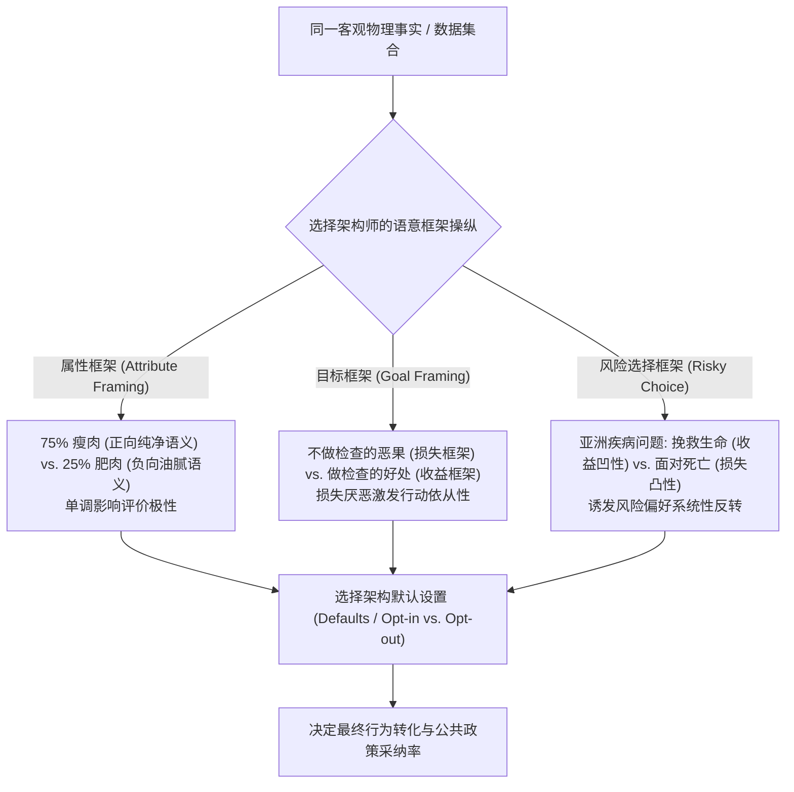
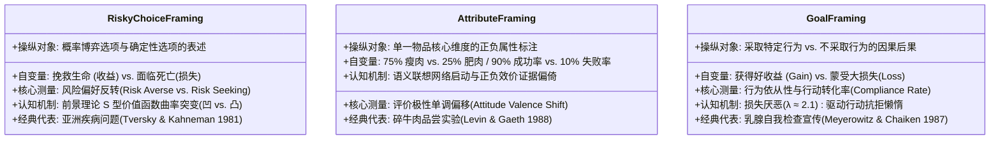

# Lec 7 框架效应与选择架构

> MIT 9.55 / 15.8471 · 消费者行为学 · 主讲团队

## TL;DR

- **描述不变性公理的破产**：新古典经济学核心公理“描述不变性”（Description Invariance）假定外延相同的表述绝不改变决策结果，但真实人类心智对语意语言框架具有极高敏感度。
- **框架效应的三元分类法**：莱文、施耐德与盖思（1998）严密解构了三类本质不同的框架：风险选择框架（亚洲疾病问题）、属性框架（75% 瘦肉 vs. 25% 肥肉）与目标框架（收益 vs. 损失倡导）。
- **默认选项的统治性力量**：约翰逊与高德斯坦（Science 2003）欧洲器官捐献自然实验证实，仅仅是将选择模式从“主动加入”（Opt-in）改为“默认加入”（Opt-out），签署率即从 15% 跃升至 99% 以上。
- **自由主义家长制与选择架构**：塞勒与桑斯坦提出助推（Nudge）理论，强调在不禁止任何选项、不改变经济激励的前提下，通过重塑物理与数字环境的选择架构（Defaults, Decoys, Layout）保护消费者长期福祉。

## 1. 核心问题

- **形式与内容的解耦危机**：如果两个商业合同或医疗方案在客观数理逻辑与物理结果上完全等价（Extensional Equivalence），仅仅是将“存活率 90%”改换为“死亡率 10%”，为什么病人和消费者的选择会发生 180 度的剧烈偏好反转？
- **默认选项（Default）为何具备不可抗拒的魔力**：面对需要勾选的复选框，消费者选择维持默认不作为，究竟是因为纯粹的物理懒惰，还是心智潜意识地将默认值解读为“制度设计者的官方权威背书（Implied Endorsement）”？
- **助推的道德与工程边界**：当商家的产品设计师无论如何都必须设定一个排版顺序或默认选项（“中立的选择架构在物理上根本不存在”）时，这套技术究竟是在帮助消费者克服自控力缺陷，还是在进行隐蔽而残忍的数字剥削？



## 2. 核心概念

| 概念 | 一句话定义 | 易混淆对象 |
|---|---|---|
| **描述不变性（Description Invariance）** | 理性选择理论的基本规范性公理，断言决策者的偏好仅由选项的客观实质结果决定，不受其表述修辞或框架形式影响 | 过程不变性（Procedure Invariance: 选择 vs. 定价偏好一致） |
| **属性框架（Attribute Framing）** | 操纵某个客观客体的单一特征维度是采用正向属性还是负向属性进行修饰（如 90% 成功率 vs. 10% 失败率） | 风险选择框架（涉及不同概率选项的权衡） |
| **目标框架（Goal Framing）** | 操纵采取某种特定行为能够获得的积极收益，还是不采取该行为将承受的消极损失（用于说服与依从） | 纯粹的威胁或恐吓营销 |
| **默认选项效应（Default Effect）** | 决策者在面临复杂或不确定选择时，具有压倒性概率保持系统预设状态而不采取任何主动更改行为的现象 | 强迫购买（Mandatory Choice） |
| **自由主义家长制（Libertarian Paternalism）** | 制度设计者在完全保留个体自由选择权与退出权（自由主义）的同时，主动将选择架构偏向有利于个体福祉的方向（家长制） | 强制命令主义（Coercive Mandates） |

## 3. 证据链

### 3.1 经典风险选择框架：Tversky & Kahneman (1981, Science)

阿莫斯·特沃斯基与丹尼尔·卡尼曼在《科学》（*Science*）发表了著名的“亚洲疾病问题”（Asian Disease Problem），确立了风险偏好随框架反转的经典实验范式。

#### 实验设计与等价博弈矩阵

受试者被告知：美国正在面临一场致命罕见亚洲疾病的爆发，预计将导致 600 人丧生。专家提出了两套备选救治方案：

```text
框架 1: 收益框架 (Gain Frame: "以拯救生命为参考点")
  方案 A: 确定挽救 200 人的生命
  方案 B: 有 1/3 的概率挽救全部 600 人, 2/3 的概率一个人也救不了

框架 2: 损失框架 (Loss Frame: "以 600 人死亡为参考点")
  方案 C: 确定会有 400 人死亡
  方案 D: 有 1/3 的概率没有一个人死亡, 2/3 的概率 600 人全部死亡
```

#### 震撼的实证数据反转

两组受试者在两个框架下的选择比例呈现戏剧性的镜像对称反转：
- **收益框架组**：**72% 的受试者坚定选择方案 A（风险厌恶）**，仅 28% 选择方案 B；
- **损失框架组**：**78% 的受试者毅然选择方案 D（风险寻求）**，仅 22% 选择方案 C！
- **数学等价性剖析**：
  - 方案 A（救 200 人）在物理事实上完全等于方案 C（死 400 人）；
  - 方案 B（1/3 救 600，2/3 救 0）在物理事实上完全等于方案 D（1/3 死 0，2/3 死 600）；
  - 两组方案面对的死亡人数期望值均为：$200 \times 1.0 = 200$ 人幸存，$400$ 人遇难。
- **核心理论推论**：仅仅是将叙述焦点从“活下来的人”切换为“死去的人”，消费者的主观参考点便被瞬间重置。在收益框架中，人们聚焦于保住确定性的 200 条生命（S 型价值函数第一象限的凹性诱发风险规避）；在损失框架中，400 人的确定死亡被编码为无法接受的严酷损失，迫使心智滑入价值函数的凸性区域，孤注一掷地赌博博取生机。

---

### 3.2 属性框架与牛肉评分实验：Levin & Gaeth (1988)

欧文·莱文与加里·盖思研究了属性框架如何直接自下而上渗透消费者的初级感官品尝体验。

#### 实验设计与盲测操纵

研究团队向受试者呈现绞碎牛肉（Ground Beef）的质量标签并让其品尝：
- **正向属性组**：标签标注为 **“75% 瘦肉”（75% Lean）**；
- **负向属性组**：标签标注为 **“25% 肥肉”（25% Fat）**。
- 两组牛肉来自同一块原料肉分割，脂肪含量严格恒定为 25%。

#### 实证结果：知觉被词汇标签污染

实验系统地测量了受试者在品尝前（纯文本信息暴露）以及品尝后（引入真实味觉与咀嚼感官线索）的多维度消费心理评分。如果人类的知觉是纯粹自底向上的客观物理测量，那么在食物进入口腔接触味蕾的瞬间，真实的脂肪酸分子与肌红蛋白物理刺激应当迅速冲刷掉纸面文字的微弱修辞。

然而，实证统计数据显示出令人震惊的语言认知渗透现象，纸面上的词汇框架不仅没有被真实的味觉纠正，反而全面主导了后续的感官知觉判断：

```text
75% 瘦肉 vs. 25% 肥肉消费者多维评分对比 (Levin & Gaeth, 1988):
评分维度 (1-7 分)          正向标签组 (75% Lean)     负向标签组 (25% Fat)     统计显著性
- 高品质感知 (High Quality)        5.15 分                  4.32 分             p < 0.01
- 口感不油腻 (Non-greasy)          4.88 分                  3.95 分             p < 0.001
- 风味可口度 (Delicious Taste)     4.92 分                  4.20 分             p < 0.05
- 购买意愿 (Purchase Intent)       5.05 分                  4.10 分             p < 0.01
```

莱文与盖思进一步对比了品尝前与品尝后的评分轨迹，发现了一项极具震撼力的双重认知机制：
- **品尝前的纯标签锚定**：在尚未品尝前，“75% 瘦肉”组对风味的预期评分比“25% 肥肉”组高出近 1.2 分；
- **品尝后的感官持续污染**：在受试者亲自将牛肉煎熟并咀嚼咽下后，虽然两组的评分差距微弱收窄至 0.72 分，但在所有核心评价维度上仍然保持了极其高度的统计显著性（$p < 0.05$）；
- **深层机制剖析**：属性框架通过语义联想网络的**单向线索激活（Valence-based Semantic Priming）**发挥作用。“瘦肉”激活了健康、健美、优质蛋白与精细屠宰的积极概念簇；“肥肉”激活了胆固醇、油脂沉积、油腻反胃与心血管疾病的消极图式。人类初级感觉皮层传来的模糊神经电位，在进入意识前台时被大脑高阶预置的积极语义过滤器完全重新诠释。

---

### 3.3 默认选项的制度奇迹：Johnson & Goldstein (2003, Science)

埃里克·约翰逊与丹尼尔·高德斯坦在《科学》（*Science*）发表了当代行为公共政策领域最著名的自然实验实证研究。

#### 欧洲跨国器官捐献自然实验

研究团队对比了文化、地理与宗教背景高度相似的西欧与北欧各国的已身故公民器官捐献签署率：
- **主动加入国（Opt-in Countries）**：法律规定公民默认不是器官捐献者，若想捐献，必须主动填表或在驾照上勾选确认；
- **默认加入国（Opt-out Countries / Presumed Consent）**：法律规定公民默认均为捐献者，若不想捐献，可以极其自由地通过网络或电话勾选退出。

#### 震撼的跨国对比数据

```text
欧洲各国器官捐献签署率 (Johnson & Goldstein, 2003):
同意签署率 (%)
100 |                                      [ 默认加入国: 均超过 99%! ]
    |                                      奥地利 (99.98%), 法国 (99.91%)
 80 |                                      比利时 (98.00%), 匈牙利 (99.90%)
 60 |
 40 |
 20 |   [ 主动加入国: 极度低迷 ]
    |   英国 (17.17%), 德国 (12.00%)
  0 +---丹麦 (4.25%)-------------------------------------------------------->
           主动加入组 (Opt-in)                   默认加入组 (Opt-out)
```

1. **悬殊的鸿沟**：同为日耳曼文化圈、经济发展水平相当且医疗设施高度发达的德国与奥地利，其器官捐献签署率分别是 **12%** 与 **99.98%**！
2. **零交易成本下的制度奇迹**：在丹麦或德国，在驾照表格上打一个勾所需的时间成本不足 3 秒钟。然而，仅仅是这 3 秒钟的认知与物理微阻力（Friction），就造成了数以万计等待器官移植生命的生死分野！
3. **三种深层驱动机制**：
   - **认知惰性与微摩擦（Effort / Friction）**：避免任何额外的心智与物理操作；
   - **暗示性官方背书（Implied Endorsement）**：决策者将默认值视为政府或专家的推荐行为；
   - **参考点损失规避**：在 Opt-out 下，“所有人都是英雄”成为心理现状，主动退出意味着主动选择成为一个拒绝奉献的冷漠者（承受道德损失）。

---

## 4. 理论之争与计算模型

### 4.1 框架效应的三元分类分类学：Levin et al. (1998)

在特沃斯基与卡尼曼开创性的亚洲疾病实验后，整个 20 世纪 80 年代与 90 年代初的心理学与营销学文献陷入了严重的“框架泛化概念混乱”。研究者们将广告修辞、价格折扣、医疗手术知情同意书、甚至新闻头条的文字微调，均不加区分地统称为“框架效应”（Framing Effects），导致理论解释陷入各执一词的泥潭。

为了从根本上厘清不同语境下人类心智的信息处理机制，欧文·莱文（Irwin Levin）、桑德拉·施耐德（Sandra Schneider）与加里·盖思（Gary Gaeth）于 1998 年在《组织行为与人类决策过程》（*OBHDP*）发表了里程碑式的三元分类学论文。他们严密指出：所谓“框架效应”并非单一的心理黑箱，而是由三种在操作定义、自变量构型、底层认知神经算法以及最终行为表现上截然不同的独立认知机制所构成的谱系：



三类框架的理论与商业运用边界：
1. **风险选择框架**：影响的是**风险容忍度**，企业在宣传保险、对冲基金或医疗手术时最为关键；
2. **属性框架**：影响的是**品质好感度**，广泛用于消费品包装、无糖/低脂声明以及金融资产回报率宣传；
3. **目标框架**：影响的是**行动号召力**。实证表明，在健康预防、节能减排与催缴税款等促进行动改变的场景中，**损失框架（“如果不做，你将损失……”）的号召力显著强于收益框架**。

---

### 4.2 选择架构的形式化：塞勒-桑斯坦 Nudge 模型

理查德·塞勒与卡斯·桑斯坦在《助推》（*Nudge: Improving Decisions About Health, Wealth, and Happiness*）中将选择架构提炼为 **EAST 行为工程框架**：

$$\Delta \text{Behavior} = \mathcal{F}\left( \text{Easy}, \text{Attractive}, \text{Social}, \text{Timely} \right)$$

1. **Easy（使其极简）**：利用默认选项的力量，消灭一切微摩擦。将 401(k) 退休储蓄计划设为入职自动加入（Automatic Enrollment），员工参与率瞬间从 49% 跃升至 86%（Madrian & Shea 2001, QJE）；
2. **Attractive（使其吸睛）**：利用视觉显著性图谱与即时小额奖赏吸引注意力；
3. **Social（利用社会规范）**：告知“你所在社区 90% 的居民都已经按时缴纳税费”；
4. **Timely（把握时机）**：在习惯重构的关键时间节点（如新年、搬家、入职第一天）进行行为干预。

---

## 5. 分析层次的整合

| 系统层次 | 核心研究维度 | 本讲关键机制与实证 |
|---|---|---|
| **计算理论层（Computational Theory）** | 符号语义与参考点绑定的自适应信息解析机制 | 描述不变性破产：心智并非对外部物理客观状态建模，而是对语义框架投射的心理图景建模 |
| **算法与表征层（Algorithm & Representation）** | 三元框架分类算法与默认选项状态机 | 风险选择框架调用前景价值函数；属性框架调用语义扩散；默认选项作为参考点与官方背书 |
| **生理与制度实现层（Physical & Institutional Implementation）** | 行为干预制度设计与国家级公共政策立法 | 欧洲器官捐献 Opt-out 法律实践；401(k) 自动储蓄立案；英国行为洞察团队（BIT / Nudge Unit） |

#### 层次小结

从一张印着“75% 瘦肉”的塑料包装纸，到亚洲疾病情景下前额叶对“挽救”与“死亡”的词汇神经反应，再到欧洲数十个国家凭借一行法律默认文本拯救了数万名尿毒症与器官衰竭患者，框架效应与选择架构展示了认知科学改造真实世界的澎湃伟力。计算层证明了符号表征对人类决策的绝对统治；算法层解构了三大框架的数学机制；制度实现层则证明，微小的认知开关，足以撬动整个文明的健康与财富基石。

---

## 6. 边界条件与失效情形

- **框架翻转的“双向透明度反噬”**：
  如果受试者同时并排看到两种框架（例如同一份菜单上并列印着“75% 瘦肉”与“25% 肥肉”，或同一张纸上同时呈现亚洲疾病问题的方案 A 与方案 C），描述不变性将瞬间复活！受试者的大脑会立刻意识到两者的逻辑等价性，框架效应衰减超过 80%。这表明框架效应高度依赖**孤立呈现（Separate Evaluation）**的心智盲区。
- **深层价值观与道德立场的框架免疫**：
  在涉及强烈政治信念、宗教教条或极端道德底线的议题（如死刑存废、堕胎权利）上，框架效应几乎完全失效。消费者的态度被极度刚性的意识形态先验所锁定，任何语义修辞技巧都无法撼动其立场。
- **“暗黑模式”（Dark Patterns / Sludge）引发的消费者觉醒反击**：
  当企业恶意滥用默认选项（如在机票购买页面默认勾选昂贵的隐形保险、默认绑定自动续费会员）时，过度的欺骗感会激起消费者的心理抗拒（Psychological Reactance），导致品牌声誉的毁灭性坍塌和监管机构的反垄断调查。

---

## 7. 课程内外的横向关联

- **承接 Lec 6（前景理论）**：本讲的风险选择框架与目标框架，直接依托于 Lec 6 中推导出的 S 型价值函数（收益凹、损失凸）与损失厌恶系数 $\lambda \approx 2.1$。
- **启示 Lec 8（情境效应）**：框架效应操纵的是“同一选项的表述方式”；而下一讲的情境效应（诱饵效应、折中效应）将探讨更为复杂的“不同选项之间的集合构型”，揭示新古典第三大公理——独立无关备选公理（IIA）的彻底瓦解。
- **横向跨学科映射**：
  - 与 **MIT 14.01（微观经济学）** 中关于消费者主权（Consumer Sovereignty）的哲学预设形成激烈交锋；
  - 呼应 **MIT 15.279（管理沟通）** 中的策略性信息架构与说服性修辞学。

---

::: insight
### 认知科学家的心智诊断：建筑师的责任——没有中立的设计，唯有被塑造的命运

在传统自由主义政治哲学的宏大叙事中，人类是至高无上的“独立意志主体”；我们被假定能够穿透一切华丽辞藻的迷雾，清晰洞察商品背后的客观物理事实。

然而，特沃斯基、卡尼曼与塞勒用几十年的严密实验，敲碎了这座建立在沙滩上的理智圣殿。

当“75% 瘦肉”与“25% 肥肉”摆在眼前，即使你把那块肉塞进嘴里咀嚼，你的味蕾也依然无法摆脱语言文字施加的神经催眠；

当奥地利与德国的国民在生死攸关的器官捐献协议上做出抉择时，99% 与 12% 的巨大鸿沟，竟然仅仅取决于公文表格上是否预先印刷了一个微小的勾选框。

这向每一位未来的产品设计师、商业领袖与政策制定者，道出了一个近乎残酷的真理：

在这个世界上，根本不存在所谓“中立的设计”。

你把哪件商品摆在货架中间，你把哪一个按钮做成高亮，你为用户预设了哪一个默认选项——在你落笔的那一秒钟，你实际上就已经替数以百万计的普通人，做出了他们人生中最重要或最琐碎的决定。

既然框架不可避免，既然心智注定被结构所囚禁，那么选择架构师唯一的救赎，便是带着对人类有限理性的深深谦卑，把那扇通往健康、尊严与幸福的大门，设计得最顺畅、最宽敞、最不费吹灰之力。
:::

---

## 8. 思考题与自测

### 思考题

1. **属性框架与风险选择框架的认知机制差异**：在 Levin et al. (1998) 的分类学中，为什么说“亚洲疾病问题”属于风险选择框架，而“75% 瘦肉牛肉”属于属性框架？这两者在底层调用的认知神经计算模型有何根本不同？
2. **欧洲器官捐献自然实验的因果排他性分析**：批评者可能辩称：“奥地利与德国器官捐献率的巨大差异，可能是由于两国的天主教/新教比例不同，或者是国民互助文化差异造成的，而非单纯的默认选项（Default）”。请从自然实验方法学的角度，结合比利时与英国等更多样本，反驳这一文化决定论质疑。
3. **商业助推（Nudge）与数字暗黑模式（Sludge）的界限**：某知名手机 App 在用户点击“注销账户”时，将“取消注销（放弃操作）”按钮设计为显眼的明亮蓝色大按钮，而将真正的“确认注销”按钮设计为浅灰色极小字体并隐藏在页面最底部折叠菜单中。请用选择架构理论分析该设计是否属于合法的“助推”，并给出伦理判准。

### 参考答案

<details>
<summary>点击展开详细解析</summary>

1. **价值函数曲率突变 vs. 语义效价记忆启动**：
   - **风险选择框架（亚洲疾病）**：其选项包含“确定性方案”与“概率性博弈方案”的二元权衡。框架通过操纵参考点，将同一客观状态分别投射到前景理论价值函数的“收益域”（凹函数，引发确定性偏好的风险规避）与“损失域”（凸函数，引发绝望对赌的风险寻求），其核心机制是**价值函数曲率与概率权重的非线性突变**；
   - **属性框架（75% 瘦肉）**：该任务不涉及任何概率或风险赌博，它仅仅是对同一个静态实体的单一属性进行正向（Lean）或负向（Fat）修饰。其核心机制是**语义联想网络的单向启动（Valence-based Associative Priming）**。正向词汇直接激活记忆中健康有益的证据，负向词汇激活油腻致病的证据，直接导致主观评价单调上扬或下滑，不涉及风险偏好的反转。
2. **多国对照与跨文化自然实验断层**：如果文化或宗教是决定性因素，那么文化传统高度相近的邻国应当表现出相近的捐献率。然而实证数据展示了剧烈的不连续断层：
   - 同属天主教主导且地理相连的奥地利（Opt-out, 99.98%）与德国（Opt-in, 12%）悬殊达 8 倍；
   - 具有相同北欧新教传统的瑞典（Opt-out, 85.9%）与丹麦（Opt-in, 4.25%）悬殊达 20 倍；
   - 双语文化共存的比利时，在从 Opt-in 立法转向 Opt-out 之后，签署率在极短时间内自发从不足 20% 暴增至 98% 以上。这一系列跨文化、时间序列立法干预的数据彻底排除了文化决定论，无可辩驳地确立了默认选项制度架构的绝对因果主导地位。
3. **选择架构伦理与暗黑模式（Sludge）定性**：该设计绝不属于合法的“助推”，而是典型的**欺骗性数字暗黑模式（Dark Pattern / Sludge）**。塞勒与桑斯坦定义的正当助推必须满足三大伦理准则：
   - **透明性**：干预必须公开透明，绝不误导或隐匿信息；
   - **退出的极低成本（Low-cost Opt-out）**：用户改变选择应如同“挥挥手一样容易”；
   - **增进决策者自身的长远福祉（Beneficence）**：助推的方向必须符合用户自身的真正利益（如存钱、健康饮食）。
   该 App 人为制造高额视觉与认知摩擦（Cognitive Friction），故意误导用户将灰色确认按钮视作不可点击的死链接，其核心目的是为了维护企业自身的虚假用户留存率 KPI，直接侵犯了用户的自主决定权，在法律与伦理上属于典型的数字消费者操纵。
</details>

---

## 9. 开放问题与前沿探索

- **个性化 AI 选择架构的“认知量身定做”**：在大数据与大模型驱动下，未来的数字界面能够实时推断每一位用户的 CRT 认知反思特征与损失厌恶系数，并动态生成只针对该个体的定制化框架。这种“超精准个性化助推”究竟是公共卫生管理的终极神器，还是对人类自由意志的彻底终结？
- **助推对长期内在动机的侵蚀风险**：过度依赖默认选项与外部选择架构来引导绿色环保或慈善捐赠，是否会导致公众逐渐丧失自觉的公民道德责任感，一旦脱离预设架构便发生报复性行为反弹？

---

## 10. 参考文献与延伸阅读

- **框架效应与选择架构经典文献**：
  - Tversky, A., & Kahneman, D. (1981). The framing of decisions and the psychology of choice. *Science*, 211(4481), 453–458.
  - Levin, I. P., Schneider, S. L., & Gaeth, G. J. (1998). All frames are not created equal: A typology and critical analysis of framing effects. *Organizational Behavior and Human Decision Processes*, 76(2), 149–188.
  - Johnson, E. J., & Goldstein, D. (2003). Do defaults save lives?. *Science*, 302(5649), 1338–1339.
  - Thaler, R. H., & Sunstein, C. R. (2008). *Nudge: Improving decisions about health, wealth, and happiness*. Yale University Press.
- **前沿拓展与政策应用**：
  - Madrian, B. C., & Shea, D. F. (2001). The power of suggestion: Inertia in 401 (k) participation and savings behavior. *The Quarterly Journal of Economics*, 116(4), 1149–1187.
  - Levin, I. P., & Gaeth, G. J. (1988). How consumers are affected by the framing of attribute information before and after consuming the product. *Journal of Consumer Research*, 15(3), 374–378.
