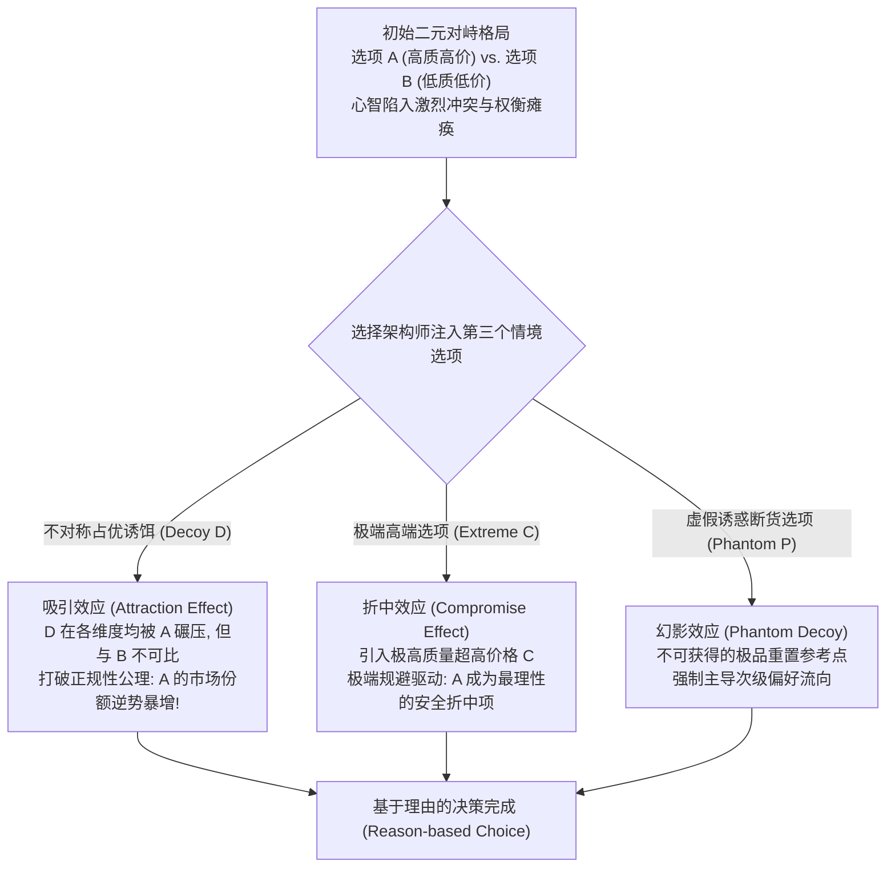

# Lec 8 情境效应：吸引、折中与幻影选项

> MIT 9.55 / 15.8471 · 消费者行为学 · 主讲团队

## TL;DR

- **公理化选择理论的瓦解**：新古典经济学基本公理“独立无关备选公理”（IIA）与“正规性公理”（Regularity）断言，在一个选择集中加入任何新选项，现有选项的绝对市场份额绝不可能增加。
- **吸引效应与诱饵策略**：休伯、佩恩与普托（Huber, Payne, & Puto 1982）证实，引入一个被目标品全面占优但劣于竞品的“不对称占优诱饵”（Decoy），目标品的绝对选择比例竟出现奇迹般的逆势暴增（如《经济学人》经典订阅实验）。
- **折中效应与极端规避**：西蒙森（Simonson 1989）发现，当消费者面临在属性间艰难权衡时，引入更高端的极端选项会使处于中间的折中选项成为心理安全避风港，威廉-索诺玛面包机引入 429 美元旗舰款使 275 美元原款销量翻倍。
- **基于理由的决策架构**：沙菲尔、西蒙森与特沃斯基（1993）指出，人类决策核心动力是为自己的选择构建能够说服自我与外界的“正当理由”（Reason-based Choice），情境构型直接赋予了理由的生产土壤。

## 1. 核心问题

- **偏好的内在绝对性 vs. 选项集合的相对构型**：消费者在两款手机之间犹豫不决时，如果在货架上摆上第三款各方面都更差的“炮灰手机”，为什么会瞬间促使消费者毫不犹豫地下单购买其中某一款？
- **正规性公理（Regularity Axiom）为何在现实中彻底失效**：新古典概率选择理论在数学上断言：任何新选项的加入最多分流现有份额，绝无可能让已有选项的市场占有率凭空增加（$P(A \mid \{A, B, C\}) \le P(A \mid \{A, B\})$）。现实商业中诱饵效应究竟是如何在经验实证中粉碎这一公理的？
- **决策冲突与基于理由的心理防御**：当属性权衡带来沉重的心智内耗与后悔风险时，消费者是如何利用情境构型提供的折中或占优线索，快速构建起能够抵御购后失调（Post-purchase Dissonance）的正当理由的？



## 2. 核心概念

| 概念 | 一句话定义 | 易混淆对象 |
|---|---|---|
| **独立无关备选公理（IIA）** | 肯尼斯·阿罗与邓肯·卢斯提出的理性公理：在集合 $S$ 中对 $A$ 和 $B$ 的相对偏好比例，不受其他无关备选项是否存在的影响 | 传递性公理（Transitivity） |
| **正规性公理（Regularity Axiom）** | 概率选择模型的底线条件：向备选集合中添加任何新选项，原有集合中任何选项被选中的绝对概率不得增加 | 简单单调性（Monotonicity） |
| **吸引效应 / 诱饵效应（Attraction / Decoy Effect）** | 引入一个在各属性维度上均劣于目标品（Target）、但部分优于或不可比于竞品（Competitor）的不对称占优诱饵，导致目标品选择份额显著提升的现象 | 纯粹的降价打折促销 |
| **折中效应（Compromise Effect）** | 决策者在面临多属性权衡冲突时，本能地规避处于属性极端的极端选项，倾向于挑选处于中间维度的折中选项的现象（极端规避） | 随波逐流的从众效应 |
| **基于理由的决策（Reason-based Choice）** | 消费者在做决定时，并非机械计算效用积分，而是主动搜寻能够向自我及他人合理解释并捍卫该选择的定性理由 | 纯理性的成本效益分析 |

## 3. 证据链

### 3.1 吸引效应的里程碑奠基：Huber, Payne, & Puto (1982, JCR)

乔尔·休伯、约翰·佩恩与克里斯托弗·普托在《消费者研究杂志》（*Journal of Consumer Research*）发表了彻底动摇公理化效用理论根基的重磅论文。

#### 二维属性几何空间构型

在经典多属性决策几何学中，商品的选择集合通常被投射在一个由多个相互冲突的正交属性所构成的二维或多维坐标平面上。设商品具有两个彼此冲突的核心属性维度：属性 1（如啤酒的醇厚口感与麦芽品质，该指标数值越大表示主观感知质量越优越）与属性 2（如价格维度，在图中通常处理为“价格经济性”，数值越高表示花费越少、价格越便宜）。

在没有诱饵的基准状态下，目标品与主要竞品通常位于有效帕累托边界（Pareto Frontier）的不同位置：目标品在品质上占优但在经济性上处于劣势，而竞品则在经济性上占优但在品质上相对平庸。此时消费者必须在两个属性之间做出痛苦的跨维度权衡折中。然而，引入不对称占优诱饵后，三者在几何空间中的拓扑布局呈现出高度扭曲的非对称结构：

```text
属性 2 (价格更便宜 / 经济性更优)
   ^
   |        [ 选项 B: 竞品 Competitor ] (价格极便宜, 但口感平平)
   |
   |
   |        [ 诱饵 D: 不对称占优诱饵 Decoy ] (价格比 A 贵, 且口感比 A 差!)
   |             \
   |              \ (被 A 绝对占优 Asymmetrically Dominated)
   |               v
   |        [ 选项 A: 目标品 Target ] (口感极佳, 价格中高)
   |
   +------------------------------------------------------------> 属性 1 (口感品质更优)
```

从几何投影视角观察，诱饵 $D$ 在坐标空间中的定位经过了严密的工程化构造。它位于目标品 $A$ 的负支配象限（Dominated Region）之内，但在竞品 $B$ 的非支配象限之中。这意味着，$A$ 在属性 1 和属性 2 上均严格优于 $D$（使得比较具有完全的无歧义优势），但竞品 $B$ 与诱饵 $D$ 之间仍然存在属性交错，无法直接建立严格占优关系。这一不对称的空间拓扑结构，彻底击穿了基于固定无差异曲线的新古典效用几何学。

#### 实验设计与诱饵配置

在经典的六类耐用消费品与快速消费品（汽车、啤酒、餐馆、胶卷、电视、公寓租赁）实验中，受试者面临两选一基准环境（仅有 A 与 B），随后实验者在集合中加入不对称占优诱饵 $D$：
- **目标品 A**：高品质、高价格；
- **竞品 B**：低品质、低价格（两者在基准状态下平分秋色，各占约 50% 份额）；
- **诱饵 D（Decoy）**：品质略低于 A，但价格比 A 还要昂贵！

#### 震撼的实验数据反转

- **传统经济学预测**：诱饵 $D$ 是一个在客观上绝对劣于 $A$ 的荒谬选项，没有任何理性人会选择 $D$；根据正规性公理，$P(A \mid \{A, B, D\}) \le P(A \mid \{A, B\})$，且 $A$ 与 $B$ 的相对比例应保持不变；
- **实证数据的耳光**：
  - 诱饵 $D$ 确实几乎没有人挑选（选择率 $< 2\%$）；
  - 但是，**目标品 A 的绝对选择份额从初始基准的 43% 惊人地暴增至 64% 以上（$p < 0.001$）**！
  - 竞品 $B$ 的份额惨遭腰斩从 57% 暴跌至 34%！
- **数学证明**：实证结果公开推翻了 $P(A \mid \{A, B, D\}) \le P(A \mid \{A, B\})$，宣告了统治微观经济学半个世纪的“正规性公理”与“独立无关备选公理（IIA）”在人类实际心理选择中宣告破产。

---

### 3.2 《经济学人》真实订阅实验：Ariely (2008)

丹·阿里利在《可预测的非理性》（*Predictably Irrational*）中记录了他针对著名财经期刊《经济学人》（*The Economist*）真实征订广告进行的麻省理工学院经典实证。这项研究揭示了即使在受过高强度数理分析训练的顶尖商学院群体中，诱饵效应依然能够产生极其稳定且无法免疫的心智操控效果。

#### 实验对照设计

阿里利在麻省理工学院斯隆管理学院招募了 100 名 MBA 和高年级本科生，受试者被随机分配到两个完全平行的订阅实验组中。在三选项的完整实验环境中，受试者面对的是《经济学人》官方网站当年真实发布的印刷版与电子版套餐定价组合；而在二选项控制组中，实验人员仅仅移除了那个看似纯属“定价笔误”或“冗余摆设”的单买纯印刷版选项：

- **选项 1（电子版订阅，Web Subscription）**：定价 $59 美元。读者可无限制浏览过往二十年的全部数字存档与即时深度分析；
- **选项 2（印刷版订阅，Print Subscription）**：定价 $125 美元。每周邮寄纸质杂志，不附带任何数字阅读权益；
- **选项 3（合订套餐，Print & Web Package）**：定价 $125 美元。同时包含每周送达的纸质杂志以及全功能的线上数字订阅权限。

在纯理性经济学框架中，任何具有初等逻辑判断力的人都会立即发现，选项 2 是一个完全被选项 3 严格支配的“劣质品”——两者的售价分毫不差，但选项 3 凭空多出了一项价值 $59 美元的数字服务。标准经济学理论会毫不犹豫地判定选项 2 纯属废纸一张，其在货架上的存在与否，绝不可能对消费者在纯电子版与合订套餐之间的理性抉择产生任何哪怕一丝一毫的边际扰动。

#### 戏剧性的实证选择转移

然而，真实的受试者选择数据却呈现出近乎荒诞的反差。在三选项完整组中（包含印刷版诱饵，$N = 100$）：
- 纯电子版（$59）：仅有 16 人挑选，占比 16%；
- 纯印刷版（$125）：0 人挑选，占比 0%（证实受试者完全具备基础逻辑能力，确实无人甘当纯冤大头）；
- 合订套餐（$125）：高达 84 人挑选，占比 84%，展现出压倒性的绝对统治力；
- 该组单客平均贡献收入（ARPU）高达 **$114.44 美元**。

而在二选项控制组中（去除了零人挑选的印刷版诱饵后，直接呈现 $59 电子版与 $125 合订套餐两选一，$N = 100$）：
- 纯电子版（$59）：选择人数狂飙至 68 人，占比暴涨至 68%！
- 合订套餐（$125）：选择人数骤降至 32 人，占比遭遇毁灭性腰斩，跌至 32%！
- 该组单客平均贡献收入骤跌至 **$80.12 美元**，出版商的销售总额在几分钟内断崖式蒸发了整整 **30%**。

数据展示了诱饵选项无与伦比的商业操纵威力：
- 没有任何一个心智健全的人会单买 125 美元的纯印刷版，因为同等价格下可以白拿一份电子版；
- 但这个看似毫无价值的“炮灰选项”，却在心智中构建了一座压倒性的对比灯塔：它让合订套餐瞬间显得如同免费赠送电子版一样极其合算；
- 一旦把这个 0 人选的诱饵撤下，失去对比坐标系的学生立即清醒过来，超过三分之二的人掉头选择 59 美元的廉价纯电子版，导致商家的客单价发生灾难性雪崩。

---

### 3.3 折中效应与极端规避：Simonson (1989, JCR)

伊塔马尔·西蒙森证明了消费者在面对属性冲突时普遍存在的**折中倾向（Compromise Effect）**。

#### 威廉-索诺玛面包机传奇商战案例

高端厨具零售商威廉-索诺玛（Williams-Sonoma）曾推出一款售价 **275 美元** 的家用自动烘焙面包机。尽管技术评测优异，但该产品长期滞销，消费者普遍抱怨其价格昂贵且不知道其在家庭厨房中是否必要。

公司并未降价促销，而是在营销顾问西蒙森的建议下，在货架该款机器旁边摆上了一台功能更强、体积稍大、售价高达 **429 美元** 的超级旗舰款面包机。

```text
货架格局演进与销量逆转:
阶段一 (二元对峙):
[ 275 美元面包机 ] <--- 消费者心智: "太贵了! 厨房不需要这种奢侈品。" (严重滞销)

阶段二 (引入极端高端选项):
[ 275 美元面包机 ] vs. [ 429 美元旗舰面包机 ]
        ^
        |
消费者心智: "429 美元实在太夸张了; 相比之下, 275 美元这款既实用又显得性价比极高!"
结果: 275 美元型号的销量在几周内狂飙接近 100%!
```

#### 理论解释：多属性维度下的损失规避

特沃斯基与西蒙森（1993）将折中效应数学形式化为**极端规避（Extremeness Aversion）**：
- 在多属性权衡中，选择极端选项意味着在某一个属性上获得巨大优势，但在另一个属性上承受巨大劣势；
- 根据前景理论，劣势在心理上被编码为“损失”，而损失的痛苦具有 2 倍以上的心理放大乘数；
- 折中选项虽然在任何单一属性上都不是最强，但它在所有属性上都避免了极端惨烈的损失，其综合前景主观心理效用达到最大。

---

## 4. 理论之争与计算模型

### 4.1 独立无关备选公理（IIA）的数学破产

在邓肯·卢斯（Luce 1959）的公理化选择概率模型中，选项 $x$ 在集合 $S$ 中的选择概率满足比例比值规则：

$$\frac{P(x \mid S)}{P(y \mid S)} = \frac{v(x)}{v(y)}$$

其中 $v(\cdot)$ 为选项的内在固定绝对价值标量。

该公理推导出一个刚性数学约束：不论集合 $S$ 中加入或移除了什么其他备选项 $z$，任何两个既有选项 $x$ 与 $y$ 的选择概率相对比值保持严格恒定不变（即著名的 IIA 公理）。

### 4.1 独立无关备选公理（IIA）的数学破产

在邓肯·卢斯（Luce 1959）的公理化选择概率模型中，选项 $x$ 在集合 $S$ 中的选择概率满足经典的比例比值规则：

$$\frac{P(x \mid S)}{P(y \mid S)} = \frac{v(x)}{v(y)}$$

其中 $v(\cdot)$ 被假定为选项内在固有的、不受外界无关情境干扰的绝对效用标量。这一公理体系推导出了微观选择理论最核心的数学基石：独立无关备选公理（IIA）。根据 IIA，不论外部环境如何引入或移除第三者备选品 $z$，原有集合中任意两个选项 $x$ 与 $y$ 的相对选择概率之比必须严格保持恒定不变。

然而，休伯等人（Huber et al., 1982）与阿里利（Ariely, 2008）的实证数据彻底碾碎了这一公理：
1. **基准二元状态下的相对比值**：在仅有目标品 $A$ 与竞品 $B$ 的基准二元集合 $\{A, B\}$ 中，两者的选择份额为：
   $$\frac{P(A \mid \{A, B\})}{P(B \mid \{A, B\})} = \frac{43\%}{57\%} \approx 0.754$$
2. **引入诱饵 $D$ 后的三元状态相对比值**：当不对称占优诱饵 $D$ 介入后，三元集合 $\{A, B, D\}$ 中两者的选择份额演变为：
   $$\frac{P(A \mid \{A, B, D\})}{P(B \mid \{A, B, D\})} = \frac{64\%}{34\%} \approx 1.882$$
3. **公理证伪的纯数学推导**：
   比值从 $0.754$ 发生剧烈跳跃，暴增至 $1.882$（增长了整整 150%）。这一纯数学代数矛盾表明，在真实的人类神经认知系统中，根本不存在一个孤立封闭、永恒不变的标量效用函数 $v(x)$。每一个选项的心理感知价值，完全是在选项所构成的相对几何空间与对比拓扑网络中，被即时动态计算与建构出来的。

---

### 4.2 基于理由的选择模型（Reason-Based Choice）：Shafir et al. (1993)

埃尔达·沙菲尔、伊塔马尔·西蒙森与阿莫斯·特沃斯基提出了著名的**基于理由的选择假说**，为情境效应对人类心智的俘获提供了深邃的认知心理学解释。

该理论认为，人类在充满高度不确定性与信息不完全的现实商业世界中做决定，其根本目标往往并非如新古典经济学假设的那样在连续微积分曲面上求解全局效用最大化，而是**积极搜寻能够向自我内心完成自我辩护（Self-justification）、以及在社会交往中向他人合理解释自身选择的正当理由（Defensible Reasons）**。

#### 决策权衡冲突与心智瘫痪

在纯粹的二元对立格局中（例如高品质高价格的 $A$ 对决低品质低价格的 $B$），消费者往往深陷于剧烈的心智权衡冲突（Trade-off Conflict）之中。如果要挑选高质量的 $A$，就必须直面付出昂贵金钱的“损失之痛”；如果要挑选低价格的 $B$，就必须承受品质平庸所带来的遗憾与不满。此时，在两个不可通约的属性维度之间进行艰难折中，会激发强烈的主观决策焦虑，甚至导致消费者延期决策或直接放弃购买。

#### 诱饵带来的现成免责理由

而不对称占优诱饵 $D$ 的介入，戏剧性地改变了整个认知博弈的受力格局：
- **现成的局部支配逻辑**：诱饵 $D$ 的存在为选择目标品 $A$ 提供了毫不费力的、无懈可击的正当理由——“$A$ 在每一个属性上都绝对完胜 $D$，并且价格还比 $D$ 便宜或相当！”
- **免除全局折中计算的认知负荷**：由于目标品 $A$ 相对于诱饵 $D$ 的占优优势是显而易见的、绝对无争议的局部真理，消费者的大脑便迅速抓住这一清晰的局部理由，以此作为选择 $A$ 的充分正当依据，从而安全避开了对 $A$ 与 $B$ 之间错综复杂的跨维度效用积分计算；
- **化解内疚与事后后悔风险**：基于理由的选择极大地降低了消费者的预期后悔（Anticipated Regret）。当决策者事后需要向伴侣、同事或自己的内心解释这笔支出时，“我挑选了一个在各个方面都明显击败同类替代品的优质选项”构成了坚不可摧的心理防御盾牌。

---

## 5. 分析层次的整合

| 系统层次 | 核心研究维度 | 本讲关键机制与实证 |
|---|---|---|
| **计算理论层（Computational Theory）** | 冲突消除与决策决策后悔最小化目标 | 基于理由的选择理论（Reason-based Choice）：在多属性不可通约时，通过情境局部优势快速化解决策焦虑 |
| **算法与表征层（Algorithm & Representation）** | 多维属性相对空间向量比较算法 | 吸引效应打破 IIA 与正规性公理；折中效应的多维损失规避算法；极端规避几何映射 |
| **生理与市场实现层（Physical & Market Implementation）** | 零售货架陈列排版、订阅制套餐阶梯定价与菜单工程学 | 《经济学人》真实订阅实验（单客收入提升 30%）；威廉-索诺玛面包机战术；星巴克咖啡大中小杯中杯陷阱 |

#### 层次小结

从公理化选择理论在代数上的彻底失效，到多维属性空间中诱饵选项对注意力的强力牵引，再到现代零售货架上精巧构筑的三层套餐体系，情境效应向我们揭示了“人类偏好”高度可塑的相对本质。计算层解释了心智为什么渴望利用现成理由逃避权衡痛苦；算法层给出了局部相对占优的计算规则；市场实现层则用商业史上一次次惊心动魄的客单价翻倍实战证明，操纵了选项的拓扑排布，就操纵了消费者的黄金选择。

---

## 6. 边界条件与失效情形

- **属性透明度与高计算卷入度（Attribute Transparency）**：
  如果商品的核心属性极其简单透明、容易直接换算为统一的客观货币价值（例如比较两张不同金额与手续费的储蓄银行卡），或者消费者具备极强的专业财务核算背景，诱饵效应的威力将大幅下降，理性价格比对将重新占据上风。
- **诱饵选项过差引发的“虚假作秀识破”**：
  如果诱饵选项设置得过于极端、劣质得过于荒谬且明显脱离商业常理（例如在两台正常笔记本电脑旁摆上一台售价 10,000 美元但内存仅有 1MB 的机器），消费者会敏锐地识破商家的操纵企图，激发起强烈的心理抗拒（Reactance），反而导致对整个品牌信誉的怀疑与抛弃。
- **跨品类替代品与跳出货架选择**：
  情境效应高度依赖于消费者被**封闭锁定在当前备选集合（Closed Consideration Set）**之内。一旦消费者拥有跳出当前货架的退出机制（例如随手掏出手机进行全网比价），封闭情境构型的相对优势会被全局市场的绝对低价瞬间击溃。

---

## 7. 课程内外的横向关联

- **承接 Lec 7（框架效应）**：框架效应操纵的是单一选项的语意表述方式；本讲的情境效应则上升至选项集合层级，探讨选项与选项之间的相互作用对偏好的重塑。
- **启示 Lec 9（心智账户与支付之痛）**：诱饵选项之所以能诱导消费者多掏几十美元选择合订套餐，是因为合订版在消费者心智中被归入了“捡大便宜的交易效用（Transaction Utility）”账户；下一讲将系统拆解心智账户如何扭曲金钱的可替代性。
- **横向跨学科映射**：
  - 与 **MIT 14.01（微观经济学原理）** 中的显示偏好理论（Revealed Preference）与无差异曲线形成根本性实证反思；
  - 呼应 **MIT 15.818（定价策略）** 中的产品线设计（Product Line Design）、版本划分（Versioning）与价格歧视架构。

---

::: insight
### 认知科学家的心智诊断：相对性的牢笼——为什么我们永远无法孤立地看世界？

如果我们去问任何一个理性的现代人：“你喜欢什么？你愿意为一个理想的生活付出多少代价？”

他通常会给出一个充满自尊的回答，坚称自己的偏好源自深思熟虑的价值观和内心深处的真实渴望。

但休伯、佩恩与西蒙森的经典实验，却用最优雅的数学反证法，将这份骄傲击得粉碎。

在人类心智的底层，根本不存在一条孤立的绝对价值坐标系。

我们是一群深陷在“相对性牢笼”中的生物。我们不会孤立地评估一瓶酒的甘冽、一间公寓的宽敞、甚至一份工作的尊严；我们永远在眼角余光中搜寻着身边的参照物。

那个看似荒唐可笑的“不对称占优诱饵”，之所以能够像魔法一样将数以万计的消费者驱赶到高价套餐面前，是因为它极其慈悲地替大脑解除了最沉重、最痛苦的折磨——那就是**在不确定的复杂世界中独立做出权衡的孤独与焦虑**。

它为心智送上了一副唾手可得的拐杖，一条清晰无比的优劣理由。

商业世界的最高境界，从来不是声嘶力竭地证明自己有多么完美；而是巧妙地在自己的身旁，摆上一尊略带残缺的诱饵，然后静静等待着那颗渴望寻找比较的心灵，带着释然的微笑，心甘情愿地投向你的怀抱。
:::

---

## 8. 思考题与自测

### 思考题

1. **正规性公理（Regularity Axiom）的数学反证**：请写出正规性公理的形式化不等式，并结合 Huber et al. (1982) 吸引效应的实验数据，严密推导为什么目标品市场份额的逆势上涨构成了对该公理的彻底颠覆？
2. **折中效应在企业产品线定价中的经典运用**：一家 SaaS 云服务软件公司目前仅提供“基础版（每月 $19）”与“专业版（每月 $49）”。绝大多数用户都挤在基础版，专业版转化率极低。在不改变现有两款产品任何功能的前提下，作为产品总监，你应如何设计第三款产品来强力拉动专业版的销量？
3. **幻影选项（Phantom Decoy）与饥饿营销的认知机理**：某些高档电子产品或奢侈品品牌在发布会上高调推出一款性价比极高但常年显示“缺货 / 售罄”（Phantom Alternative）的爆款型号，导致原本滞销的另一款高价现货型号销量暴增。请运用基于理由的决策理论剖析这一商业把戏的深层心智动力学。

### 参考答案

<details>
<summary>点击展开详细解析</summary>

1. **正规性公理的破产推导**：
   - **公理形式化定义**：设备选集为 $S$，若向其添加任意新选项 $D$ 构成新集合 $S' = S \cup \{D\}$，根据概率论基础事件分割与非负性，任何已有选项 $A \in S$ 在新集合中的选择概率绝不可能超越其在原集合中的概率，即必须严格满足：
     $$P(A \mid S') \le P(A \mid S)$$
   - **实验实证证伪**：在初始二元集 $S = \{A, B\}$ 中，实测 $P(A \mid \{A, B\}) = 43\%$。当加入不对称占优诱饵 $D$ 后，新集合为 $S' = \{A, B, D\}$，实测数据表明 $P(A \mid \{A, B, D\}) = 64\%$。
   - **数学结论**：实证结果明确呈现 $64\% > 43\%$，即 $P(A \mid S') > P(A \mid S)$，这在数学上直接击穿了正规性公理，证明了新选项的引入不仅没有摊薄原有选项的份额，反而由于局部对比优势逆向抽取了其他竞品的市场份额。
2. **折中效应三阶产品梯队重构**：
   - **现状病因**：在仅有 $19 和 $49 两个选项时，用户将 $49 视为属性极端的“高风险昂贵款”，极端规避心理促使其退缩至安全便宜的 $19 基础版；
   - **重构方案**：在产品线上方新增一款**“企业旗舰尊享版（每月 $149）”**，提供海量算力与专属客服；
   - **心智重定位**：新增 $149 的极端款后，原本显得高不可攀的 $49“专业版”在属性空间中瞬间褪去了极端的色彩，变成了极具性价比、兼具专业性能与合理价格的“安全折中选项”（Compromise Option）。由于极端规避与多维损失规避机制，大量原基础版用户会在心理上将 $49 视为不偏不倚的理性首选，推动专业版转化率暴增。
3. **幻影选项的参考点重塑与认知降级**：
   - **参考点锚定**：不可获得的“缺货幻影选项”由于极高的配置和极低的价格，首先在消费者心智中确立了一个极高维度的价值期望参考点；
   - **冲动激发与行动锁定**：消费者在决定购买幻影款的瞬间，已经在神经层面完成了“我要掏钱消费”的行动承诺；
   - **缺货冲突与理由代偿**：当看到“暂时缺货”的提示时，心智产生了强烈的目标受阻挫折感。此时，旁边那款功能略有缩水、价格略高但“现货速发”的高价型号，立即成为了平复挫折感、释放既有购买冲动的最佳替代理由（“虽然没买到神机，但买这个现货也不亏，免得白等”）。幻影选项充当了将潜在观望者转化为真实买家的强力催化剂。
</details>

---

## 9. 开放问题与前沿探索

- **神经眼动空间注视与诱饵偏好的实时因果解码**：利用高频眼动追踪与脑磁图（MEG），在受试者扫视诱饵与目标品的最初 300 毫秒内，视觉皮层与纹状体是如何协同完成属性对比并计算出“局部占优信号”的？
- **多维度复杂商品推荐中的“动态算法诱饵注入”**：电商推荐系统是否正在利用强化学习算法，在为不同用户展示酒店房间或二手车列表时，动态穿插由算法生成的合成诱饵房源，从而在用户毫不知情的情况下定向操纵其预订选择？

---

## 10. 参考文献与延伸阅读

- **情境效应奠基文献**：
  - Huber, J., Payne, J. W., & Puto, C. (1982). Adding asymmetrically dominated alternatives: Violations of regularity and the similarity hypothesis. *Journal of Consumer Research*, 9(1), 90–98.
  - Simonson, I. (1989). Choice based on reasons: The case of attraction and compromise effects. *Journal of Consumer Research*, 16(2), 158–174.
  - Tversky, A., & Simonson, I. (1993). Context-dependent preferences. *Management Science*, 39(10), 1179–1189.
  - Shafir, E., Simonson, I., & Tversky, A. (1993). Reason-based choice. *Cognition*, 49(1–2), 11–36.
- **前沿拓展与经典商业案例**：
  - Ariely, D. (2008). *Predictably Irrational: The Hidden Forces That Shape Our Decisions*. HarperCollins.
  - Farquhar, P. H., & Pratkanis, A. R. (1993). Decision structuring with phantom alternatives. *Organizational Behavior and Human Decision Processes*, 56(1), 121–139.
